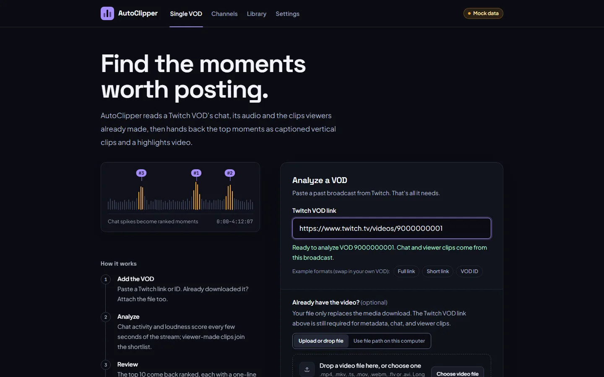
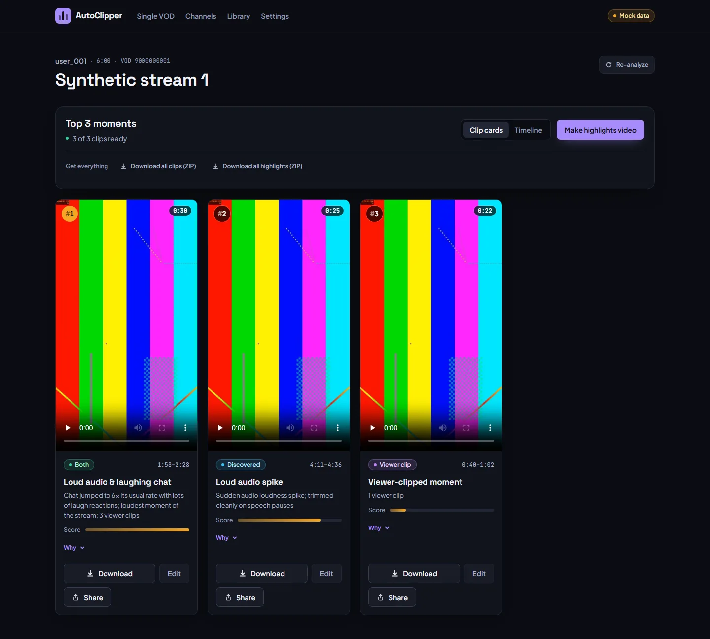
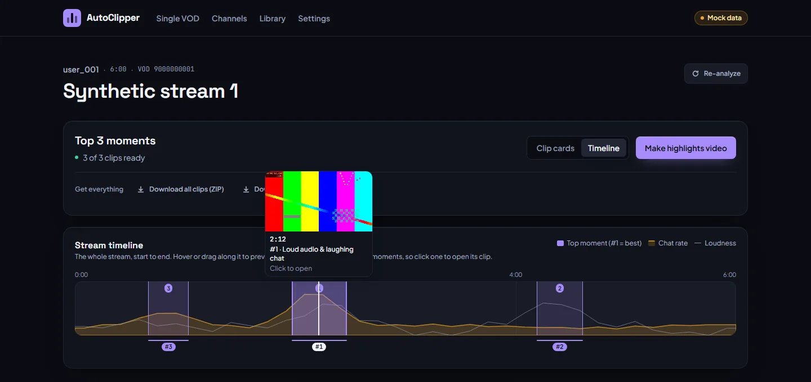
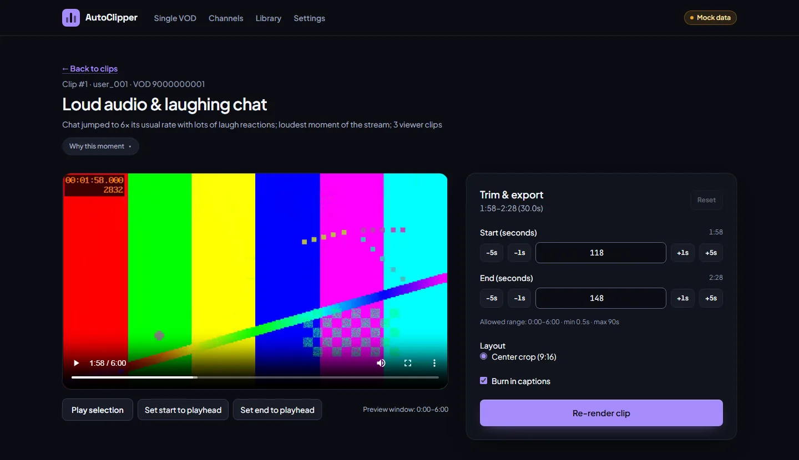
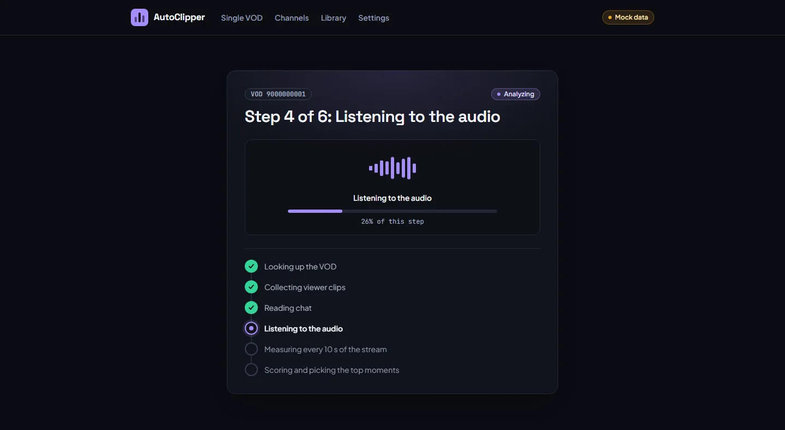
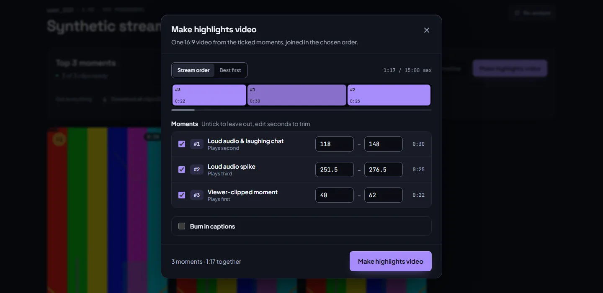
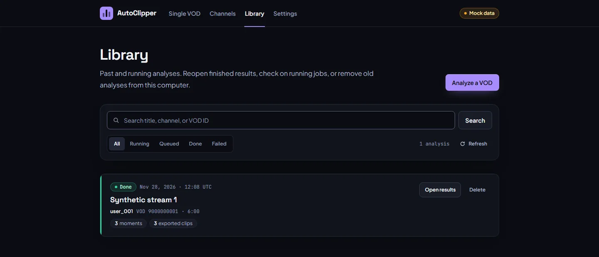
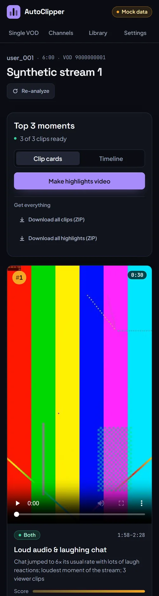

# AutoClipper

> **Find the highlights in a long Twitch stream.**
> Paste a Twitch VOD link, get its best moments ranked, preview and trim them, and export vertical, captioned clips ready to post, or one highlights video to watch.

**Website:** [adillpickles.github.io/AutoClipper](https://adillpickles.github.io/AutoClipper/): what it does, a short demo clip and how to get it.


> [!IMPORTANT]
> **Project status: pre-alpha.** The local CLI pipeline (`ingest`, `analyze`, `export`, `highlights`, `doctor`, `serve`) and the Next.js web app run end to end on a real two-hour Twitch VOD. There is no real labeled dataset or model trained on real data yet, so ranking uses chat activity and loudness. See [`docs/project/status.md`](docs/project/status.md) for what exists today.

---

## What it looks like

Paste a Twitch VOD link; AutoClipper reads the chat and audio and comes back with the top 10 moments as ranked, captioned vertical clips. These screens use the app's built-in mock data and synthetic test-pattern video, not real stream footage; the sample stream has only 3 moments, so the screens show a top 3 rather than a top 10.

<table>
  <tr>
    <td width="50%"><br><sub><b>Start:</b> paste a VOD link</sub></td>
    <td width="50%"><br><sub><b>Results:</b> ranked clips, each with a reason</sub></td>
  </tr>
  <tr>
    <td width="50%"><br><sub><b>Timeline:</b> chat and loudness across the stream</sub></td>
    <td width="50%"><br><sub><b>Clip editor:</b> nudge start and end, re-render</sub></td>
  </tr>
</table>

<details>
<summary>More screens: progress, highlights video, library, phone, stacked facecam layout</summary>

| Progress | Highlights video |
|---|---|
|  |  |

| Library | Results on a phone | Stacked facecam layout |
|---|---|---|
|  |  |  |

</details>

**What it does today**

- **Top 10 vertical clips:** ranked 9:16 clips with burned-in captions, each with a one-line reason and a "Why" breakdown.
- **Stacked facecam layout:** the streamer's webcam over the gameplay; the webcam box is detected in each clip automatically (a heuristic that falls back to a center crop).
- **Highlights video:** join the moments you pick into one 16:9 video, in stream order or best first.
- **Timeline:** the whole stream, with measured chat rate and loudness behind every ranked moment.
- **Share and download:** share a finished clip, copy a caption with a timestamped VOD link, or download one clip or a ZIP of all of them.
- **Library and re-analyze:** reopen past analyses, or run a VOD again with one click.

Ranking today uses chat activity and loudness. The trained scorers (logistic regression and LightGBM) are built but so far trained only on synthetic data; training on real Twitch data is in progress.

## Start here (humans and AI agents)

Start with the task guide and current state, then read what's relevant:

1. [`AGENTS.md`](AGENTS.md): task workflow and pointers to the docs for your area.
2. [`docs/project/status.md`](docs/project/status.md): what exists right now and what's next.
3. [`docs/product/prd.md` § Scope at a glance](docs/product/prd.md#scope-at-a-glance): what we're building (must / should / could / won't).
4. [`docs/architecture/overview.md`](docs/architecture/overview.md): how the system fits together.
5. [`CONTRIBUTING.md`](CONTRIBUTING.md): how to pick up an issue, open a PR and get it merged.
6. The issue you're working on ([GitHub issues](https://github.com/adillpickles/AutoClipper/issues), ordered by week in the [roadmap](docs/product/roadmap.md)), plus the docs [`AGENTS.md` § 3](AGENTS.md#3-what-to-read-for-which-task) lists for that kind of task.

## First local run

**One command:** with uv and Node.js installed (step 1), this does steps 2–5 and opens the app in your browser:

```bash
bash scripts/demo.sh                                           # macOS, Linux (Ctrl+C stops it)
powershell -ExecutionPolicy Bypass -File scripts/demo.ps1      # Windows (close its two windows to stop)
```

Run `demo.sh` with `bash`, not `sh`. It installs dependencies and tools, creates `.env` with a generated chat hash salt, writes `web/.env.local`, runs `autoclipper doctor` and starts the backend and web app. Without Twitch credentials in `.env` it starts in mock mode. Where the captions extra has no wheel (Intel Macs, macOS 13 or older, Windows on ARM) it installs without captions and says so. Re-running is safe. Flags: `--mock` / `-Mock`, `--skip-install` / `-SkipInstall`, `--api-port` / `-ApiPort`, `--web-port` / `-WebPort`, `--demo-vod` / `-DemoVod`.

### 1. Prerequisites

- **[uv](https://docs.astral.sh/uv/getting-started/installation/)** — manages the Python **3.12** environment pinned in [`.python-version`](.python-version) (`uv sync` downloads 3.12 if needed).
- **[Node.js 24 LTS](https://nodejs.org/)** — pinned in [`web/.nvmrc`](web/.nvmrc) (`npm` is included).
- **FFmpeg & FFprobe** (6+, with `libx264` and `libass` for captions) and **[TwitchDownloaderCLI 1.56.5](https://github.com/lay295/TwitchDownloader/releases/tag/1.56.5)** — no need to hunt for them by hand; step 2 installs pinned, SHA-256-verified copies into your per-user AutoClipper tools folder via `uv run autoclipper setup-tools` (existing copies on `PATH` or explicit `AUTOCLIPPER_*_PATH` overrides also work).

Platform-specific install commands, pinned tool sources/licenses, offline setup, PowerShell equivalents, git hooks and troubleshooting live in [`docs/development/setup.md`](docs/development/setup.md).

### 2. Install

From the repository root:

```bash
# Python backend and CLI (includes faster-whisper for burned-in captions, used by default on web clip exports)
uv sync --extra captions

# Download pinned, SHA-256-verified FFmpeg/FFprobe and TwitchDownloaderCLI into your managed tools folder
# (safe to re-run; skips tools that are already installed and verified)
uv run autoclipper setup-tools

# Web frontend
cd web && npm ci && cd ..
```

If you prefer system-installed tools on `PATH` or an offline install, see [`docs/development/setup.md#managed-external-tools`](docs/development/setup.md#managed-external-tools) (`--show-urls` and `--from-dir`). If you omit `--extra captions`, CLI exports work with captions off (the default) and web exports work when you turn captions off in the clip editor; automatic captioned exports on the results screen need `faster-whisper`.

### 3. Configure `.env`

Copy `.env.example` to `.env` in the repository root (`Copy-Item .env.example .env` in PowerShell) and fill in the values privately — never commit `.env`:

```bash
cp .env.example .env
```

`autoclipper` reads `.env` from the current working directory (run commands from the repository root), and process environment variables override it:

- `TWITCH_CLIENT_ID` and `TWITCH_CLIENT_SECRET` — app credentials from the [Twitch Developer Console](https://dev.twitch.tv/console). Required for real VOD analysis; not needed for `--jobs mock`.
- `AUTOCLIPPER_CHAT_HASH_SALT` — secret HMAC key used to pseudonymize chatter and clip-creator IDs. Generate a random value with:

  ```bash
  uv run python -c "import secrets; print(secrets.token_hex(32))"
  ```

All optional variables (storage paths, Whisper model size, export crop regions, CORS origins, log level) are documented in [`.env.example`](.env.example) and [`docs/development/setup.md#configuration`](docs/development/setup.md#configuration).

### 4. Check readiness (`autoclipper doctor`)

Before starting the server, verify local tools, extras and credentials without making network calls or loading models:

```bash
uv run autoclipper doctor              # checks for real VODs (--jobs pipeline, default)
uv run autoclipper doctor --jobs mock  # checks for mock scenarios (no Twitch credentials)
uv run autoclipper doctor --json       # machine-readable PreflightReport JSON
```

What the preflight statuses mean:

- `[OK]` — ready to use.
- `[WARN]` — optional or degraded capability (for example, `TwitchDownloaderCLI`, `AUTOCLIPPER_CHAT_HASH_SALT`, or the `captions` extra is missing; or Twitch credentials are unset in `mock` mode). `autoclipper doctor` still exits `0` and `autoclipper serve` starts normally.
- `[FAIL]` — required setup is missing (`ffmpeg`/`ffprobe` not found in the managed tools folder or on `PATH`, or `TWITCH_CLIENT_ID`/`TWITCH_CLIENT_SECRET` unset in `pipeline` mode). `autoclipper doctor` exits `1`.

`autoclipper doctor` also prints which copy of each tool is in use (`config`, `managed`, or `path`) and its local path (omitted from `--json` and `GET /api/v1/preflight`). `autoclipper serve` prints the same preflight summary at startup (never blocking startup on warnings) and serves it at `GET /api/v1/preflight` (no secrets or local file paths are included). When the web app talks to the backend, the start page shows a dismissible banner listing any `warn` or `fail` checks with their fix steps, plus a **Download missing tools** button (`POST` / `GET /api/v1/tools/setup`) that downloads pinned, SHA-256-verified FFmpeg/FFprobe and TwitchDownloaderCLI builds with live progress and refreshes preflight automatically.

### 5. Run the backend and web app

Terminal 1 (repository root):

```bash
uv run autoclipper serve              # real pipeline jobs on http://127.0.0.1:8000 (API docs at /docs)
# or, without Twitch credentials (built-in mock scenarios, real FFmpeg exports/highlights):
uv run autoclipper serve --jobs mock
```

Terminal 2 (connect the Next.js dev server to the backend):

```bash
cp web/.env.example web/.env.local    # sets NEXT_PUBLIC_API_ORIGIN=http://127.0.0.1:8000
cd web && npm run dev                 # open http://localhost:3000
```

`AUTOCLIPPER_CORS_ORIGINS` already allows `http://localhost:3000` and `http://127.0.0.1:3000` by default. Leave `NEXT_PUBLIC_API_ORIGIN` unset (or set `NEXT_PUBLIC_API_MODE=mock`) to run the web app in browser-only mock mode without starting the backend; on a fresh checkout, run `npm run mock-media` inside `web/` once (needs FFmpeg) to generate the sample MP4s it plays.

### 6. Avoid segment downloads with a local VOD file

If you already downloaded the full VOD (starting at the VOD's start), AutoClipper can read audio and cut previews, clips and highlights from that file instead of downloading audio or video segments from Twitch. The Twitch VOD link is still required for broadcast metadata, chat replay and viewer clips; your video file only replaces the media download.

- **Web app:** on the start page, either **upload or drop the video file** (streams in chunks directly to the server with live progress and cancellation) or switch to **Use file path on this computer** and paste its absolute path (`video_path` on `POST /api/v1/jobs`) to skip copying multi-gigabyte files when the server runs on the same machine.
- **CLI:**

  ```bash
  uv run autoclipper analyze <vod-url-or-id> --video /path/to/vod.mp4
  uv run autoclipper highlights artifacts/analysis/<video_id>.json --video /path/to/vod.mp4
  ```

The local file must cover the full VOD from its start; if its duration differs from Twitch's reported duration by more than 2 seconds, analysis fails with `video_mismatch`.

## The problem

Twitch streams run 4–12+ hours, but the moments worth watching or posting add up to a few minutes. Finding them means scrubbing footage by hand.

| Who | Pain today | With AutoClipper |
|---|---|---|
| **Viewer** who missed the stream | Can't sit through a 7-hour VOD | Watch one highlights video of the best moments |
| **Small streamer** without an editor or clippers | Their best moments never get posted | Paste the VOD, download captioned vertical clips in minutes |
| **Clipper / editor** | Hours of scrubbing for 30 seconds of gold | Get the top 10 moments as ready-to-post vertical clips |

Viewer-made clips help, but they're duplicated, incomplete, missing for smaller streams, and their view counts measure popularity rather than whether a moment works as a highlight.

## What we're building

**The MVP:** paste a VOD link (and optionally the path to a VOD you already downloaded) → the pipeline pulls viewer clips, chat and audio → chat and audio signals plus a trained model rank moments across the whole VOD (even when nobody clipped anything) → the app shows the top 10 as ranked, captioned 9:16 clips → nudge start/end and download them, or join them into one 16:9 highlights video.

The full scope, including what's explicitly out (live clipping, auto-posting, TikTok view prediction), is in the [PRD scope table](docs/product/prd.md#scope-at-a-glance).

## How it works

```text
Twitch VOD URL
   │
   ├─▶ 1. Collect        VOD info + viewer clips (Twitch API), chat replay, audio
   ├─▶ 2. Signals        chat activity and audio loudness in short windows across the VOD
   ├─▶ 3. Rank           baselines + trained model (logistic regression → LightGBM)
   ├─▶ 4. Clips          top 10 moments auto-cut to 9:16 with captions
   ├─▶ 5. Highlights     the top moments joined into one 16:9 video, on request
   └─▶ 6. App            ranked clip cards: preview, nudge start/end, download
```

Viewer clips double as **noisy training labels**: roughly, a stretch of the VOD that viewers clipped counts as a good moment ([modeling plan](docs/ml/modeling-plan.md#0-the-plan-in-plain-english)). The model is evaluated on streamers it never trained on and compared against simple baselines (random, biggest chat spike, loudest audio, and chat + loudness combined). Results get reported honestly, even if a baseline wins. See [evaluation](docs/ml/evaluation.md). The training and evaluation code is built and tested on synthetic data. The 25-VOD pilot collection exists, but the labeled dataset built from it and a model trained on that dataset don't exist yet.

## Tech stack

| Layer | Choice | Why | Background |
|---|---|---|---|
| Pipeline and ML | Python 3.12, uv, pandas/Polars, scikit-learn, LightGBM | All the ML is Python. uv gives one-command, reproducible setup. LightGBM learns combinations of tabular signals. | [Tooling](docs/decisions/0002-language-and-tooling.md) |
| Signals | Twitch Helix API, TwitchDownloader (chat), yt-dlp + NumPy (audio) | Chat and audio are cheap per-second signals that run on a laptop. Video is only downloaded for clips we export. | [Build order](docs/decisions/0004-staged-scope-chat-and-audio-first.md) |
| Data storage | Parquet files + DuckDB | Fast analytics on a laptop with no database server to run | [Storage](docs/decisions/0005-local-storage-parquet-duckdb.md) |
| Export | FFmpeg, faster-whisper, OpenCV | Standard tool for cutting, cropping and burning in captions; Whisper captions run on CPU; OpenCV finds the facecam for the stacked layout | [Architecture § Export](docs/architecture/overview.md#46-export) |
| Backend | FastAPI + background worker | Same language as the ML. Processing a VOD takes minutes, so jobs run outside the request. | [App stack](docs/decisions/0007-web-application-stack.md) |
| Frontend | Next.js + TypeScript + Tailwind | The team knows it; supports a polished UI with a custom highlight timeline | [App stack](docs/decisions/0007-web-application-stack.md) |
| Quality | Ruff, Pyright, pytest, pre-commit, GitHub Actions | Fast, deterministic feedback for humans and agents. Actions is free for this public repo. | [Tooling](docs/decisions/0002-language-and-tooling.md) |
| Delivery | Local setup first; website + download (stretch) | A laptop is enough to start. Shared collection/storage and hosted deployment are options as the product develops. | [Data and delivery](docs/decisions/0011-data-sources-and-local-delivery.md) |

## Documentation

| If you want to… | Read |
|---|---|
| Know what we're building and why | [PRD](docs/product/prd.md) |
| See the plan, milestones and dates | [Roadmap](docs/product/roadmap.md) |
| Find something to work on | [GitHub issues](https://github.com/adillpickles/AutoClipper/issues), ordered by week in the [roadmap](docs/product/roadmap.md) |
| Understand the system design | [Architecture](docs/architecture/overview.md) · [Data model](docs/architecture/data-model.md) |
| Work with the data | [Sources](docs/data/data-sources.md) · [Collection](docs/data/collection-plan.md) · [Pilot report](docs/data/pilot-report.md) · [Labeling](docs/data/labeling.md) |
| Work on the models | [Modeling plan](docs/ml/modeling-plan.md) · [Evaluation](docs/ml/evaluation.md) |
| Set up a dev environment | [Setup](docs/development/setup.md) |
| Contribute a change | [CONTRIBUTING](CONTRIBUTING.md) |
| Work with AI coding agents | [AGENTS.md](AGENTS.md) · [Parallel work](docs/agents/parallel-work.md) |
| Understand why a choice was made | [Technical choices](docs/decisions/README.md) |
| See every doc | [`docs/README.md`](docs/README.md) |

## Contributing

Pick an issue, branch, open a PR that says `Closes #N`, and squash-merge once CI is green. [`CONTRIBUTING.md`](CONTRIBUTING.md) walks through every step, including PR titles, labels and screenshots for UI work.

## Data handling

Keep media, datasets and secrets out of git; where data lives is in [data handling](docs/data/data-governance.md).

## Background

AutoClipper is built by a four-person team (4 FPS) in the [CUNY Tech Prep](https://cunytechprep.org/) Data Science track, Fall 2026.

## License

[MIT](LICENSE).
