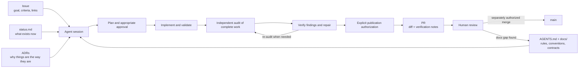

# Agent-Driven Development on AutoClipper

AutoClipper plans to use AI coding agents (Claude Code, Codex and similar) directed and reviewed by humans. No application code exists yet. This section explains how to make that work **consistently**, so any agent or human can pick up any task without someone re-explaining context.

| Doc | For |
|---|---|
| [AGENTS.md](../../AGENTS.md) | **Agents:** the operating manual (rules, task loop, conventions). Required reading. |
| [writing-tasks.md](writing-tasks.md) | **Humans:** how to write an issue an agent can finish correctly |
| [reviewing-agent-prs.md](reviewing-agent-prs.md) | **Reviewers:** what agents get wrong and how to catch it |
| [parallel-work.md](parallel-work.md) | Running several agents at once without collisions |
| [prompts.md](prompts.md) | Reusable prompts for common tasks |

## The core idea: context lives in the repo

An agent starts every session with no memory of previous ones. Everything it needs to make a consistent change has to be **written down in the repo**:

The last arrow matters most. **When an agent makes a mistake because the docs were missing something, fix the docs**, not just the code. Over time the docs absorb the team's knowledge and agents make fewer mistakes.

## The workflow

The canonical task loop is [AGENTS.md §7](../../AGENTS.md#7-how-to-do-a-task-the-standard-loop): **planning → implementation → independent audit → verify/repair → re-audit as necessary → authorized push/PR → human review → separately authorized merge**. It is a general team practice, applicable across tools, rather than a tool-specific habit. See [ADR-0010](../decisions/0010-agent-review-and-publication-workflow.md).

Write a bounded task with acceptance criteria and integration context ([writing tasks](writing-tasks.md)). Substantial/ambiguous plans need appropriate approval; routine authorized tasks can proceed without repeated permission requests. Implementation agents choose architecture-consistent solutions and meaningful validation, rather than mechanically executing a prescribed design. Where available, planning mode helps inspect the repository before edits.

For substantial work, use a separate audit context/reviewer to challenge the completed change and inspect its actual files, tests and complete comparison-base diff ([review guidance](reviewing-agent-prs.md)). Repair agents independently verify each finding. Record fixed, disproved, deferred and unresolved items; re-audit meaningful remaining defects. An agent's own final checks are self-review, not an independent audit. If none is available, return a reviewable local branch pending audit.

The human submitter remains responsible for understanding the change and truthful assistance disclosure. Agent audit does not replace the required approving human review. External issue/comment writes, pushing and PR publication require explicit authorization; a later merge needs separate approval. No AI reviewer integration is required.

## What agents are good and bad at here

| Good at | Needs a human |
|---|---|
| Implementing a well-specified stage (parser, feature function, metric) | Deciding product behavior or what "clip-worthy" means |
| Writing tests for documented edge cases | Choosing between proposals in open ADRs |
| Boilerplate: CLI wiring, config, FastAPI routes | Judging label quality by watching clips |
| Refactors with a clear target | Anything touching platform terms, credentials or publishing |
| Drafting docs from code | Interpreting experiment results honestly |
| FFmpeg command construction | Debugging audio/video output by ear and eye |

## Guardrails that make this safe

- **Branch protection:** nothing reaches `main` without a human approval.
- **Hard rules** in AGENTS.md: no data/secrets in git, no invented results, no silent schema changes.
- **Contracts:** adopt the relevant [data model](../architecture/data-model.md) and [feature](../ml/features.md) proposals explicitly before implementing them as shared contracts.
- **ADRs** stop agents from "helpfully" swapping a technology choice.
- **Templates** force verification notes and AI-assistance disclosure.
