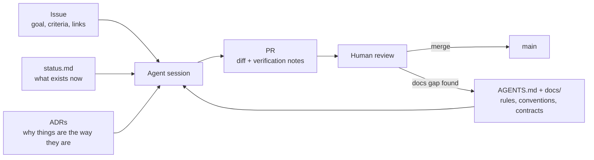

# Agent-Driven Development on AutoClipper

AutoClipper plans to use AI coding agents (Claude Code, Codex and similar) directed and reviewed by humans. No application code exists yet. This section explains how to make that work **consistently**, so any agent or human can pick up any task without someone re-explaining context.

| Doc | For |
|---|---|
| [AGENTS.md](../../AGENTS.md) | **Agents:** the operating manual (rules, task loop, conventions). Required reading. |
| [writing-tasks.md](writing-tasks.md) | **Humans:** how to write an issue an agent can finish correctly |
| [reviewing-agent-prs.md](reviewing-agent-prs.md) | **Reviewers:** what agents get wrong and how to catch it |
| [parallel-work.md](parallel-work.md) | Running several agents at once without collisions |
| [prompts.md](prompts.md) | Reusable prompts for common tasks |

## The core idea: context lives in the repo

An agent starts every session with no memory of previous ones. Everything it needs to make a consistent change has to be **written down in the repo**:

The last arrow matters most. **When an agent makes a mistake because the docs were missing something, fix the docs**, not just the code. Over time the docs absorb the team's knowledge and agents make fewer mistakes.

## The workflow

1. **Human writes or refines an issue** using the Task template ([writing-tasks.md](writing-tasks.md)). When it's fully specified, label it `agent-ready`.
2. **Human starts an agent session** on a fresh branch (or worktree) and points it at the issue. See [prompts.md § Start a task](prompts.md#start-a-task).
3. **Agent follows the loop** in [AGENTS.md § 7](../../AGENTS.md#7-how-to-do-a-task-the-standard-loop): read context → plan → implement → test → update docs → PR.
4. **Human verifies** before requesting review: runs the code and reads the diff. The submitter owns the PR.
5. **Another team member reviews** ([reviewing-agent-prs.md](reviewing-agent-prs.md)). One approval is required.
6. **Squash-merge.** If review found a docs gap, the fix is part of the same PR or a follow-up `docs` issue.

## What agents are good and bad at here

| Good at | Needs a human |
|---|---|
| Implementing a well-specified stage (parser, feature function, metric) | Deciding product behavior or what "clip-worthy" means |
| Writing tests for documented edge cases | Choosing between proposals in open ADRs |
| Boilerplate: CLI wiring, config, FastAPI routes | Judging label quality by watching clips |
| Refactors with a clear target | Anything touching platform terms, credentials or publishing |
| Drafting docs from code | Interpreting experiment results honestly |
| FFmpeg command construction | Debugging audio/video output by ear and eye |

## Guardrails that make this safe

- **Branch protection:** nothing reaches `main` without a human approval.
- **Hard rules** in AGENTS.md: no data/secrets in git, no invented results, no silent schema changes.
- **Contracts:** [data model](../architecture/data-model.md) and [features](../ml/features.md) give agents exact names and types to follow.
- **ADRs** stop agents from "helpfully" swapping a technology choice.
- **Templates** force verification notes and AI-assistance disclosure.
