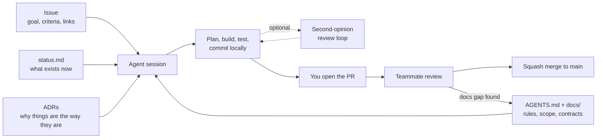

# Working with AI Agents on AutoClipper

Most of AutoClipper is built with AI coding agents (Claude Code, Codex, Cursor and similar), directed and reviewed by teammates. This section explains how to make that work **consistently**, so any agent or person can pick up any issue without someone re-explaining context.

| Doc | For |
|---|---|
| [AGENTS.md](../../AGENTS.md) | **Agents:** the operating manual (rules, task steps, conventions). Agents load it automatically. |
| [prompts.md](prompts.md) | Copy-paste prompts: start a task, address review comments, draft issues |
| [writing-tasks.md](writing-tasks.md) | How to write an issue an agent can finish correctly |
| [reviewing-agent-prs.md](reviewing-agent-prs.md) | What agents typically get wrong and how to catch it in review |
| [review-loop.md](review-loop.md) | **Optional:** have a second model audit a branch before you open the PR |
| [parallel-work.md](parallel-work.md) | Running several agents at once without collisions |

## The core idea: context lives in the repo

An agent starts every session with no memory of previous ones. Everything it needs to make a consistent change has to be **written down in the repo**:

The last arrow matters most. **When an agent makes a mistake because the docs were missing something, fix the docs**, not just the code. Over time the docs absorb the team's knowledge and agents make fewer mistakes.

## The workflow

1. **Pick an issue** and claim it ([CONTRIBUTING § 2](../../CONTRIBUTING.md#2-pick-up-an-issue)).
2. **Hand it to your agent** with the [start-a-task prompt](prompts.md#start-a-task). The agent reads `AGENTS.md`, the issue and the relevant docs, plans if the task is non-trivial, then builds, tests and commits on a branch.
3. **Check the result yourself.** Run it, read the diff, make sure you can explain it.
4. **Optional:** for big or risky changes, run the [second-opinion review loop](review-loop.md).
5. **Open the PR** and get one teammate approval ([CONTRIBUTING § 6–8](../../CONTRIBUTING.md#6-open-a-pull-request)).

Agents don't push, open PRs or merge unless you tell them to. You own what you merge.

## What agents are good and bad at here

| Good at | Needs a human |
|---|---|
| Implementing a well-specified stage (parser, feature function, metric) | Deciding product behavior or what "clip-worthy" means |
| Writing tests for documented edge cases | Choosing between proposals in open questions |
| Boilerplate: CLI wiring, config, FastAPI routes, React components | Judging label quality by watching clips |
| Refactors with a clear target | Anything touching platform terms, credentials or publishing |
| Drafting docs from code | Interpreting experiment results honestly |
| FFmpeg command construction | Debugging audio/video output by ear and eye |

## Guardrails

- **Branch protection:** nothing reaches `main` without a teammate's approval.
- **Hard rules** in AGENTS.md: no data or secrets in git, no invented results, no silent schema changes, no publishing without being asked.
- **ADRs** stop agents from "helpfully" swapping a technology choice.
- **Contracts** in the [data model](../architecture/data-model.md) and [features](../ml/features.md) keep names, units and time handling consistent across agents.
