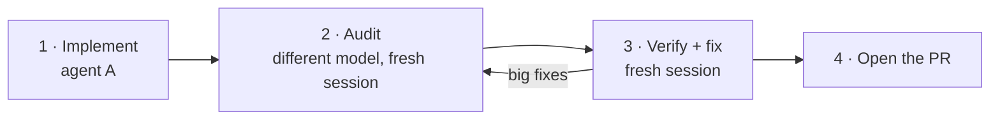

# Optional: Second-Opinion Review Loop

| | |
|---|---|
| **Status** | Recommended for large or risky changes. **Not required.** A PR is required; second-person approval is optional. |
| **Last updated** | 2026-10-21 |

An agent that just wrote the code is bad at spotting its own mistakes. A different model with fresh context often catches bugs, missed acceptance criteria and untested edge cases before a teammate has to. This page describes one workflow that works well. Use it, adapt it or skip it.

## When it's worth it

- The change is large (several files, new module, schema or pipeline work).
- It's hard to test by eye (time alignment, labels, metrics, leakage).
- You're not confident you understand every line the agent wrote.

For a typo fix or a small, well-tested change, skip it.

## The loop



1. **Implement.** Hand the issue to your agent of choice ([start-a-task prompt](prompts.md#start-a-task)). Let it finish, test and commit locally. Don't open the PR yet.
2. **Audit.** Start a session with a **different model**, with no history from the implementation, and give it the [audit prompt](#audit-prompt). It reads the complete branch and reports findings. It doesn't edit anything.
3. **Verify and fix.** Start a **new session** (the original implementer model is fine, just not the same conversation). Give it the [verify prompt](#verify-and-fix-prompt) with the findings pasted in.
   - Present the findings as claims to check, **not confirmed bugs**. Auditors produce false positives and flag intentional choices.
   - Don't say which model found them. Severity labels are fine.
   - The agent confirms or rejects each finding with evidence, fixes only the confirmed ones and adds a regression test per real bug.
4. **Repeat if needed.** If the fixes were substantial, run another audit round and include the previous findings and verdicts in the prompt. Stop when only nits remain.
5. **Open the PR** as usual ([CONTRIBUTING § 6](../../CONTRIBUTING.md#6-open-a-pull-request)). Optionally paste the finding → verdict table into the PR description; it helps the human reviewer.

## Audit prompt

```text
You're reviewing someone else's work. Don't edit any files, commit, push or comment on GitHub.

Task: issue #<N> (gh issue view <N>). Branch: <branch>, compared against main.

1. Read AGENTS.md, the issue and the docs it links.
2. Review the COMPLETE change, not just the last commit:
   git diff $(git merge-base HEAD origin/main)
   Also check `git status` for uncommitted or untracked files.
3. Run the available checks (tests, lint, type check).
4. Look for real problems: bugs, missed acceptance criteria, untested edge cases,
   mismatches with docs/architecture/data-model.md or docs/ml/features.md
   (names, units, time handling), train/test leakage, invented API details,
   scope creep, stale docs.
5. For each finding give: severity (high / medium / low), file:line,
   what goes wrong and how to reproduce it, and a suggested fix.

Only report things you'd defend. Keep real defects separate from opinions and
optional improvements. If you find nothing serious, say so.
```

## Verify-and-fix prompt

```text
I'm working on issue #<N> on branch <branch>. The implementation is done.
A separate review raised the findings below.

Don't assume they're correct. For each finding:
1. Check it against the actual code. Reproduce it with a test if you can.
2. Decide: confirmed, false positive, or intended behavior. Explain why, with evidence.
3. Fix only the confirmed ones, and add a regression test for each confirmed bug.

Don't make unrelated changes. Re-run the checks and commit locally (don't push).
Finish with a short table: finding → verdict → what you did.

Findings:
<paste findings here>
```

## Follow-up audit prompt

For a second round, use the audit prompt and add:

```text
This is a follow-up review. Previous findings and how they were handled:
<paste the finding → verdict table>
Check that confirmed fixes are correct and complete, and challenge any
"false positive" verdict you disagree with. Report only new or unresolved problems.
```
