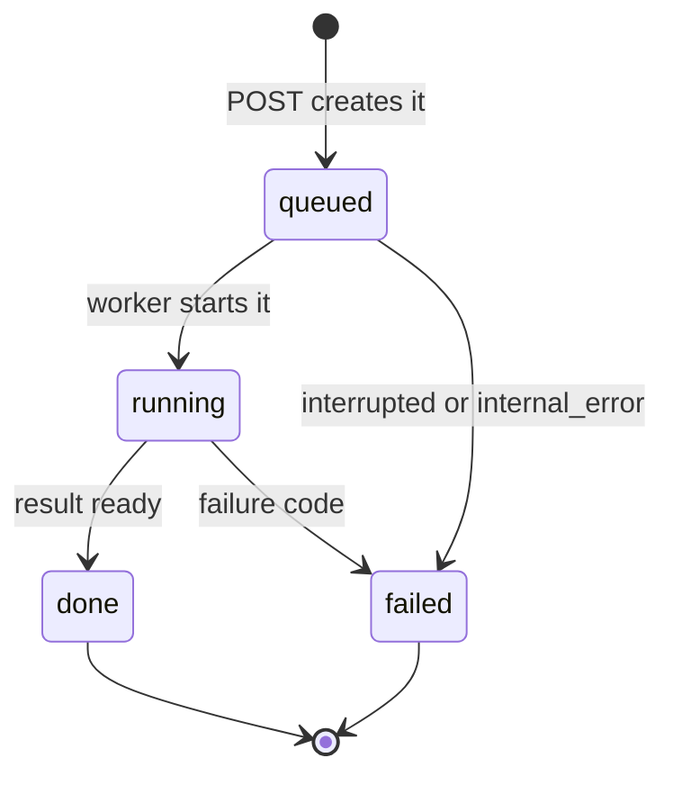

# API Contract: Jobs, Candidates, Media, Exports and Highlights

| | |
|---|---|
| **Status** | Current (2026-11-04). The mock backend (#28) implements every endpoint: `autoclipper serve`, `autoclipper.api` and the FastAPI-free models in `autoclipper.schemas` / `autoclipper.analysis`. Update this contract and its examples alongside implementation changes; see [§ 10](#10-versioning). |
| **Last updated** | 2026-10-31 |
| **Related** | [Application stack](../decisions/0007-web-application-stack.md) · [Modeling plan](../ml/modeling-plan.md) · [Data sources and delivery defaults](../decisions/0011-data-sources-and-local-delivery.md) · [Data model § candidates](data-model.md#candidates-apicli-output-json) · [Overview § 4.6–4.7](overview.md#46-export) |

The shared contract between the FastAPI backend (`src/autoclipper/api/`) and the Next.js app (`web/`), and the JSON that `autoclipper analyze` writes. It lets the mock job API (#28), the screens (#29–#31), the export endpoint (#32), the highlights video (#71, #72) and the integration (#33) be built in parallel from this page alone, and gives real analysis and media (#44–#46) a fixed target.

The initial setup uses `autoclipper serve` on a development machine and the app in a browser ([delivery defaults](../decisions/0011-data-sources-and-local-delivery.md)). Shared collection/storage and hosted deployment can reuse the pipeline; deployment work extends authentication, persistence and media inputs as needed. How candidates are generated and which scorer ships are defined elsewhere (§ 12); this page defines the shapes, states and codes every scorer and media source produces.

## 1. Conventions

- **Base path:** every endpoint is under `/api/v1`. Bodies are JSON (`application/json; charset=utf-8`), except media, export and highlights files.
- **Field names** are `snake_case` in JSON, matching the [data model](data-model.md) and the CLI output. The TypeScript client uses the same names (no camelCase mapping).
- **VOD positions and durations** are JSON numbers in **seconds from VOD start**, with names ending `_s` ([conventions § 3](../development/conventions.md#3-units-time-and-ids)). They are **source time**: already aligned, never chat-lag shifted again.
- **Wall-clock times** are **UTC ISO-8601 strings with a `Z` suffix**, with names ending `_at`, e.g. `"2026-10-19T15:00:00Z"`.
- **IDs are strings.** Twitch IDs (`video_id`, `broadcaster_id`) stay exactly as Twitch uses them (digits, never cast to a number). IDs that AutoClipper generates (`job_id`, `export_id`, `highlights_id`, `candidate_id`, and `media_id` in file URLs) are opaque, match `^[A-Za-z0-9_-]{1,64}$` and must not be parsed.
- **Job, export, highlights and media IDs are random and never reused**, including across server restarts: a short prefix plus at least 64 bits from a cryptographic random source (e.g. `"job_" + secrets.token_hex(8)`), never a counter or anything derived from the VOD. So a stale ID kept in a page URL from before a restart gets a `404`, never another VOD's job (§ 9.3). `candidate_id` only has to be unique within its result, because it's always used together with a `job_id`.
- **Returned URLs are root-relative** (`PreviewMedia.url`, `Export.download_url`, `HighlightsVideo.download_url`, `Location`), e.g. `/api/v1/exports/{export_id}/file`, so the server never needs to know its public address. Clients resolve them against the API origin they're configured with (e.g. `new URL(url, apiOrigin)`, § 9.4) and otherwise use them as given. If a later media route returns an absolute URL, the same resolution leaves it unchanged.
- **Every field is always present.** An optional value is `null`, never omitted; an empty list is `[]`. Numbers are finite (no `NaN` or `Infinity`).
- **Requests are strict, responses are tolerant.** The server rejects unknown request fields and invalid values (`422 invalid_request`). Request models use Pydantic strict mode with unknown fields forbidden (`ConfigDict(strict=True, extra="forbid")`): default (lax) mode would accept `"yes"` or `1` for a boolean and `"115.5"` for a number. Strict mode still accepts a JSON integer for a float field, so `115` is a valid `start_s`. Request enums are `Literal[...]`: FastAPI validates the parsed body as Python data, where strict mode rejects a plain string for a `StrEnum` field, so `"center_crop"` would fail. A request field with a default (e.g. `CreateJobRequest.video_path`, `CreateHighlightsRequest.count`) may be omitted. Clients ignore unknown response fields and give *open* enums a default branch (§ 10).
- **Messages are for people.** `message` fields are short English sentences that are safe to show in the UI: no secrets, tokens or file paths. Clients branch on `code`, never on `message`.
- **Initial API scope:** single-user operation with polling (§ 9) and no authentication. Deployment work can extend this setup ([PRD § Delivery](../product/prd.md#5-delivery)).

**Model mapping.** Response models live in one FastAPI-free module (e.g. `autoclipper.schemas`) so the CLI can use them too ([app stack](../decisions/0007-web-application-stack.md): Pydantic models are shared with the CLI output schema). TypeScript types are hand-written from this page, in one module the screens share (e.g. `web/src/lib/api/types.ts`), so #29–#31 don't wait for a backend. Generating them from FastAPI's OpenAPI document is an option once #28 exists; the hand-written types must then match it.

| JSON | Pydantic (Python 3.12) | TypeScript |
|---|---|---|
| string, ID | `str` | `string` |
| `*_s`, `score`, fractions | `float` | `number` |
| counts, `rank`, indexes | `int` | `number` |
| `*_at` | timezone-aware UTC `datetime` | `string` |
| nullable | `T \| None`, always serialized | `T \| null` |
| enum | `Literal[...]` (always in request models, § 1) or `StrEnum` | string-literal union |

Model names used below: `CreateJobRequest`, `VideoUpload`, `Job`, `JobRenderSummary`, `JobSummary`, `JobListResponse`, `DeleteJobResponse`, `Progress`, `AnalysisWarning`, `ApiError`, `ErrorResponse`, `AnalysisResult`, `VodSummary`, `ScorerInfo`, `Candidate`, `SignalDetail`, `CandidateMedia`, `PreviewMedia`, `ExportAvailability`, `CreateExportRequest`, `Export`, `CreateHighlightsRequest`, `HighlightsSegment`, `HighlightsVideo`, `Health`, `PreflightCheck`, `PreflightReport`, `ChannelInfo`, `ChannelVod`, `ChannelVodsResponse`.

## 2. Endpoints

| Method | Path | Purpose | Success |
|---|---|---|---|
| `GET` | `/api/v1/health` | Liveness, active job runner and caption capability | `200` `Health` |
| `GET` | `/api/v1/preflight` | Local setup readiness checks (tools, optional extras, credentials presence) | `200` `PreflightReport` |
| `GET` | `/api/v1/channels/vods` | Resolve a channel URL or login and list recent archive VODs (§ 9.7) | `200` `ChannelVodsResponse` |
| `POST` | `/api/v1/tools/setup` | Start downloading pinned managed tools (`ffmpeg`, `twitch_downloader`) in the background (§ 9.8) | `202` (or `200` if already running/up to date) `ToolSetupStatus` |
| `GET` | `/api/v1/tools/setup` | Current progress and result of managed tool setup (§ 9.8) | `200` `ToolSetupStatus` |
| `POST` | `/api/v1/uploads` | Stream an already-downloaded VOD video file to disk for a job (§ 3.1a) | `201` `VideoUpload` |
| `GET` | `/api/v1/settings` | App settings: the output folder and the latest copy into it (§ 9.9) | `200` `AppSettings` |
| `PUT` | `/api/v1/settings` | Set or clear the output folder finished renders are copied to (§ 9.9) | `200` `AppSettings` |
| `GET` | `/api/v1/jobs` | List analysis jobs (newest first, paginated, optional `q` and `state` filters, § 3.7) | `200` `JobListResponse` |
| `POST` | `/api/v1/jobs/status` | Look up current library summaries for a batch of job IDs (§ 3.7) | `200` list of `JobSummary` |
| `POST` | `/api/v1/jobs` | Start analyzing a VOD | `201` new `Job`; `200` if the same VOD and video source is already analyzed or queued/running |
| `GET` | `/api/v1/jobs/{job_id}` | Job status and progress (poll this) | `200` `Job` |
| `DELETE` | `/api/v1/jobs/{job_id}` | Remove a finished job from the library index and optionally delete its rendered files (§ 3.8) | `200` `DeleteJobResponse` |
| `GET` | `/api/v1/jobs/{job_id}/result` | Ranked candidates of a `done` job | `200` `AnalysisResult` |
| `GET` | `/api/v1/jobs/{job_id}/candidates/{candidate_id}/media` | Preview and export availability for one candidate | `200` `CandidateMedia` |
| `GET` | `/api/v1/media/{media_id}` | Preview video file, reached only through `PreviewMedia.url` (§ 5.1) | `200`/`206` `video/mp4` |
| `POST` | `/api/v1/exports` | Start exporting a trimmed candidate | `201` new `Export`; `200` if an identical export is queued/running or finished with its file on disk |
| `GET` | `/api/v1/exports/{export_id}` | Export status (poll this) | `200` `Export` |
| `GET` | `/api/v1/exports/{export_id}/file` | Download the finished MP4 | `200` `video/mp4` |
| `POST` | `/api/v1/highlights` | Start rendering a highlights video from chosen candidates | `201` new `HighlightsVideo`; `200` if an identical one is queued/running |
| `GET` | `/api/v1/highlights/{highlights_id}` | Highlights video status (poll this) | `200` `HighlightsVideo` |
| `GET` | `/api/v1/highlights/{highlights_id}/file` | Download the finished MP4 | `200` `video/mp4` |
| `GET` | `/api/v1/jobs/{job_id}/archives/{kind}` | What the job's ZIP of finished clips (`kind=clips`) or highlights videos (`kind=highlights`) would contain (§ 7.6) | `200` `ArchiveStatus` |
| `GET` | `/api/v1/jobs/{job_id}/archives/{kind}/file` | Download that ZIP, streamed (§ 7.6), reached only through `ArchiveStatus.download_url` | `200` `application/zip` |

Clients never build media or file URLs; they use `PreviewMedia.url`, `Export.download_url`, `HighlightsVideo.download_url` and `ArchiveStatus.download_url` as returned (§ 1). Errors for every endpoint are in § 8. There is no cancel endpoint in v1 (§ 9.3).

## 3. Jobs

### 3.1 Create a job

`POST /api/v1/jobs` with a `CreateJobRequest`:

| Field | Type | Notes |
|---|---|---|
| `vod` | str | A Twitch VOD link or bare video ID, as the user typed it. Always required: chat and viewer clips come from Twitch. |
| `video_path` | str \| null | Optional, default `null`. Absolute path on the server machine to a video file of this VOD the user already downloaded. Mutually exclusive with `upload_id`. When given, preview and export read this file instead of downloading video (§ 5). |
| `upload_id` | str \| null | Optional, default `null`. Opaque upload ID returned by `POST /api/v1/uploads` (§ 3.1a). Mutually exclusive with `video_path`. Keeps `Job.video_path` as `null` so server paths are never exposed over HTTP. |

The request handler validates and normalizes `vod` and checks `video_path` or `upload_id`; it makes no Twitch calls. Whether the VOD exists, is a past broadcast and matches the video file is checked by the worker, and those problems arrive as job failures (§ 3.5). Passing both `video_path` and `upload_id` fails with `422 invalid_request`.

**Accepted inputs** (anything else is `422 invalid_vod_link`). Matching is case-insensitive, after trimming surrounding whitespace:

1. A **bare ID**: one or more ASCII digits, e.g. `9000000001`.
2. A **VOD URL**: optional `https://` or `http://` scheme (none means `https://`), host `twitch.tv`, `www.twitch.tv` or `m.twitch.tv`, path `/videos/<digits>` with an optional trailing `/`. A query string (e.g. `?t=1h2m3s`) or fragment is ignored.

The digits become `video_id`. Not accepted in v1: clip links, channel pages, other Twitch URL shapes (channel-scoped video paths, player embeds) and `v`-prefixed IDs. Clients may pre-validate with this regex (case-insensitive; the ID is in group 1 or 2), but the server is authoritative:

```text
^(?:(?:https?://)?(?:www\.|m\.)?twitch\.tv/videos/([0-9]+)/?(?:[?#].*)?|([0-9]+))$
```

**Local video file.** If `video_path` is not `null`, it must be an absolute path to an existing, readable file with a supported video extension (`.mp4`, `.mkv`, `.ts`, `.mts`, `.m2ts`, `.mov`, `.webm`, `.flv`, `.m4v`, `.avi`, `.mpg`, `.mpeg`, `.wmv`, `.ogv`) that the shared media probe (#51) reads as a video with a known duration; otherwise the request fails with `422 invalid_video_path` (without exposing local filesystem paths in `message`) and no job is created. If `upload_id` is not `null`, it must refer to a validated upload from `POST /api/v1/uploads`; otherwise the request fails with `422 invalid_video_upload`. Comparing the file with the VOD needs Twitch's duration, so the worker does it while resolving the VOD: if the file's duration differs from the VOD's `duration_s` by more than 2 s, the job fails with `video_mismatch` (§ 3.5). The pipeline may also take the VOD's audio from this file instead of downloading it (#44).

**Responses.** `201 Created` with the new `Job` (`queued`) and `Location: /api/v1/jobs/{job_id}`. If a job with the same `video_id`, `video_path`, and `upload_id` (the same VOD and video source) already exists, nothing new is created and that job comes back with `200 OK` (no `Location`), so double-clicks, reloads and analyzing a VOD again don't start duplicate work or add a second Library entry (#186). The newest `done` job whose saved result is still on disk wins; otherwise a `queued` or `running` one. A `failed` job, or a `done` job whose result file is gone, is never reused: posting again re-analyzes. This is the "caching analyzed VODs" Should item in the [PRD](../product/prd.md#scope-at-a-glance). To re-analyze a VOD from scratch (e.g. after training a new model), delete its job (§ 3.8) and post again. A new upload has a new `upload_id`, so it counts as a new source.

### 3.1a Upload a VOD video file

`POST /api/v1/uploads?filename=<basename>` streams a raw video file body (typically 5–20 GB for a 4–6 hour VOD) in chunks directly to disk under `<artifacts_dir>/uploads/` without buffering the whole request in memory.

- **Origin check:** when `AUTOCLIPPER_CORS_ORIGINS` is configured and a browser `Origin` header is present outside the allowlist, the server rejects the request with `403 origin_not_allowed` before reading the body.
- **Early validation and cleanup.** The only query parameter is `filename`. Missing or unknown parameters return `422 invalid_request` before streaming. The server keeps only the basename and rejects unsupported extensions or a zero `Content-Length` with `422 invalid_video_upload`. FFprobe checks that the completed file has a video stream usable as footage and a known duration. An audio file with cover art alone fails with `422 invalid_video_upload`. The server removes partial uploads after cancellation, including during validation, and after truncated uploads, invalid video or disk I/O failures.
- **Response (`201 Created`, `Cache-Control: no-store`):** `VideoUpload`:

| Field | Type | Notes |
|---|---|---|
| `upload_id` | str | Opaque upload ID (`upl_<hex>`) to pass as `CreateJobRequest.upload_id` |
| `filename` | str | Sanitized basename of the uploaded file |
| `size_bytes` | int | Total bytes written to disk (`>= 1`) |
| `duration_s` | float \| null | Probed media duration in seconds (`null` only when a test double replaces FFprobe) |

### 3.2 The `Job` resource

| Field | Type | Notes |
|---|---|---|
| `job_id` | str | Server-generated, opaque, random, never reused (§ 1) |
| `video_id` | str | Normalized from the request |
| `video_path` | str \| null | As requested. `null` when the server uses a stored upload or downloads video. |
| `state` | `queued` \| `running` \| `done` \| `failed` | § 3.3 |
| `progress` | `Progress` \| null | § 3.4 |
| `warnings` | list<`AnalysisWarning`> | Degradations found so far (§ 3.5); `[]` if none |
| `error` | `ApiError` \| null | Non-null **iff** `state` is `failed`; codes in § 3.5 |
| `created_at` | timestamp | Job accepted |
| `started_at` | timestamp \| null | Entered `running` |
| `updated_at` | timestamp | Last change to any field |
| `finished_at` | timestamp \| null | Entered `done` or `failed` |

### 3.3 States



`done` and `failed` are terminal. `done` means `GET …/result` returns a result. It does **not** mean every signal was available (check `warnings`) or that there's at least one candidate. Exports and highlights videos use the same four states (§ 6, § 7).

### 3.4 Progress

`Progress` describes the work in hand without claiming more precision than the server has:

| Field | Type | Notes |
|---|---|---|
| `stage` | str (open enum) | Analysis stages below; export stages in § 6.3, highlights stages in § 7.3 |
| `stage_index` | int | 1-based position of `stage` in its list |
| `stage_count` | int | Number of stages for this resource type: 6 for jobs, 3 for exports and highlights videos |
| `stage_fraction` | float \| null | Fraction of **the current stage** done, 0–1, only when actually measured (e.g. bytes downloaded of a known total, windows scored of the total). `null` when unknown. |
| `message` | str | Short status for display, e.g. "Downloading chat replay" |

There's no overall percentage: stage durations vary too much for one honest number. Show a stepper ("Step 4 of 6") and add a bar only when `stage_fraction` isn't `null`. A cached VOD can pass every stage between two polls, so the web app's stepper walks forward one stage at a time and keeps each on screen for at least 1 s (#188), also when `POST /jobs` returned an already finished job for a VOD the user just asked to analyze (§ 3.1); that pacing is display-only and never changes what the server reports.

`progress` is `null` while `queued` and once `done`. While `running` it describes the current stage. When `failed` it keeps the last value (or `null` if the job never started), so the UI can say where it stopped.

Analysis stages, in order. Skipped stages (e.g. served from a cache) are passed over. If work overlaps, the server reports the earliest unfinished stage.

| # | `stage` | Pipeline step ([overview § 3](overview.md#3-pipeline)) |
|---|---|---|
| 1 | `resolving_vod` | Resolve VOD metadata (1a) |
| 2 | `fetching_clips` | Fetch viewer clips (1b) |
| 3 | `downloading_chat` | Chat replay and pseudonymization (1c) |
| 4 | `downloading_audio` | Audio (1d) |
| 5 | `computing_features` | Windows and chat/audio features (2b, 3) |
| 6 | `ranking` | Scoring and candidate generation (4) |

### 3.5 Degraded results and failures

**A missing signal degrades the result instead of failing the job.** The PRD requires moments for VODs with no viewer clips and tolerance of missing chat, #44 asks the pipeline to *report* missing chat or audio clearly, and [overview § 4.6](overview.md#46-export) keeps analytical results usable when video is missing. So when one input can't be obtained, the job carries on with the rest, finishes `done` and records an `AnalysisWarning` (`{ "code": str, "message": str }`). The "missing chat" and "missing audio" codes that #13, #44 and #45 ask for are these warnings.

| Warning `code` | When |
|---|---|
| `chat_missing` | No chat replay could be obtained, for any reason (see **Precedence** below). Chat signals are absent. |
| `audio_missing` | No audio could be obtained, for any reason. Audio signals are absent. |
| `audio_partly_muted` | Twitch muted part of the VOD's audio, so audio signals are unreliable there. |
| `audio_partly_silent` | At least a minute of the VOD's audio is digital silence (music muted out of the VOD without a Helix muted segment, or a starting screen), so audio signals are unreliable there. With the default ranking the message adds that moments there were ranked lower ([ranking rules](../ml/modeling-plan.md#3-candidate-generation)). |
| `viewer_clips_missing` | The viewer clip list couldn't be fetched. No candidate is `viewer_clips` or `both`, and `n_viewer_clips_total` is `null` (unknown, not zero). |
| `viewer_clips_incomplete` | Clip discovery hit a known query limit ([data sources](../data/data-sources.md), Get Clips), so some clips may be missing. |

Warning codes are an open enum: clients show `message` for any code, including ones they don't know. The server never fills a missing signal with placeholder values; how a scorer copes with a missing signal family is up to #44 and is visible in `scorer`. A VOD that genuinely has **zero viewer clips is not a warning**: `n_viewer_clips_total` is `0` and every candidate is `discovered`.

A job **fails** only when it can't produce a meaningful result. `Job.error.code` is then one of:

| Failure `code` | When | Typical stage |
|---|---|---|
| `vod_unavailable` | Twitch has no accessible video with this ID: not found, deleted or expired, or not publicly viewable (e.g. subscriber-only) | `resolving_vod` |
| `vod_unsupported` | The video exists but isn't a past broadcast (Helix `type` other than `archive`, e.g. a highlight or upload) | `resolving_vod` |
| `video_mismatch` | A file supplied via `upload_id` or `video_path` differs from the VOD's duration by more than 2 s | `resolving_vod` |
| `no_usable_signals` | Nothing to rank (chat and audio both missing, no viewer clips with VOD offsets) and none of those inputs failed transiently, so trying again won't help | `downloading_audio` (after the last input) |
| `upstream_unavailable` | Twitch or a download tool kept failing after retries (network, rate limit, tool breakage) while resolving the VOD, or while fetching inputs that left nothing to rank. Trying again later may work. | `resolving_vod` or `downloading_audio` |
| `interrupted` | The server stopped while the job was queued or running (§ 9.3) | any |
| `internal_error` | A bug. Details go to the server log; `message` stays generic. | any |

**Precedence.** Every step first retries transient errors (network, rate limits, `5xx`; [overview § 6](overview.md#6-cross-cutting-concerns)). What remains is classified like this:

1. **Resolving the VOD is required.** Twitch says the video doesn't exist or isn't viewable → `vod_unavailable`; it isn't an archive → `vod_unsupported`; Twitch or the network keeps failing → `upstream_unavailable`; a `video_path` file that doesn't match the VOD's duration → `video_mismatch`.
2. **A per-input step never fails the job on its own.** If viewer clips, chat or audio still can't be obtained, whatever the cause (the VOD has no chat or audio, TwitchDownloader or yt-dlp broke, the network dropped), the job records `viewer_clips_missing`, `chat_missing` or `audio_missing` and carries on. The warning's `message` says whether analyzing again later may help; there's no machine-readable retry flag in v1 (one can be added later as a minor change, § 10). A clip list that was fetched and is empty isn't missing: that's the zero-clips case above, with no warning.
3. **Nothing to rank fails the job** once all inputs have been tried: `upstream_unavailable` if any missing input failed transiently (tool and network errors count as transient; when unsure, treat as transient), otherwise `no_usable_signals`.
4. Anything unexpected is `internal_error`.

### 3.6 Examples

All IDs, names and timestamps are synthetic.

Create a job:

```http
POST /api/v1/jobs
Content-Type: application/json

{ "vod": "https://www.twitch.tv/videos/9000000001" }
```

`201 Created`, `Location: /api/v1/jobs/job_3f9c2b7a1d4e4c8b`:

```json
{
  "job_id": "job_3f9c2b7a1d4e4c8b",
  "video_id": "9000000001",
  "video_path": null,
  "state": "queued",
  "progress": null,
  "warnings": [],
  "error": null,
  "created_at": "2026-10-19T15:00:00Z",
  "started_at": null,
  "updated_at": "2026-10-19T15:00:00Z",
  "finished_at": null
}
```

`GET /api/v1/jobs/job_3f9c2b7a1d4e4c8b` while running:

```json
{
  "job_id": "job_3f9c2b7a1d4e4c8b",
  "video_id": "9000000001",
  "video_path": null,
  "state": "running",
  "progress": {
    "stage": "downloading_audio",
    "stage_index": 4,
    "stage_count": 6,
    "stage_fraction": 0.35,
    "message": "Downloading audio"
  },
  "warnings": [],
  "error": null,
  "created_at": "2026-10-19T15:00:00Z",
  "started_at": "2026-10-19T15:00:01Z",
  "updated_at": "2026-10-19T15:01:30Z",
  "finished_at": null
}
```

When it finishes, the same job has `"state": "done"`, `"progress": null` and `"finished_at": "2026-10-19T15:02:41Z"`. A degraded job (another VOD) finishes `done` with warnings:

```json
{
  "job_id": "job_8d2e6f0a9b1c4d7e",
  "video_id": "9000000003",
  "video_path": null,
  "state": "done",
  "progress": null,
  "warnings": [
    {
      "code": "chat_missing",
      "message": "Chat replay isn't available for this VOD, so moments are ranked from audio and viewer clips only."
    }
  ],
  "error": null,
  "created_at": "2026-10-19T15:08:00Z",
  "started_at": "2026-10-19T15:08:01Z",
  "updated_at": "2026-10-19T15:10:12Z",
  "finished_at": "2026-10-19T15:10:12Z"
}
```

A failed job:

```json
{
  "job_id": "job_c4b3a2918f7e4d6c",
  "video_id": "9000000004",
  "video_path": null,
  "state": "failed",
  "progress": {
    "stage": "resolving_vod",
    "stage_index": 1,
    "stage_count": 6,
    "stage_fraction": null,
    "message": "Looking up the VOD"
  },
  "warnings": [],
  "error": {
    "code": "vod_unavailable",
    "message": "This VOD isn't available on Twitch. It may have been deleted, expired or made private.",
    "details": null
  },
  "created_at": "2026-10-19T15:12:00Z",
  "started_at": "2026-10-19T15:12:01Z",
  "updated_at": "2026-10-19T15:12:03Z",
  "finished_at": "2026-10-19T15:12:03Z"
}
```

The other failure and warning codes, one object per line:

```jsonc
// Job.error
{ "code": "vod_unsupported", "message": "This video is a highlight or upload. AutoClipper analyzes past broadcasts only.", "details": null }
{ "code": "video_mismatch", "message": "The video file you chose doesn't match this VOD's length. Check that it's the right VOD and fully downloaded.", "details": null }
{ "code": "no_usable_signals", "message": "This VOD has no chat replay, no usable audio and no viewer clips, so there's nothing to rank.", "details": null }
{ "code": "upstream_unavailable", "message": "Twitch or a download tool isn't responding. Try again in a few minutes.", "details": null }
{ "code": "interrupted", "message": "The server stopped while this analysis was running. Analyze the VOD again.", "details": null }
{ "code": "internal_error", "message": "Something went wrong on the server. Try again.", "details": null }

// Job.warnings[] and AnalysisResult.warnings[]
{ "code": "chat_missing", "message": "Chat replay couldn't be downloaded right now, so moments are ranked from audio and viewer clips only. Analyzing the VOD again later may include it." }
{ "code": "audio_missing", "message": "Audio isn't available for this VOD, so moments are ranked from chat and viewer clips only." }
{ "code": "audio_partly_muted", "message": "Twitch muted parts of this VOD's audio, so audio signals are unreliable there." }
{ "code": "viewer_clips_missing", "message": "Viewer clips couldn't be loaded, so only discovered moments are shown." }
{ "code": "viewer_clips_incomplete", "message": "Twitch may not have returned every viewer clip for this VOD." }
```

HTTP errors for jobs use the envelope from § 8:

```jsonc
// 422 from POST /api/v1/jobs with { "vod": "twitch.tv/user_001" }
{ "error": { "code": "invalid_vod_link", "message": "That isn't a Twitch VOD link. Paste a link like twitch.tv/videos/<id> or just the numeric ID.", "details": null } }

// 422 from POST /api/v1/jobs with a video_path that doesn't exist or isn't a video
{ "error": { "code": "invalid_video_path", "message": "That video file can't be opened. Check the path and that it's a complete video file.", "details": null } }

// 409 from GET /api/v1/jobs/job_3f9c2b7a1d4e4c8b/result before it's done
{ "error": { "code": "job_not_done", "message": "This analysis hasn't finished yet.", "details": { "state": "running" } } }

// 404 from GET /api/v1/jobs/job_0000000000000000
{ "error": { "code": "job_not_found", "message": "This analysis no longer exists. The server may have restarted; analyze the VOD again.", "details": null } }
```

(The `//` comments label the examples; real bodies are plain JSON.)

### 3.7 List jobs (Library)

`GET /api/v1/jobs` returns a paginated `JobListResponse` with `Cache-Control: no-store`, ordered by `created_at`, creation sequence, and `job_id`, all descending.

The list has **one row per VOD and video source** (`video_id`, `video_path`, `upload_id`). Libraries from before #186 can hold several jobs for the same source; the list shows only the newest `done` job whose result is on disk, or the newest job if none is. The others are hidden, not deleted: they and their renders still answer by ID (`GET /jobs/{job_id}`, `POST /jobs/status`, result and file downloads), and deleting the shown row (§ 3.8) reveals the next one. Collapsing happens before the `q` and `state` filters, and `total` counts rows, not jobs.

Query parameters (unknown or out-of-range values return `422 invalid_request`):

| Parameter | Type | Default | Notes |
|---|---|---|---|
| `limit` | int | `20` | Page size, `1..100` |
| `offset` | int | `0` | Non-negative number of matching jobs to skip |
| `before` | str \| null | `null` | Opaque `next_cursor` from a previous page with the same filters. Requires `offset=0`. |
| `q` | str \| null | `null` | Case-insensitive substring filter across `title`, `broadcaster_display_name`, and `video_id` |
| `state` | `queued` \| `running` \| `done` \| `failed` \| null | `null` | Optional job-state filter |

`JobListResponse`:

| Field | Type | Notes |
|---|---|---|
| `items` | list<`JobSummary`> | Matching jobs on this page, newest first |
| `total` | int | Total matching jobs across all pages |
| `limit` | int | Echoed page size |
| `offset` | int | Echoed offset |
| `has_more` | bool | True when more matching items follow this page |
| `next_cursor` | str \| null | Cursor for the next page, or `null` when there are no more matching jobs |

To continue browsing, pass the last page's `next_cursor` as `before`. The cursor marks an exclusive sort boundary and remains valid if the boundary job is deleted. Newer insertions and deletions leave the continuation point in place. `total` counts all jobs matching the filters, including jobs ahead of the cursor. The Library reloads its loaded range when pagination reveals a change in that count.

`POST /api/v1/jobs/status` accepts `{ "job_ids": ["job_…", "job_…"] }` and returns a JSON array of current `JobSummary` objects with `Cache-Control: no-store`. It returns each existing requested job once, in request order, and omits missing jobs. Summaries include terminal state and final render counts when work has just finished. The operation is read-only. A JSON request body keeps large batches within the same request without a long URL.

`JobSummary`:

| Field | Type | Notes |
|---|---|---|
| `job_id` | str | |
| `video_id` | str | |
| `video_path` | str \| null | As requested |
| `state` | `queued` \| `running` \| `done` \| `failed` | |
| `progress` | `Progress` \| null | Current stage while `running`, last stage on `failed` (if started), `null` otherwise (§ 3.4) |
| `title` | str \| null | VOD title once known; `null` before completion |
| `broadcaster_id` | str \| null | Channel ID once known |
| `broadcaster_display_name` | str \| null | Channel display name once known |
| `duration_s` | float \| null | VOD duration in seconds once known |
| `thumbnail_url` | str \| null | VOD thumbnail URL if known |
| `candidate_count` | int \| null | Number of ranked candidates once `done` |
| `result_available` | bool | True iff `state` is `done` and the saved result JSON is present on disk |
| `export_count` | int | Number of `done` exports for this job whose file is still on disk |
| `missing_export_count` | int | Number of `done` exports for this job whose file is no longer on disk |
| `highlights_count` | int | Number of `done` highlights videos for this job whose file is still on disk |
| `missing_highlights_count` | int | Number of `done` highlights videos for this job whose file is no longer on disk |
| `exports` | list<`JobRenderSummary`> | Export records for this job, newest first |
| `highlights` | list<`JobRenderSummary`> | Highlights records for this job, newest first |
| `warning_count` | int | Number of `warnings` on the job |
| `error` | `ApiError` \| null | Non-null iff `state` is `failed` |
| `created_at` | timestamp | |
| `started_at` | timestamp \| null | |
| `updated_at` | timestamp | |
| `finished_at` | timestamp \| null | |

`JobRenderSummary`:

| Field | Type | Notes |
|---|---|---|
| `render_id` | str | `export_id` or `highlights_id` |
| `kind` | `export` \| `highlights` | |
| `candidate_id` | str \| null | Non-null for exports, `null` for highlights |
| `state` | `queued` \| `running` \| `done` \| `failed` | |
| `file_available` | bool | True iff `state` is `done` and the rendered MP4 still exists on disk |
| `download_url` | str \| null | Root-relative download URL when `file_available` is true, else `null` |
| `duration_s` | float \| null | Clip or finished highlights duration in seconds |
| `created_at` | timestamp | |
| `finished_at` | timestamp \| null | |

### 3.8 Delete a job

`DELETE /api/v1/jobs/{job_id}` removes a finished (`done` or `failed`) job and its render records from the persistent index, and removes its saved per-job analysis result JSON. By default (`delete_exports=false`), finished export and highlights MP4 files are left on disk; pass `?delete_exports=true` to also delete them. Never deletes a user-supplied `video_path`.

- Success: `200 OK` with `Cache-Control: no-store` and `DeleteJobResponse`: `{ "job_id": "...", "deleted": true, "deleted_files": <int> }`, where `deleted_files` counts rendered MP4 files removed from disk.
- Errors: `404 job_not_found`, `409 job_in_progress` (the job or one of its renders is still `queued` or `running`), `422 invalid_request`, `500 delete_failed` (one or more files couldn't be removed from disk; the job record is kept intact so retrying `DELETE` can complete cleanup).

## 4. Results and candidates

`GET /api/v1/jobs/{job_id}/result` returns an `AnalysisResult` once the job is `done` (otherwise `409 job_not_done`). It's the same model `autoclipper analyze` writes (§ 4.6).

### 4.1 `AnalysisResult`

| Field | Type | Notes |
|---|---|---|
| `schema_version` | str | `"1.1"` for this contract (§ 10); saved `"1.0"` files without candidate explanation fields remain loadable |
| `generated_at` | timestamp | When the analysis finished |
| `vod` | `VodSummary` | What the header and timeline need |
| `scorer` | `ScorerInfo` | What produced `score` |
| `n_viewer_clips_total` | int \| null | Distinct viewer clips linked to this VOD with a VOD offset, as retrieved. `null` when clips couldn't be fetched. |
| `warnings` | list<`AnalysisWarning`> | Same as the job's final `warnings` |
| `candidates` | list<`Candidate`> | In `rank` order; 0 to 200 items |
| `n_chat_messages` | int, optional | Chat messages read from the replay, for the progress screen's numbers (#188). Omitted when no chat replay arrived. |
| `n_windows` | int, optional | 10 s windows scored ([labeling](../data/labeling.md)). Omitted when nothing was scored (no chat or audio, so viewer clips ranked alone). |

`VodSummary`:

| Field | Type | Notes |
|---|---|---|
| `video_id` | str | |
| `title` | str | Stream title |
| `broadcaster_id` | str | |
| `broadcaster_display_name` | str | Public channel display name |
| `duration_s` | float | Greater than 0. The timeline spans `[0, duration_s]`. |
| `created_at` | timestamp | Twitch's video creation time, not a verified stream-start clock ([data model § vods](data-model.md#vods)) |

`ScorerInfo`:

| Field | Type | Notes |
|---|---|---|
| `kind` | `heuristic` \| `trained_model` \| `mock` | `mock` marks synthetic output from the mock job. The UI should label it so fake results are never mistaken for analysis. |
| `name` | str | A baseline such as `chat_loudness` ([baselines](../ml/evaluation.md#2-baselines)), a model family such as `logreg`, or `mock` |
| `run_id` | str \| null | Experiment run of a trained artifact (e.g. `exp-012`, [experiments](../ml/experiments.md)); `null` otherwise |

### 4.2 `Candidate`

| Field | Type | Notes |
|---|---|---|
| `candidate_id` | str | Opaque. Unique within this result and meaningful only within it. |
| `rank` | int | 1 = best; exactly `1..N` |
| `score` | float | § 4.3 |
| `start_s` | float | Start of the interval to review, source time |
| `end_s` | float | End of the interval (exclusive) |
| `source` | `viewer_clips` \| `discovered` \| `both` | How it was generated (§ 4.4) |
| `n_viewer_clips` | int | Distinct viewer clip IDs merged into this candidate |
| `top_signals` | list<str> | Feature names that contributed most, strongest first (names from [features](../ml/features.md), e.g. `chat_msg_rate_z`). Always present; empty only when no signal stands out (then a client without `reason` falls back to "Viewers clipped this moment" if `n_viewer_clips` > 0, else "Steady activity throughout"). An explanation aid, not evidence of quality. |
| `title` | str \| null | Short human title (2–5 words) summarizing the moment from aggregate signals, e.g. `"Loud audio & laughing chat"`. Never contains raw chat text or usernames. `null` only on older `"1.0"` results or raw pre-explanation candidates. |
| `reason` | str \| null | Deterministic plain-English one-line "why this moment" explanation from aggregate signals (chat rate/reaction categories, audio loudness lookback, viewer clip counts, optional audio events, pause-snapped edges), e.g. `"Chat jumped to 6× its usual rate with lots of laugh reactions; loudest moment in the last 20 minutes; 3 viewer clips"`. Never alters rank or score; never contains raw chat text or usernames. `null` only on older `"1.0"` results or raw pre-explanation candidates. |
| `signal_details` | list<`SignalDetail`> | Structured contributing signals behind `reason`, for UI "why" tooltips/expanders. Always present; `[]` when no explanation details are attached. |
| `speech_features` | `SpeechFeatures` \| omitted | Optional Phase 2 shortlist Whisper features (`speech_word_rate`, `speech_exclaim_density`, `speech_question_density`, `speech_keyword_rate`, `speech_frac`, `speech_peak_loudness_align`; [features § Phase 2](../ml/features.md#phase-2-features-after-the-mvp-works), #64). Omitted from JSON when opt-in speech features were not computed for this candidate. |
| `title_source` | `"llm"` \| omitted | Omitted when `title` is the deterministic one. `"llm"` when the optional, off-by-default title polisher (`autoclipper.models.title_polish`, #65) reworded `title`; `reason`, `signal_details`, ranking and scores are never changed by it. Open enum: show an unknown value like an omitted one. |

`SignalDetail`:

| Field | Type | Notes |
|---|---|---|
| `kind` | str (open enum) | Stable signal category, e.g. `chat_rate`, `chat_laugh`, `chat_hype`, `chat_shock`, `chat_keyword`, `chat_unique`, `chat_events`, `chat_emotes`, `chat_caps`, `audio_loudness`, `audio_onset`, `audio_event`, `viewer_clips`, `pause_snap`, `ranking_rule` (the default ranking lowered this candidate's score; `detail` says why) |
| `label` | str | Short human-readable label, e.g. `"Chat rate"`, `"Audio loudness"`, `"Viewer clips"` |
| `detail` | str | Concrete aggregate summary, e.g. `"6× usual stream rate (z=3.4)"`, `"Loudest in the last 20 min (z=2.6)"`, `"3 viewer clips overlap this moment"` |

`start_s` and `end_s` are the interval exactly as the candidate generator produced it, including any context padding it chose. They're already source time: a chat-time heuristic was converted once during generation ([labeling § 5](../data/labeling.md#5-chat-lag)). Preview, export and highlights use them as given; the server never shifts or pads them again.

### 4.3 Score, rank and ties

- **Higher score means a better candidate** according to `scorer`. Scores are comparable **only within one result** (one VOD, one scorer). They aren't probabilities or percentages, can be negative (e.g. sums of z-scores for the chat + loudness baseline) and mean nothing across VODs or scorers. Show rank prominently. If a score is shown, show it as a plain number or as a bar scaled within this result, never as a "% chance".
- **Rank follows score.** Candidates are ordered by `score` descending. Ties go to the earlier `start_s`, then to the smaller `candidate_id` (code-point order). `rank` is the 1-based position in that order, and the `candidates` array is in that order; clients don't re-sort it.
- **Not in this contract:** how viewer-clip and discovered candidates are put on one score scale, the candidate budget and the deduplication policy. Those are candidate generation rules (§ 12).

### 4.4 `source`

`source` says **how the candidate was generated**. It never says whether the moment is a "true" highlight or whether ground truth overlaps it ([glossary: candidate](../project/glossary.md)).

| Value | Meaning | `n_viewer_clips` |
|---|---|---|
| `viewer_clips` | Built only from one or more viewer clips Twitch returned for this VOD (merged when they overlap). Signal-based discovery didn't produce it. | ≥ 1 |
| `discovered` | Found only by signal-based discovery (chat/audio heuristics or a trained scorer) without clip information. No viewer clip was merged into it. | 0 |
| `both` | Discovery produced it **and** the generator merged it with one or more viewer clips under its deduplication policy | ≥ 1 |

So `source` is `discovered` exactly when `n_viewer_clips` is 0. A `discovered` candidate doesn't prove nobody clipped that time: the clip list can be incomplete and overlap handling is the generator's policy. Suggested badge labels: "Viewer clip", "Discovered", "Both".

### 4.5 Invariants

The server checks every result against these before returning it, and the CLI before writing it (Pydantic validators):

1. `0 ≤ start_s < end_s ≤ vod.duration_s` for every candidate. Intervals are half-open, `[start_s, end_s)` ([labeling § 2](../data/labeling.md#2-from-clips-to-moments)).
2. `candidate_id` values are unique. `rank` values are exactly `1..N` in array order, and `score` never increases along the array, with ties ordered as in § 4.3.
3. `n_viewer_clips == 0` exactly when `source == "discovered"`.
4. `top_signals` is a list (possibly empty) of distinct strings.
5. At most 200 candidates. Zero is valid (e.g. a very short VOD) and the UI shows an empty state.
6. All numbers are finite.
7. `n_viewer_clips_total` is `null` exactly when `warnings` contains `viewer_clips_missing`, and then every candidate is `discovered`. Otherwise `n_viewer_clips ≤ n_viewer_clips_total` for every candidate.

Candidates may overlap each other; the timeline has to cope with overlapping markers.

**Across API responses** (checked by the server, not by the result model alone): `AnalysisResult.vod.video_id`, `CandidateMedia.video_id`, `Export.video_id` and `HighlightsVideo.video_id` equal the job's `video_id`; `CandidateMedia.job_id` and `candidate_id` echo the request path; and a `done` job's `warnings` equal its result's `warnings`.

### 4.6 Relation to the CLI

`autoclipper analyze <vod>` (#44) accepts the same inputs as `POST /jobs` (one shared normalization function; `--video <path>` is `video_path`, with the same checks) and writes one `AnalysisResult` as JSON: the same Pydantic model and `schema_version` the API returns, so a saved CLI result is also a valid frontend fixture. It goes to `<artifacts dir>/analysis/<video_id>.json` (or `--out <path>`) and records which scorer produced the scores (`chat_loudness` by default, degraded to the signal families that arrived; a named baseline with `--scorer`; a trained run with `--model <artifacts/models/<run_id>>`). How long each stage took is logged. Warnings go into `warnings` and are also printed to stderr. If analysis fails, the CLI writes no result, prints the failure `code` and `message` to stderr and exits per [conventions § 7](../development/conventions.md#7-cli):

- `1` (this input can't be analyzed): `invalid_vod_link`, `invalid_video_path`, `vod_unavailable`, `vod_unsupported`, `video_mismatch` and `no_usable_signals`, which by the precedence in § 3.5 means the inputs are genuinely absent.
- `2` (external failure; trying again later may work): `upstream_unavailable`.
- `3` (a bug): `internal_error`.

`autoclipper highlights <result.json> --video <path>` (#71) renders a highlights video (§ 7) from a saved `AnalysisResult` and a local file of the VOD's video, with the same options as `CreateHighlightsRequest`: `--count`, `--order chronological|rank`, `--captions`, and optionally `--segments <file.json>` holding a `segments` list. It applies the same rules as § 7.1, with the whole VOD as every candidate's export bounds and the server's configured maximum clip and highlights lengths, and writes `autoclipper_<video_id>_highlights.mp4` to `artifacts/highlights/` (or to `--out <path>`). It exits `1` when the input can't be rendered (`invalid_highlights_bounds`, `invalid_video_path`, `video_mismatch`, `captioning_failed`, `render_failed`) and `3` for `internal_error`.

`interrupted` is API-only. Job, media, export and highlights records (and their IDs) exist only in the API.

### 4.7 Examples

`GET /api/v1/jobs/job_3f9c2b7a1d4e4c8b/result`, one candidate of each `source` (scores are made up by the mock and measure nothing):

```json
{
  "schema_version": "1.1",
  "generated_at": "2026-10-19T15:02:41Z",
  "vod": {
    "video_id": "9000000001",
    "title": "Synthetic stream 1",
    "broadcaster_id": "9100000001",
    "broadcaster_display_name": "user_001",
    "duration_s": 360.0,
    "created_at": "2026-10-12T18:00:00Z"
  },
  "scorer": { "kind": "mock", "name": "mock", "run_id": null },
  "n_viewer_clips_total": 4,
  "warnings": [],
  "candidates": [
    {
      "candidate_id": "c001",
      "rank": 1,
      "score": 3.42,
      "start_s": 118.0,
      "end_s": 148.0,
      "source": "both",
      "n_viewer_clips": 3,
      "top_signals": ["chat_msg_rate_z", "audio_rms_max_z"],
      "title": "Loud audio & laughing chat",
      "reason": "Chat jumped to 6× its usual rate with lots of laugh reactions; loudest moment of the stream; 3 viewer clips",
      "signal_details": [
        { "kind": "chat_rate", "label": "Chat rate", "detail": "6× usual stream rate (z=3.4)" },
        { "kind": "chat_laugh", "label": "Chat reaction", "detail": "High laugh-reaction activity" },
        { "kind": "audio_loudness", "label": "Audio loudness", "detail": "Loudest moment of the stream (z=2.6)" },
        { "kind": "viewer_clips", "label": "Viewer clips", "detail": "3 viewer clips overlap this moment" }
      ]
    },
    {
      "candidate_id": "c002",
      "rank": 2,
      "score": 2.87,
      "start_s": 251.5,
      "end_s": 276.5,
      "source": "discovered",
      "n_viewer_clips": 0,
      "top_signals": ["audio_rms_max_z"],
      "title": "Loud audio spike",
      "reason": "Sudden audio loudness spike; trimmed cleanly on speech pauses",
      "signal_details": [
        { "kind": "audio_loudness", "label": "Audio loudness", "detail": "Sudden spike vs. last 5 min (rz=2.9)" },
        { "kind": "pause_snap", "label": "Speech boundaries", "detail": "Start and end aligned to speech pauses" }
      ]
    },
    {
      "candidate_id": "c003",
      "rank": 3,
      "score": 1.05,
      "start_s": 40.0,
      "end_s": 62.0,
      "source": "viewer_clips",
      "n_viewer_clips": 1,
      "top_signals": [],
      "title": "Viewer-clipped moment",
      "reason": "1 viewer clip",
      "signal_details": [
        { "kind": "viewer_clips", "label": "Viewer clips", "detail": "1 viewer clip overlaps this moment" }
      ]
    }
  ],
  "n_chat_messages": 2418,
  "n_windows": 36
}
```

Degraded result for `job_8d2e6f0a9b1c4d7e` (chat missing):

```json
{
  "schema_version": "1.1",
  "generated_at": "2026-10-19T15:10:12Z",
  "vod": {
    "video_id": "9000000003",
    "title": "Synthetic stream 3",
    "broadcaster_id": "9100000001",
    "broadcaster_display_name": "user_001",
    "duration_s": 300.0,
    "created_at": "2026-10-13T18:00:00Z"
  },
  "scorer": { "kind": "mock", "name": "mock", "run_id": null },
  "n_viewer_clips_total": 1,
  "warnings": [
    {
      "code": "chat_missing",
      "message": "Chat replay isn't available for this VOD, so moments are ranked from audio and viewer clips only."
    }
  ],
  "candidates": [
    {
      "candidate_id": "c001",
      "rank": 1,
      "score": 2.1,
      "start_s": 75.0,
      "end_s": 100.0,
      "source": "discovered",
      "n_viewer_clips": 0,
      "top_signals": ["audio_rms_max_z"],
      "title": "Loudest moment of stream",
      "reason": "Loudest moment of the stream",
      "signal_details": [
        { "kind": "audio_loudness", "label": "Audio loudness", "detail": "Loudest moment of the stream (z=2.1)" }
      ]
    },
    {
      "candidate_id": "c002",
      "rank": 2,
      "score": 1.3,
      "start_s": 190.0,
      "end_s": 215.0,
      "source": "viewer_clips",
      "n_viewer_clips": 1,
      "top_signals": [],
      "title": "Viewer-clipped moment",
      "reason": "1 viewer clip",
      "signal_details": [
        { "kind": "viewer_clips", "label": "Viewer clips", "detail": "1 viewer clip overlaps this moment" }
      ]
    }
  ],
  "n_windows": 30
}
```

A VOD with no viewer clips has the same shape with `"n_viewer_clips_total": 0` and only `discovered` candidates, e.g. `{ "candidate_id": "c001", "rank": 1, "score": 1.8, "start_s": 12.0, "end_s": 40.0, "source": "discovered", "n_viewer_clips": 0, "top_signals": ["chat_msg_rate_z"], "title": "Hype chat surge", "reason": "Chat jumped to 4× its usual rate with lots of hype reactions", "signal_details": [{ "kind": "chat_rate", "label": "Chat rate", "detail": "4× usual stream rate (z=2.4)" }, { "kind": "chat_hype", "label": "Chat reaction", "detail": "High hype-reaction activity" }] }`. A result with no candidates has `"candidates": []`.

## 5. Media (preview)

Preview, export and highlights all use the VOD's video. If the job was created with an `upload_id` or a `video_path` (§ 3.1), the server uses that file. Otherwise it downloads what it needs with TwitchDownloader or yt-dlp ([data sources](../data/data-sources.md), #46), either the whole VOD or a segment around a candidate. Media is unavailable only for technical reasons (the reasons below), and analysis never depends on it: a job is `done` even if nothing can be previewed.

When the user selects a candidate, the client calls `GET /api/v1/jobs/{job_id}/candidates/{candidate_id}/media` and gets a `CandidateMedia`. It says separately whether the candidate can be **previewed** and whether it can be **exported**, because the two can differ: preview may still be `preparing` while export is already `available` (an export obtains its own media in its first stage, § 6.3). Errors: `404 job_not_found`/`candidate_not_found`, `409 job_not_done`.

`CandidateMedia`:

| Field | Type | Notes |
|---|---|---|
| `job_id` | str | |
| `candidate_id` | str | |
| `video_id` | str | |
| `preview` | `PreviewMedia` | |
| `export` | `ExportAvailability` | Also governs highlights (§ 7.1) |

`PreviewMedia`:

| Field | Type | Notes |
|---|---|---|
| `status` | `available` \| `preparing` \| `unavailable` | `preparing`: the server is obtaining media (e.g. downloading the segment around the candidate); poll again (§ 9.1) |
| `kind` | `video_file` \| null | Non-null iff `available`. Open enum: treat an unknown kind as unavailable. |
| `url` | str \| null | Root-relative URL (§ 1) of an MP4 (H.264/AAC) that an HTML `<video>` element can play, with range support for seeking (§ 5.1). Non-null iff `kind` is `video_file`. |
| `media_start_s` | float \| null | VOD time at media time 0. Non-null iff `available`. |
| `media_end_s` | float \| null | End of the preview's usable video and audio coverage in VOD time, capped by the VOD duration. Non-null iff `available`. |
| `reason` | str \| null | `MediaUnavailableReason`; non-null iff `unavailable` |
| `message` | str \| null | Explanation for the user. Non-null when `unavailable`; optional while `preparing`. |

**`video_file`:** position *p* seconds into the file shows VOD time `media_start_s + p`, so to play a candidate, seek to `start_s - media_start_s`. The file may cover a segment around the candidate (`media_start_s > 0`) or the whole VOD. Another `kind` (e.g. Twitch's embedded player) can be added later as a minor change (§ 10) that older clients show as unavailable.

`ExportAvailability`:

| Field | Type | Notes |
|---|---|---|
| `status` | `available` \| `unavailable` | Whether `POST /exports` can succeed for this candidate now |
| `reason` | str \| null | `MediaUnavailableReason`; non-null iff `unavailable` |
| `message` | str \| null | Non-null iff `unavailable` |
| `min_start_s` | float \| null | Earliest export `start_s` allowed; non-null iff `available` |
| `max_end_s` | float \| null | Latest export `end_s` allowed; non-null iff `available` |
| `max_duration_s` | float \| null | Longest export allowed (`end_s - start_s`); non-null iff `available`. Server-configured; default 90 s, the export preset in [labeling § 2](../data/labeling.md#2-from-clips-to-moments). |
| `layouts` | list<str> | Layouts the server can render now (§ 6.1); `[]` iff `unavailable`. `configured_region` is listed only when `AUTOCLIPPER_EXPORT_REGION` is set; `stacked` is always listed: the server detects the facecam in the clip, falling back to the channel preset in `configs/channels.yaml` or to a center crop (#68, #191). Clients ignore values they don't know. |

`MediaUnavailableReason` (open enum):

| `reason` | Meaning |
|---|---|
| `source_unavailable` | Twitch doesn't serve this VOD's video for download: it was deleted or expired, or it's restricted (e.g. subscriber-only). Trying again won't help; analyzing again with an uploaded file or a `video_path` will. |
| `local_file_missing` | The job's uploaded or local VOD file is missing or can no longer be read (moved, deleted or on a disconnected drive). The server checks again on every request, so putting the file back works without a restart. |
| `fetch_failed` | The video download failed or the preview could not be prepared; trying again later may work. Also reported when the prepared file doesn't cover the requested moment (a local file a little shorter than `vod.duration_s`, or a downloaded segment whose measured span misses the candidate); retrying won't help then, and `message` says so. Export availability is reported separately. |

**Guarantees.** `0 ≤ media_start_s < media_end_s ≤ vod.duration_s` and `0 ≤ min_start_s < max_end_s ≤ vod.duration_s`. When available, preview coverage and export bounds both contain the candidate's own `[start_s, end_s)`.

**Client behavior.** "Media unavailable" is a normal, designed state, not an error page: disable preview and export independently and show the matching `message`. Playback stays within `[media_start_s, media_end_s]`. Trim controls clamp to `[export.min_start_s, export.max_end_s]` and to `export.max_duration_s`; "reset" restores the candidate's `start_s` and `end_s`. Whenever export isn't `available`, the client doesn't know these limits, so it keeps the trim controls disabled and says why: until the first candidate-media response arrives, while that request has failed (it then offers a retry) and while export is `unavailable`. It never saves a trim edited against made-up bounds. If a candidate is longer than `max_duration_s`, the UI asks the user to shorten it before enabling Export.

**Mock (#28):** every mock VOD except `9000000007` (§ 11) previews and exports one sample video as `video_file`. #28 generates that sample itself, as an FFmpeg test pattern with a tone (via the shared FFmpeg runner, #51), into a git-ignored directory, at least as long as the longest mock VOD (360 s in these examples), so it doesn't depend on the length of any other task's output (#15's synthetic video may be reused only if it meets that length). Preview coverage and export bounds are both `[0, vod.duration_s]`, so the guarantees above hold for every mock candidate.

### 5.1 Media files

`GET /api/v1/media/{media_id}` serves the file behind a `video_file` URL. `media_id` is opaque and random (§ 1); the server looks it up in its own records. It returns `200`, or `206 Partial Content` for a `Range` request, with `Content-Type: video/mp4` and `Accept-Ranges: bytes`. An unknown or no longer available media ID gives `404 media_not_found`. This route and the export and highlights file routes (§ 6.4, § 7.4) resolve IDs only through server records and never join request text into a filesystem path. On all three file routes, a `Range` header that can't be satisfied gets `416` and a malformed one `400`, as plain responses from the file server (Starlette's `FileResponse` builds them inside the response, where error handlers can't wrap them); these are the only non-2xx responses without an `ErrorResponse` body (§ 8). Clients treat them as a failed load.

### 5.2 Examples

`GET /api/v1/jobs/job_3f9c2b7a1d4e4c8b/candidates/c001/media` (mock):

```json
{
  "job_id": "job_3f9c2b7a1d4e4c8b",
  "candidate_id": "c001",
  "video_id": "9000000001",
  "preview": {
    "status": "available",
    "kind": "video_file",
    "url": "/api/v1/media/med_7b1e4c9a2f3d4e5a",
    "media_start_s": 0.0,
    "media_end_s": 360.0,
    "reason": null,
    "message": null
  },
  "export": {
    "status": "available",
    "reason": null,
    "message": null,
    "min_start_s": 0.0,
    "max_end_s": 360.0,
    "max_duration_s": 90.0,
    "layouts": ["center_crop", "configured_region", "stacked"]
  }
}
```

Preview still being prepared (e.g. while the segment around the candidate downloads; `preview` object only):

```json
{
  "status": "preparing",
  "kind": null,
  "url": null,
  "media_start_s": null,
  "media_end_s": null,
  "reason": null,
  "message": "Fetching the video for this moment…"
}
```

The VOD's video can't be downloaded (mock `9000000007`):

```json
{
  "job_id": "job_0e1f2a3b4c5d4e6f",
  "candidate_id": "c001",
  "video_id": "9000000007",
  "preview": {
    "status": "unavailable",
    "kind": null,
    "url": null,
    "media_start_s": null,
    "media_end_s": null,
    "reason": "source_unavailable",
    "message": "Preview isn't available: Twitch doesn't offer this VOD's video for download. It may have been deleted or be subscriber-only."
  },
  "export": {
    "status": "unavailable",
    "reason": "source_unavailable",
    "message": "Export isn't available: Twitch doesn't offer this VOD's video for download. If you have the video file, analyze the VOD again with it.",
    "min_start_s": null,
    "max_end_s": null,
    "max_duration_s": null,
    "layouts": []
  }
}
```

## 6. Exports

### 6.1 Create an export

`POST /api/v1/exports` with a `CreateExportRequest`:

| Field | Type | Notes |
|---|---|---|
| `job_id` | str | A `done` job |
| `candidate_id` | str | A candidate in that job's result |
| `start_s` | float | Trimmed start, source time |
| `end_s` | float | Trimmed end (exclusive) |
| `layout` | `center_crop` \| `configured_region` \| `stacked` | Must be in the candidate's `export.layouts` |
| `captions` | bool | Burn in speech-to-text captions |

Layouts ([PRD § Export](../product/prd.md#export), #20, #68):

- `center_crop`: the central 9:16 region of the 16:9 source, scaled to 1080×1920.
- `configured_region`: one fixed 9:16 source region set in server configuration (e.g. where a streamer's layout puts the action). It isn't chosen per request in v1.
- `stacked`: facecam region stacked above gameplay inside 1080×1920 (#68), always listed. The facecam region is `AUTOCLIPPER_EXPORT_FACECAM_REGION` when set, otherwise the webcam overlay detected in the clip, otherwise the channel's `stacked_layout` preset in `configs/channels.yaml`; a full-screen camera, or no facecam and no preset, renders a center crop instead (#191). The export still succeeds in those cases; the fallback is logged on the server.

Further layouts (e.g. automatic smart crop, optional polish) would be added as new values (§ 10).

**Exact trim.** The export covers exactly `[start_s, end_s)` of the source as sent, to within one video frame. The server adds **no chat-lag shift and no padding**; a user who wants context trims wider ([overview § 4.6](overview.md#46-export), [labeling § 5](../data/labeling.md#5-chat-lag)). The interval may extend beyond the candidate's own bounds but must satisfy `export.min_start_s ≤ start_s < end_s ≤ export.max_end_s` and `0.5 s ≤ end_s - start_s ≤ export.max_duration_s` (matching the default cutter minimum in [overview § 4.6](overview.md#46-export); otherwise `422 invalid_export_bounds`). Output is always an MP4, H.264/AAC, 1080×1920 ([PRD § Export](../product/prd.md#export)).

**Responses.** `201 Created` with the new `Export` (`queued`) and `Location: /api/v1/exports/{export_id}`. If an export with the same six request fields is `queued` or `running`, or `done` with its file still on disk, it comes back with `200 OK` instead, so opening a results page again never renders its clips twice (#186). The region its layout resolves from must also be unchanged: for `stacked` the `AUTOCLIPPER_EXPORT_FACECAM_REGION`, the channel preset and the facecam detector version, for `configured_region` the `AUTOCLIPPER_EXPORT_REGION` (#191); otherwise a new export is rendered. This fingerprint is saved with the render, so reuse survives a server restart; renders saved before #191 have none and are reused only for `center_crop`. A `stacked` export whose facecam detection raised an error (rather than finding no facecam) is never reused. A `failed` export, or a `done` one whose file was removed, is never reused: posting again renders a new one. Errors: `404 job_not_found` or `candidate_not_found`, `409 job_not_done`, `409 media_unavailable` (export isn't available now; `details.reason` holds the `MediaUnavailableReason`), `422 invalid_request` (including a layout not in `export.layouts`) or `invalid_export_bounds`. Checks run in this order and the first failure is returned: the body's shape and types (`422 invalid_request`), the job (`404 job_not_found`, then `409 job_not_done`), the candidate (`404 candidate_not_found`), export availability (`409 media_unavailable`), the layout (`422 invalid_request`), then the bounds (`422 invalid_export_bounds`). So when export is unavailable, an empty `export.layouts` and null bounds never produce a `422`.

### 6.2 The `Export` resource

| Field | Type | Notes |
|---|---|---|
| `export_id` | str | Server-generated, opaque, random, never reused (§ 1) |
| `job_id` | str | |
| `candidate_id` | str | |
| `video_id` | str | |
| `start_s` | float | Exactly as requested |
| `end_s` | float | Exactly as requested |
| `layout` | str | As requested |
| `captions` | bool | As requested |
| `state` | `queued` \| `running` \| `done` \| `failed` | Same lifecycle as jobs (§ 3.3) |
| `progress` | `Progress` \| null | Export stages (§ 6.3); same rules as § 3.4 |
| `error` | `ApiError` \| null | Non-null iff `failed` |
| `download_url` | str \| null | Root-relative URL (§ 1) of the file endpoint. Non-null iff `done`. |
| `filename` | str \| null | Sanitized human download filename (`<channel>_<YYYY-MM-DD>_<moment>_<hh-mm-ss>.mp4`, deduplicated per job). Non-null iff `done`. |
| `created_at` | timestamp | |
| `started_at` | timestamp \| null | |
| `updated_at` | timestamp | |
| `finished_at` | timestamp \| null | |

### 6.3 Export stages and failures

| # | `stage` | Work |
|---|---|---|
| 1 | `obtaining_media` | Open the job's `video_path` file, or download the needed segment (§ 5) |
| 2 | `transcribing` | Speech-to-text for captions; skipped when `captions` is false |
| 3 | `rendering` | Cut, reframe, burn in captions and encode |

`stage_count` is 3 whether or not captions are on.

| Failure `code` | When |
|---|---|
| `media_unavailable` | Media couldn't be obtained after the export started; `details.reason` is a `MediaUnavailableReason` |
| `captioning_failed` | Captions were requested but transcription failed. The server never silently delivers an uncaptioned file; the user can retry with captions off. |
| `render_failed` | FFmpeg failed to cut, reframe or encode |
| `interrupted` | The server stopped mid-export (§ 9.3) |
| `internal_error` | A bug |

### 6.4 Download

`GET /api/v1/exports/{export_id}/file` returns `200` with `Content-Type: video/mp4` and `Content-Disposition: attachment` (sanitized filename `<channel>_<YYYY-MM-DD>_<moment>_<hh-mm-ss>.mp4`, deduplicated with `_2`, `_3`, ... on collision within a job). Resolve `download_url` against the API origin (§ 1); a plain link works cross-origin because the header forces a download. Errors: `404 export_not_found`, `409 export_not_done`, `404 export_file_missing` (the file is no longer on disk, e.g. the user cleaned the output folder; export again). Where files are stored on disk is up to the server, but each export gets its own file keyed by `export_id`, never by `candidate_id` (which repeats across results and trims). The server never deletes export files on its own in v1.

### 6.5 Examples

```http
POST /api/v1/exports
Content-Type: application/json

{
  "job_id": "job_3f9c2b7a1d4e4c8b",
  "candidate_id": "c001",
  "start_s": 115.5,
  "end_s": 150.0,
  "layout": "center_crop",
  "captions": true
}
```

`201 Created`, `Location: /api/v1/exports/exp_5a6b7c8d9e0f4a1b`:

```json
{
  "export_id": "exp_5a6b7c8d9e0f4a1b",
  "job_id": "job_3f9c2b7a1d4e4c8b",
  "candidate_id": "c001",
  "video_id": "9000000001",
  "start_s": 115.5,
  "end_s": 150.0,
  "layout": "center_crop",
  "captions": true,
  "state": "queued",
  "progress": null,
  "error": null,
  "download_url": null,
  "filename": null,
  "created_at": "2026-10-19T15:05:00Z",
  "started_at": null,
  "updated_at": "2026-10-19T15:05:00Z",
  "finished_at": null
}
```

While running, `"state": "running"` and, for example, `"progress": { "stage": "transcribing", "stage_index": 2, "stage_count": 3, "stage_fraction": null, "message": "Generating captions" }`. When done:

```json
{
  "export_id": "exp_5a6b7c8d9e0f4a1b",
  "job_id": "job_3f9c2b7a1d4e4c8b",
  "candidate_id": "c001",
  "video_id": "9000000001",
  "start_s": 115.5,
  "end_s": 150.0,
  "layout": "center_crop",
  "captions": true,
  "state": "done",
  "progress": null,
  "error": null,
  "download_url": "/api/v1/exports/exp_5a6b7c8d9e0f4a1b/file",
  "filename": "user_001_2026-10-12_Loud-audio-laughing-chat_00-01-55.mp4",
  "created_at": "2026-10-19T15:05:00Z",
  "started_at": "2026-10-19T15:05:01Z",
  "updated_at": "2026-10-19T15:05:48Z",
  "finished_at": "2026-10-19T15:05:48Z"
}
```

A failed export has `"state": "failed"`, `"download_url": null` and an `error` such as:

```jsonc
// Export.error
{ "code": "captioning_failed", "message": "Captions couldn't be generated for this clip. Try again, or export without captions.", "details": null }
{ "code": "media_unavailable", "message": "The video for this clip couldn't be fetched. Try again later.", "details": { "reason": "fetch_failed" } }
{ "code": "render_failed", "message": "The clip couldn't be rendered. Try again, or pick another layout.", "details": null }
{ "code": "interrupted", "message": "The server stopped while this export was running. Export the clip again.", "details": null }
```

The download responds with:

```http
HTTP/1.1 200 OK
Content-Type: video/mp4
Content-Disposition: attachment; filename="user_001_2026-10-12_Loud-audio-laughing-chat_00-01-55.mp4"
```

HTTP errors for exports:

```jsonc
// 422 from POST /api/v1/exports with start_s 100.0 and end_s 200.0
{ "error": { "code": "invalid_export_bounds", "message": "Clips can be at most 90 seconds long. Shorten the selection and try again.", "details": { "min_start_s": 0.0, "max_end_s": 360.0, "max_duration_s": 90.0 } } }

// 409 from POST /api/v1/exports for a candidate of VOD 9000000007
{ "error": { "code": "media_unavailable", "message": "Export isn't available: Twitch doesn't offer this VOD's video for download. If you have the video file, analyze the VOD again with it.", "details": { "reason": "source_unavailable" } } }

// 409 from GET /api/v1/exports/exp_5a6b7c8d9e0f4a1b/file while it's running
{ "error": { "code": "export_not_done", "message": "This export hasn't finished yet.", "details": { "state": "running" } } }

// 404 from GET /api/v1/exports/exp_5a6b7c8d9e0f4a1b/file after the file was removed from disk
{ "error": { "code": "export_file_missing", "message": "This exported file is no longer on disk. Export the clip again.", "details": null } }
```

## 7. Highlights video

The second product output, for someone who wants to watch the best of a stream: the chosen moments joined into one 16:9 video ([PRD § Export](../product/prd.md#export)). It's rendered only on request, from the "Make highlights video" button on the results screen (#72); unlike the top 10 vertical clips, which are rendered automatically after analysis, nothing renders a highlights video by itself. The renderer is #71; the mock backend serves the same endpoints (#28, § 11).

### 7.1 Create a highlights video

`POST /api/v1/highlights` with a `CreateHighlightsRequest`:

| Field | Type | Notes |
|---|---|---|
| `job_id` | str | A `done` job |
| `segments` | list<`HighlightsSegment`> \| null | Default `null`. The moments to include, 1–20 items (`[]` is `422 invalid_request`). `null` means the top `count` candidates by rank, each with its own `start_s` and `end_s`. |
| `count` | int | Default 10, 1–20. Used only when `segments` is `null`; if the result has fewer candidates, all of them are used. |
| `order` | `chronological` \| `rank` | Default `chronological` (stream order); `rank` puts the best first |
| `captions` | bool | Default `false`. Burn in speech-to-text captions. |

`HighlightsSegment`:

| Field | Type | Notes |
|---|---|---|
| `candidate_id` | str | A candidate in the job's result |
| `start_s` | float | Trimmed start, source time |
| `end_s` | float | Trimmed end (exclusive) |

The results screen sends `segments` explicitly: the ticked moments (all of the top 10 by default) with their current trims. `null` is the shortcut for "top `count` as generated".

**Order.** `chronological` sorts segments by `start_s`, then `end_s`, then the candidate's `rank`. `rank` sorts them by the candidate's `rank`, then `start_s`. Segments may overlap or repeat a candidate (candidates can overlap, § 4.5); each is rendered as given.

**Output.** One MP4, H.264/AAC, 1920×1080 (16:9). Original framing: no 9:16 crop; a source that isn't 16:9 is scaled to fit and letterboxed. Each segment covers exactly `[start_s, end_s)` of the source, like an export (§ 6.1): no chat-lag shift, no padding. Consecutive segments are joined with a 0.5 s fade through black (the last 0.25 s of one segment fades out, the first 0.25 s of the next fades in, picture and sound together), so fades add no time and the video's duration is the sum of the segment durations. With `captions`, captions are burned in at the bottom of the frame.

**Bounds.** Every segment must satisfy its candidate's export bounds: `export.min_start_s ≤ start_s < end_s ≤ export.max_end_s` and `end_s - start_s ≤ export.max_duration_s` (§ 5). The total duration must not exceed a server-configured maximum, default 900 s (15 minutes). A violation, or `segments: null` on a result with no candidates, is `422 invalid_highlights_bounds`. Its `details` name the first offending segment (0-based index into the resolved, ordered list; `null` when the total or an empty result is the problem) and the limits.

**Responses.** `201 Created` with the new `HighlightsVideo` (`queued`) and `Location: /api/v1/highlights/{highlights_id}`. If one with the same `job_id`, resolved `segments`, `order` and `captions` is `queued` or `running`, it comes back with `200 OK` instead, so a `null` request and its explicit equivalent deduplicate. Checks run in this order and the first failure is returned: the body's shape and types (`422 invalid_request`), the job (`404 job_not_found`, then `409 job_not_done`), each segment's candidate (`404 candidate_not_found`), export availability for those candidates (`409 media_unavailable`), then the bounds (`422 invalid_highlights_bounds`).

### 7.2 The `HighlightsVideo` resource

| Field | Type | Notes |
|---|---|---|
| `highlights_id` | str | Server-generated, opaque, random, never reused (§ 1) |
| `job_id` | str | |
| `video_id` | str | |
| `segments` | list<`HighlightsSegment`> | Resolved: explicit segments as sent, or the top `count` candidates' own bounds; in the order they appear in the video |
| `order` | `chronological` \| `rank` | As requested |
| `captions` | bool | As requested |
| `state` | `queued` \| `running` \| `done` \| `failed` | Same lifecycle as jobs (§ 3.3) |
| `progress` | `Progress` \| null | Highlights stages (§ 7.3); same rules as § 3.4 |
| `error` | `ApiError` \| null | Non-null iff `failed` |
| `download_url` | str \| null | Root-relative URL (§ 1) of the file endpoint. Non-null iff `done`. |
| `filename` | str \| null | Sanitized human download filename (`<channel>_<YYYY-MM-DD>_highlights.mp4`, deduplicated per job). Non-null iff `done`. |
| `duration_s` | float \| null | Duration of the finished file. Non-null iff `done`. |
| `created_at` | timestamp | |
| `started_at` | timestamp \| null | |
| `updated_at` | timestamp | |
| `finished_at` | timestamp \| null | |

### 7.3 Stages and failures

| # | `stage` | Work |
|---|---|---|
| 1 | `obtaining_media` | Open the job's `video_path` file, or download the needed segments (§ 5) |
| 2 | `transcribing` | Speech-to-text for captions; skipped when `captions` is false |
| 3 | `rendering` | Cut, scale, burn in captions, join with fades and encode |

`stage_count` is 3 whether or not captions are on. Failure codes are the export ones (§ 6.3): `media_unavailable`, `captioning_failed`, `render_failed` (FFmpeg failed to cut, scale, join or encode), `interrupted` and `internal_error`. Highlights share the export worker: one render (export or highlights video) runs at a time (§ 9.3).

### 7.4 Download

`GET /api/v1/highlights/{highlights_id}/file` returns `200` with `Content-Type: video/mp4` and `Content-Disposition: attachment` (sanitized filename `<channel>_<YYYY-MM-DD>_highlights.mp4`, deduplicated on collision within a job). Errors: `404 highlights_not_found`, `409 highlights_not_done`, `404 highlights_file_missing` (the file is no longer on disk; make the video again). Each highlights video gets its own file keyed by `highlights_id`, and the server never deletes it on its own in v1.

### 7.5 Examples

```http
POST /api/v1/highlights
Content-Type: application/json

{
  "job_id": "job_3f9c2b7a1d4e4c8b",
  "segments": [
    { "candidate_id": "c001", "start_s": 115.5, "end_s": 150.0 },
    { "candidate_id": "c002", "start_s": 251.5, "end_s": 276.5 },
    { "candidate_id": "c003", "start_s": 40.0, "end_s": 62.0 }
  ],
  "order": "chronological",
  "captions": false
}
```

`201 Created`, `Location: /api/v1/highlights/hl_2c3d4e5f6a7b4c8d`. When done:

```json
{
  "highlights_id": "hl_2c3d4e5f6a7b4c8d",
  "job_id": "job_3f9c2b7a1d4e4c8b",
  "video_id": "9000000001",
  "segments": [
    { "candidate_id": "c003", "start_s": 40.0, "end_s": 62.0 },
    { "candidate_id": "c001", "start_s": 115.5, "end_s": 150.0 },
    { "candidate_id": "c002", "start_s": 251.5, "end_s": 276.5 }
  ],
  "order": "chronological",
  "captions": false,
  "state": "done",
  "progress": null,
  "error": null,
  "download_url": "/api/v1/highlights/hl_2c3d4e5f6a7b4c8d/file",
  "filename": "user_001_2026-10-12_highlights.mp4",
  "duration_s": 81.5,
  "created_at": "2026-10-19T15:20:00Z",
  "started_at": "2026-10-19T15:20:01Z",
  "updated_at": "2026-10-19T15:21:10Z",
  "finished_at": "2026-10-19T15:21:10Z"
}
```

HTTP errors for highlights:

```jsonc
// 422 from POST /api/v1/highlights where the second segment (after ordering) is 120 s long
{ "error": { "code": "invalid_highlights_bounds", "message": "Each moment can be at most 90 seconds long. Shorten it and try again.", "details": { "segment_index": 1, "max_duration_s": 90.0, "max_total_duration_s": 900.0 } } }

// 409 from GET /api/v1/highlights/hl_2c3d4e5f6a7b4c8d/file while it's running
{ "error": { "code": "highlights_not_done", "message": "This highlights video hasn't finished yet.", "details": { "state": "running" } } }
```

### 7.6 ZIP downloads

A job's finished renders download as one ZIP per kind: `clips` (vertical exports) or `highlights` (highlights videos). The client first asks what the ZIP would contain, shows what's left out, then follows `download_url` with a plain link.

`GET /api/v1/jobs/{job_id}/archives/{kind}` returns `200` `ArchiveStatus` (`Cache-Control: no-store`):

| Field | Type | Notes |
|---|---|---|
| `kind` | `"clips"` \| `"highlights"` | As requested |
| `ready_count` | int | Finished files the ZIP would contain |
| `omitted` | list of `ArchiveOmission` | Requested renders left out, in the ZIP's order |
| `filename` | str | The ZIP's download name: `<channel>_<YYYY-MM-DD>_clips.zip` or `<channel>_<YYYY-MM-DD>_highlights.zip` |
| `download_url` | str \| null | `null` when `ready_count` is 0 |

`ArchiveOmission` is `{ "render_id", "candidate_id" (null for highlights), "rank" (null for highlights or a candidate no longer in the result), "reason" }`, with `reason` one of `queued`, `running`, `failed` or `file_missing` (`done`, but the MP4 is no longer on disk).

Which renders count: for `clips`, each candidate's **newest** export (the one the results screen shows), so an earlier trim of the same moment is neither included nor listed; members are in rank order. For `highlights`, every highlights video requested for the job, oldest first.

`GET /api/v1/jobs/{job_id}/archives/{kind}/file` returns `200` `application/zip` with `Content-Disposition: attachment` (`filename` above) and `Cache-Control: no-store`. The server takes a fresh snapshot, so a render that finished since the status call is included. Each MP4 is stored uncompressed (`ZIP_STORED`) under its own download name (§ 6.4, § 7.4) and streamed in bounded chunks: no archive is built in memory or on disk, and there is no `Content-Length`. Members carry ZIP64 records only when a file needs them. If the client disconnects, the server stops at once and closes the file it was reading, so the job's MP4s can be deleted right away. When anything is left out, including a file removed while the ZIP is streaming, the ZIP ends with `missing.txt` listing each omission, e.g. `Clip 3 (exp_…): render failed`. Errors: `404 job_not_found`, `409 archive_empty` (nothing finished), `422 invalid_request` (unknown `kind`).

## 8. Errors

Every non-2xx response has the same body, `ErrorResponse`, except `Range` errors on the file routes (§ 5.1). `Job.error`, `Export.error` and `HighlightsVideo.error` use the same inner `ApiError`.

```json
{
  "error": {
    "code": "internal_error",
    "message": "Something went wrong on the server. Try again.",
    "details": null
  }
}
```

| Field | Type | Notes |
|---|---|---|
| `code` | str (open enum) | Stable and machine-readable |
| `message` | str | Safe to display |
| `details` | object \| null | Extras for specific codes (below). Never needed to display the error. |

FastAPI's default `{"detail": …}` bodies for validation errors, unknown routes and unhandled exceptions must be replaced by this envelope (#28).

| HTTP | `code` | Returned by | `details` |
|---|---|---|---|
| `403` | `origin_not_allowed` | `POST /tools/setup`, `POST /uploads` (browser `Origin` outside `AUTOCLIPPER_CORS_ORIGINS`) | `null` |
| 404 | `not_found` | Unknown path | `null` |
| 404 | `job_not_found` | `/jobs/{job_id}…` (including ZIP downloads), `POST /exports`, `POST /highlights` | `null` |
| 404 | `result_file_missing` | `/jobs/{job_id}/result`, media, `POST /exports`, `POST /highlights` (saved result JSON removed from disk) | `null` |
| 404 | `candidate_not_found` | Media endpoint, `POST /exports`, `POST /highlights` | `null` |
| 404 | `export_not_found` | `/exports/{export_id}…` | `null` |
| 404 | `export_file_missing` | Export file | `null` |
| 404 | `highlights_not_found` | `/highlights/{highlights_id}…` | `null` |
| 404 | `highlights_file_missing` | Highlights file | `null` |
| 404 | `media_not_found` | `/media/{media_id}` | `null` |
| 404 | `channel_not_found` | `GET /channels/vods` | `null` |
| 403 | `origin_not_allowed` | `POST /tools/setup`, `PUT /settings` from a browser origin outside `AUTOCLIPPER_CORS_ORIGINS` | `null` |
| 405 | `method_not_allowed` | Known path, wrong method | `null` |
| 409 | `job_not_done` | Result, media, `POST /exports`, `POST /highlights` | `{ "state": "<job state>" }` |
| 409 | `job_in_progress` | `DELETE /jobs/{job_id}` (job or one of its renders is `queued` or `running`) | `null` |
| 409 | `export_not_done` | Export file | `{ "state": "<export state>" }` |
| 409 | `highlights_not_done` | Highlights file | `{ "state": "<highlights state>" }` |
| 409 | `archive_empty` | ZIP download file (§ 7.6): no requested render has a finished file | `null` |
| 409 | `media_unavailable` | `POST /exports`, `POST /highlights` | `{ "reason": "<MediaUnavailableReason>" }` |
| 422 | `invalid_request` | Any body or query: malformed JSON, missing or unknown field, wrong type, invalid or unavailable enum value | `{ "fields": ["<field>", …] }` |
| 422 | `invalid_channel` | `GET /channels/vods` | `null` |
| 422 | `invalid_vod_link` | `POST /jobs` | `null` |
| 422 | `invalid_video_path` | `POST /jobs` | `null` |
| 422 | `invalid_video_upload` | `POST /uploads`, `POST /jobs` | `null` |
| 422 | `invalid_output_folder` | `PUT /settings` (§ 9.9) | `{ "reason": "not_absolute" \| "not_a_directory" \| "not_creatable" \| "not_writable" }` |
| 422 | `invalid_export_bounds` | `POST /exports` | `{ "min_start_s": …, "max_end_s": …, "max_duration_s": … }` |
| 422 | `invalid_highlights_bounds` | `POST /highlights` | `{ "segment_index": <int or null>, "max_duration_s": …, "max_total_duration_s": … }` |
| 500 | `delete_failed` | `DELETE /jobs/{job_id}` (one or more files couldn't be removed from disk; record kept for retry) | `null` |
| 500 | `upload_failed` | `POST /uploads` (disk I/O failure saving upload) | `null` |
| 500 | `internal_error` | Any | `null` |
| 502 | `twitch_auth_failed` | `GET /channels/vods` | `null` |
| 502 | `upstream_unavailable` | `GET /channels/vods` (Twitch server, network or response error) | `null` |
| 503 | `twitch_credentials_missing` | `GET /channels/vods` | `{ "missing": ["TWITCH_CLIENT_ID", …] }` |
| 503 | `upstream_unavailable` | `GET /channels/vods` (Twitch rate limit exhausted) | `null` |

Job failure codes (§ 3.5, including `video_mismatch`), export failure codes (§ 6.3) and highlights failure codes (§ 7.3) are reported inside `Job.error`, `Export.error` or `HighlightsVideo.error` of a `200` status response, because fetching the status itself succeeded. Two codes are also HTTP errors and mean the same in both places: `media_unavailable` (`409` when `POST /exports` or `POST /highlights` can't start; a render failure when media is lost after it started) and `internal_error` (`500` for a request; a job, export or highlights failure for background work). Examples for each HTTP code are in § 3.6, § 6.5 and § 7.5; the rest are:

```jsonc
// 404, unknown path
{ "error": { "code": "not_found", "message": "There's nothing at this address.", "details": null } }

// 404 from the media endpoint, POST /api/v1/exports or POST /api/v1/highlights with an unknown candidate_id
{ "error": { "code": "candidate_not_found", "message": "This moment isn't part of the analysis.", "details": null } }

// 404 from GET /api/v1/exports/exp_0000000000000000
{ "error": { "code": "export_not_found", "message": "This export no longer exists. The server may have restarted; export the clip again.", "details": null } }

// 404 from GET /api/v1/highlights/hl_0000000000000000
{ "error": { "code": "highlights_not_found", "message": "This highlights video no longer exists. The server may have restarted; make it again.", "details": null } }

// 404 from GET /api/v1/highlights/hl_2c3d4e5f6a7b4c8d/file after the file was removed from disk
{ "error": { "code": "highlights_file_missing", "message": "This highlights video is no longer on disk. Make it again.", "details": null } }

// 404 from GET /api/v1/media/med_0000000000000000
{ "error": { "code": "media_not_found", "message": "This video is no longer available. Reload the moment to get a new link.", "details": null } }

// 405, e.g. DELETE /api/v1/health
{ "error": { "code": "method_not_allowed", "message": "This action isn't supported.", "details": null } }

// 422 from POST /api/v1/exports with "captions": "yes"
{ "error": { "code": "invalid_request", "message": "The request is invalid: captions must be true or false.", "details": { "fields": ["captions"] } } }
```

## 9. Operational behavior

### 9.1 Polling

- Poll `GET /jobs/{job_id}`, `GET /exports/{export_id}` and `GET /highlights/{highlights_id}` every 2 s while `queued` or `running`, and stop at `done` or `failed`. Then fetch the result (jobs) or offer the download (exports and highlights).
- The Library polls `POST /jobs/status` every 2 s with the IDs of loaded jobs that have a queued or running analysis or render. It updates those rows in place and reloads the loaded range if a tracked job disappears or leaves the current filter. Polling stops when the loaded list is idle.
- Poll the media endpoint every 2 s while `preview.status` is `preparing`.
- On network errors, back off (e.g. 2, 4, 8 s, capped at 10 s). After about a minute of failures, show "Can't reach the server" with a retry button.
- Status responses send `Cache-Control: no-store`.
- Keeping `job_id` in the page URL lets a reload resume polling.
- No WebSockets or server-sent events in v1: polling a local server every 2 s is cheap and easy to mock.

### 9.2 Duplicates

- `POST /jobs` for a `video_id`, `video_path` and `upload_id` that already have a `done` job with its result, or a `queued` or `running` one, returns that job (`200`, § 3.1). Failed jobs are retried.
- `POST /exports` with the same six fields as an export that's `queued`, `running` or `done` with its file on disk returns it (`200`, § 6.1), unless the region its layout resolves from changed. Failed exports are retried.
- `POST /highlights` with the same `job_id`, resolved `segments`, `order` and `captions` as a highlights video that's `queued` or `running` returns it (`200`).
- `GET` requests are safe and idempotent. There's no `Idempotency-Key` header: matching on content is enough for one local user.

### 9.3 Worker, concurrency and restarts

- Long work runs in an in-process background worker, never in the request handler ([overview § 4.7](overview.md#47-interfaces)). One analysis job and one render run at a time; exports and highlights videos share the render queue. Others wait in `queued`, first in, first out.
- There is no cancel endpoint in v1; a later cancel endpoint that fails a job with a new `cancelled` code would be a minor change (§ 10). Finished jobs can be listed via `GET /api/v1/jobs` (§ 3.7) and removed via `DELETE /api/v1/jobs/{job_id}` (§ 3.8).
- Job, export and highlights records are persisted in a SQLite index (`<artifacts_dir>/library.db` for `pipeline` jobs and `<artifacts_dir>/library-mock.db` for `mock` jobs, WAL mode) and each finished job's `AnalysisResult` is written atomically to `<artifacts_dir>/analysis/<job_id>.json`. On restart, past `done` and `failed` jobs, results, exports, highlights and downloads keep working without mixing mock and pipeline media sources.
- A render's download name is assigned when the render finishes and stored with the render. Older renders receive a name on first access. If their analysis JSON is unavailable, the server uses the saved channel or VOD ID, the job submission date and, for a clip, its saved start time.
- Any job, export or highlights render that was `queued` or `running` when the server stopped is marked `failed` with `code: "interrupted"` and a retryable message on the next startup; it is never left `running`.
- Temporary preview media IDs (`med_*`) remain session-scoped in memory: after a restart, calling `GET /api/v1/jobs/{job_id}/candidates/{candidate_id}/media` issues a fresh preview URL.
- If the database file is corrupt or truncated, startup quarantines it aside and starts fresh without crashing. If a saved result JSON or rendered MP4 was removed from disk, the job still loads and lists cleanly (`result_available: false` or `file_available: false`), and fetching the missing file returns `404 result_file_missing`, `export_file_missing` or `highlights_file_missing`.

### 9.4 CORS and local setup

- The API allows cross-origin requests from a configured list of origins, by default the local Next.js dev server (`http://localhost:3000` and `http://127.0.0.1:3000`): methods `GET`, `POST`, `PUT` and `DELETE`, request header `Content-Type`, no credentials. It exposes the `Location` and `Content-Disposition` headers. Ports in this doc are examples; #28 and #33 set the real ones.
- The frontend reads the API origin (scheme, host and port, no path) from an environment variable (#33) and resolves every returned URL against it (§ 1). A Next.js rewrite of `/api/v1/*` to the API is an acceptable alternative: the API origin is then the app's own origin, and returned URLs still work because they're root-relative.
- The initial unauthenticated server binds to `127.0.0.1` by default. Hosted deployment can add authentication, configured origins and an upload or media-reference route for remote inputs ([delivery defaults](../decisions/0011-data-sources-and-local-delivery.md)); a browser's local path is not a path on a remote server.

### 9.5 Health

`GET /api/v1/health` returns `200`:

```json
{ "status": "ok", "schema_version": "1.1", "job_runner": "mock", "captions_available": true }
```

`job_runner` is `mock` (#28) or `pipeline` (#45), so the UI can show a "mock data" badge. Which runner is active is server configuration, not part of a job request; both produce the same shapes. `captions_available` reports whether the server can burn in speech-to-text captions (`faster-whisper` installed via `uv sync --extra captions` and FFmpeg built with the libass `subtitles` filter, or a configured transcriber), so clients can fall back to uncaptioned exports and disable caption toggles when captioning isn't available.

### 9.6 Preflight

`GET /api/v1/preflight` returns `200` with `Cache-Control: no-store` and a `PreflightReport` describing whether the local machine has the tools, optional extras and settings that AutoClipper needs. Checks make no network calls, load no ML models, and never include secret values or local file paths.

`PreflightReport`:

| Field | Type | Notes |
|---|---|---|
| `status` | `ok` \| `warn` \| `fail` | Worst status across `checks` (`fail` > `warn` > `ok`) |
| `checks` | list<`PreflightCheck`> | Individual checks in display order |

`PreflightCheck`:

| Field | Type | Notes |
|---|---|---|
| `name` | str (open enum) | Stable check identifier: `ffmpeg`, `twitch_downloader`, `chat_hash_salt`, `captions`, `twitch_credentials` |
| `label` | str | Short human-readable label for display |
| `status` | `ok` \| `warn` \| `fail` | Readiness state for this check |
| `message` | str | Short English status sentence safe for the UI |
| `fix` | str \| null | Actionable fix (exact command or env var name) when `status` is `warn` or `fail`; `null` when `ok` |
| `source` | str \| null (open enum) | Which copy is in use for external tool checks: `config`, `managed`, `path`, `mixed`, or `null` when missing or not applicable (never a local file path) |

Example:

```json
{
  "status": "warn",
  "checks": [
    {
      "name": "ffmpeg",
      "label": "FFmpeg & FFprobe",
      "status": "ok",
      "message": "FFmpeg and FFprobe are available (managed tools folder).",
      "fix": null,
      "source": "managed"
    },
    {
      "name": "captions",
      "label": "Captions extra",
      "status": "warn",
      "message": "faster-whisper is not installed; exports and highlights work without captions, but burned-in captions are unavailable.",
      "fix": "Install the captions extra with: uv sync --extra captions",
      "source": null
    }
  ]
}
```

### 9.7 Channel VODs

`GET /api/v1/channels/vods?channel=<url-or-login>&limit=<1..100>` returns `200` with `Cache-Control: no-store` and a `ChannelVodsResponse` listing the channel's recent completed past broadcasts (`type=archive`, newest first; any in-progress live stream matching Helix `GET /streams?type=live` is excluded before applying `limit` and `truncated`). `limit` defaults to `20` and is capped at `100`; unknown query parameters, missing `channel`, non-integer `limit`, or `limit` outside `1..100` fail with `422 invalid_request`.

**Accepted `channel` inputs** (anything else is `422 invalid_channel`, case-insensitive after trimming whitespace):

1. A **bare channel login** (optional leading `@`): 1–25 ASCII letters, digits or underscores starting with a letter or digit, not all digits (bare numeric strings are VOD IDs).
2. A **Twitch channel URL**: optional `https://` or `http://` scheme, host `twitch.tv`, `www.twitch.tv` or `m.twitch.tv`, path `/<login>` optionally followed by `/videos`, `/home`, `/about`, `/schedule`, or `/clips` and an optional trailing `/`, query string or fragment. Reserved Twitch paths (`/videos/...`, `/directory`, `/search`, etc.) and clip links are rejected.

`ChannelVodsResponse`:

| Field | Type | Notes |
|---|---|---|
| `channel` | `ChannelInfo` | Resolved Twitch channel |
| `vods` | list<`ChannelVod`> | Completed archive VODs, newest first; `[]` when the channel has no past broadcasts |
| `truncated` | bool | `true` if Twitch may have more completed archive VODs beyond `limit` |

`ChannelInfo`:

| Field | Type | Notes |
|---|---|---|
| `broadcaster_id` | str | Twitch user ID |
| `login` | str | Lowercase login name |
| `display_name` | str | Public display name |
| `profile_image_url` | str \| null | Channel avatar URL when present |

`ChannelVod`:

| Field | Type | Notes |
|---|---|---|
| `video_id` | str | Twitch video ID |
| `title` | str | Broadcast title |
| `created_at` | timestamp | Twitch's video creation time (UTC) |
| `duration_s` | float | Broadcast duration in seconds |
| `thumbnail_url` | str \| null | Ready-to-display 320×180 thumbnail URL, or `null` when unavailable |
| `url` | str | Canonical Twitch VOD URL (`https://www.twitch.tv/videos/<video_id>`) |
| `view_count` | int | View count reported by Twitch |
| `analyzed` | bool | `true` if an analysis result exists on disk (`artifacts/analysis/<video_id>.json`) or a `done` job exists in the current server session |
| `last_job_id` | str \| null | Most recent `done` job ID in the current server session for this VOD, or `null` |

Errors: `422 invalid_channel`, `422 invalid_request` (missing `channel`, unknown query parameter, or `limit` outside `1..100`), `404 channel_not_found`, `503 twitch_credentials_missing` (when `TWITCH_CLIENT_ID` / `TWITCH_CLIENT_SECRET` are unset in pipeline mode), `502 twitch_auth_failed` (Twitch rejected the app credentials), `503 upstream_unavailable` (rate limit exhausted), and `502 upstream_unavailable` (other Twitch or network errors).

Example:

```json
{
  "channel": {
    "broadcaster_id": "9100000001",
    "login": "user_001",
    "display_name": "User_001",
    "profile_image_url": null
  },
  "vods": [
    {
      "video_id": "9000000003",
      "title": "Synthetic stream 3",
      "created_at": "2026-10-13T18:00:00Z",
      "duration_s": 300.0,
      "thumbnail_url": null,
      "url": "https://www.twitch.tv/videos/9000000003",
      "view_count": 2890,
      "analyzed": false,
      "last_job_id": null
    }
  ],
  "truncated": false
}
```

### 9.8 Managed tool setup

`POST /api/v1/tools/setup` starts a background installation of pinned, SHA-256-verified external tools (`ffmpeg` and/or `twitch_downloader`) into AutoClipper's per-user managed tools folder. Both `POST` and `GET /api/v1/tools/setup` return `Cache-Control: no-store` and never include local filesystem paths.

Request body for `POST /api/v1/tools/setup` (optional; an empty body or `{}` installs whichever of `ffmpeg` and `twitch_downloader` are currently missing):

| Field | Type | Required | Notes |
|---|---|---|---|
| `tools` | list<`ffmpeg` \| `twitch_downloader`> \| null | no | Specific tool groups to install; `null` selects currently missing managed tools |
| `force` | bool | no (default `false`) | Re-download and reinstall even if pinned tools are already installed |

Responses:
- `202 Accepted` with `ToolSetupStatus` (`state: "running"`) when a new setup run starts.
- `200 OK` with `ToolSetupStatus` when a setup run is already in progress (idempotent) or no missing tools need installation.
- `403 Forbidden` (`origin_not_allowed`) when a browser `Origin` header is outside `AUTOCLIPPER_CORS_ORIGINS`.

`ToolSetupStatus`:

| Field | Type | Notes |
|---|---|---|
| `state` | `idle` \| `running` \| `done` \| `failed` | Overall setup status |
| `items` | list<`ToolSetupItem`> | Per-tool progress entries for the current or most recent run |
| `error` | `ApiError` \| null | Summary error when `state` is `failed`; `null` otherwise |
| `started_at` | UTC ISO-8601 \| null | When the current or most recent run started |
| `updated_at` | UTC ISO-8601 | Last status update time |
| `finished_at` | UTC ISO-8601 \| null | When the run completed or failed |

`ToolSetupItem`:

| Field | Type | Notes |
|---|---|---|
| `tool` | `ffmpeg` \| `twitch_downloader` | Tool group identifier |
| `label` | str | Human-readable label (`FFmpeg & FFprobe`, `TwitchDownloaderCLI`) |
| `stage` | str (open enum) | `queued`, `checking`, `downloading`, `verifying`, `extracting`, `done`, `skipped`, or `failed` |
| `message` | str | Path-free status message safe for the UI |
| `bytes_downloaded` | int \| null | Bytes downloaded so far when streaming |
| `bytes_total` | int \| null | Expected total archive bytes when known |
| `fraction` | float \| null | Progress in `[0, 1]` when known |
| `error` | `ApiError` \| null | Per-tool error when `stage` is `failed` |

### 9.9 Settings and the output folder

The user can pick a folder on this computer where every finished render is also saved. Settings live in the server's library database (`autoclipper.api.store`, a `settings` table next to jobs and renders), so they survive restarts. The pipeline and mock runners use separate databases (§ 9.3), so each has its own settings.

`GET /api/v1/settings` returns `200` `AppSettings` (`Cache-Control: no-store`). `PUT /api/v1/settings` with `UpdateSettingsRequest` sets or clears the folder and returns the new `AppSettings`.

`UpdateSettingsRequest`:

| Field | Type | Required | Notes |
|---|---|---|---|
| `output_folder` | str (≤ 4096 chars) \| null | yes | An absolute path (`~` is expanded). `null` or blank turns copying off |

The server validates the folder before saving: the path must be absolute, the folder must exist or be creatable (it's created, with parents), and a test file must be writable in it. Otherwise: `422 invalid_output_folder` with `details.reason` one of `not_absolute`, `not_a_directory`, `not_creatable`, `not_writable`; the message never contains the path (§ 1; the server logs it). A browser `Origin` outside `AUTOCLIPPER_CORS_ORIGINS` gets `403 origin_not_allowed`, as for tool setup (§ 9.8).

`AppSettings`:

| Field | Type | Notes |
|---|---|---|
| `output_folder` | str \| null | The saved absolute folder, as the user set it |
| `last_copy` | `OutputCopy` \| null | The most recent copy since the server started |

`OutputCopy`: `render_id`, `kind` (`export` \| `highlights`), `state` (`copied` \| `failed`), `filename` (the name the copy got in the folder, `null` if it failed), `message` (path-free reason when `failed`, else `null`), `finished_at`.

**Copying.** When an export or highlights video finishes (`done`), the server queues a copy of its MP4 into the folder set at that moment. A dedicated copy worker does the copying, so a large highlights video never delays the next render or a request. If the folder is cleared or changed before a queued copy starts, that copy is dropped. The copy keeps the download name (§ 6.4, § 7.4). It's written to a temporary `.autoclipper-*.part` file in the folder first and then linked or renamed into place, so a half-written MP4 never appears under its final name and an existing file is never replaced: a name already in the folder (compared case-insensitively) gets `_2`, `_3`, ... A missing folder (for example an unplugged drive) is not recreated. When the server shuts down mid-copy, the copy stops and removes its `.part` file. A `.part` file left by a crash or power loss is deleted once it's an hour old, at the next server start or before the next copy into that folder. A failed copy never changes the render's state; it's logged and reported in `last_copy`. Renders that finished before a folder was set aren't copied, and deleting a job (§ 3.8) never touches the copies.

## 10. Versioning

- The path prefix `/api/v1` is the major version. `schema_version` (`"MAJOR.MINOR"`) appears in `AnalysisResult` (`"1.1"`, adding `title`, `reason`, and `signal_details` on `Candidate`; `"1.0"` files without those fields remain loadable; the optional `speech_features` and `title_source` fields, and the optional result counts `n_chat_messages` and `n_windows` (#188), were added later as minor changes and are omitted when unset, so files without them load unchanged) and `Health` (`"1.1"`, adding `captions_available`).
- **Minor change** (same path, `1.x`): a new endpoint, a new response field, an optional request field with a default, or a new value in an **open** enum. Clients must already ignore unknown fields and handle unknown open-enum values with a default branch.
- **Major change** (`/api/v2`): anything else, such as renaming or removing a field, changing a type, unit or meaning, adding a required request field, or adding a value to a **closed** enum.
- **Open enums:** error `code`, warning `code`, `progress.stage`, `MediaUnavailableReason`, `PreviewMedia.kind`, `PreflightCheck.name`, `PreflightCheck.source`, `SignalDetail.kind`, `Candidate.title_source`, and layouts listed in `export.layouts`. **Closed enums:** job, export and highlights `state`, `source`, `preview.status`, `export.status`, `scorer.kind`, highlights `order`, and preflight `status`. A request's `layout` must be one the server lists.
- Update this doc, its examples and [data model § candidates](data-model.md#candidates-apicli-output-json) with the implementation in the same PR ([AGENTS.md § 6](../../AGENTS.md#6-engineering-basics), rule 4).

## 11. Mock scenarios (#28)

Fixed synthetic inputs let the frontend exercise every state against the mock backend. Unless its row says otherwise, a `done` scenario returns the first § 4.7 result (one candidate of each `source`) with `vod.video_id` set to the requested ID (§ 4.5), and its job has no warnings:

| `vod` | Mock outcome |
|---|---|
| `9000000001`, or any valid ID not listed below | `done` with that result |
| `9000000002` | `done`; no viewer clips: `n_viewer_clips_total` is 0 and `candidates` holds only the `discovered` candidate shown at the end of § 4.7 (`c001`, score 1.8, 12.0–40.0 s) |
| `9000000003` | `done` with a `chat_missing` warning: the degraded job and result in § 3.6 and § 4.7, including their `vod` |
| `9000000004` | `failed` with `vod_unavailable` at `resolving_vod`: the failed job in § 3.6 |
| `9000000005` | `failed` with the § 3.6 `no_usable_signals` error; `progress` is that of the § 3.6 running job (`downloading_audio`) with `stage_fraction` `null`; `warnings` are `chat_missing` and `audio_missing` (the § 3.6 messages) |
| `9000000006` | `done` with zero candidates: `n_viewer_clips_total` is 0 and `candidates` is `[]` |
| `9000000007` | `done`; the media endpoint returns preview and export `unavailable` (`source_unavailable`), as in § 5.2, so `POST /exports` and `POST /highlights` return `409 media_unavailable`. With a `video_path` the job's media is available, as the message suggests |
| `twitch.tv/user_001` | `422 invalid_vod_link` (normal validation, not mock-specific) |

Mock channel scenarios for `GET /api/v1/channels/vods` (in `--jobs mock` mode, no credentials needed):

| `channel` | Mock outcome |
|---|---|
| `user_001`, or any valid channel URL/login not listed below | `200` with 5 synthetic archive VODs (`9000000003`, `9000000001`, `9000000002`, `9000000006`, `9000000007`) reusing each scenario's `vod` metadata, with `9000000002` pre-marked `analyzed: true` and finished session jobs updating `analyzed` and `last_job_id` |
| `empty_channel` | `200` with `vods: []`, `truncated: false` |
| `unknown_channel` | `404 channel_not_found` |
| `no_credentials` | `503 twitch_credentials_missing` |
| `twitch_error` | `502 upstream_unavailable` |

Each mock job should take a few seconds so `queued` and `running` are visible, and report `scorer.kind: "mock"`. The mock applies the normal `video_path` check (`422 invalid_video_path`), never reports `video_mismatch`, and always serves its own sample video. Exports are rendered for real (#32): the request validates exactly as in § 6, and the shared render worker cuts the requested interval from the job's `video_path`, or from the sample preview video when the job has none, with the export pipeline (exact interval, layout, captions if asked) and reports the § 6.3 stages. Highlights videos are rendered for real too (#72): a request validates exactly as in § 7, and the same worker joins the resolved segments from the job's `video_path`, or the sample preview video, with the highlights pipeline (exact cuts, the source's own framing at 1920×1080, fades, captions if asked) and reports the § 7.3 stages. So every scenario with candidates and available export can make a clip and a highlights video. The mock lists `configured_region` only when `AUTOCLIPPER_EXPORT_REGION` is set (§ 5); its examples above show a server with a region configured. ZIP downloads (§ 7.6) work the same against the mock backend; the in-browser fixture mode has no files to zip, so its client answers `getArchiveStatus` with an `archive_backend_required` error that asks the user to connect the local backend.

**Fixture mode.** The frontend can also run without any backend, from static JSON fixtures (#29–#31). Fixtures follow the examples in this document and the scenarios above. Parity with the mock backend means the same shapes, states, codes and business values (`video_id`, `vod`, candidate fields and order, warnings, failure codes, availability and bounds). It does not cover volatile values, which differ per run and must never be hard-coded or compared: `job_id`, `export_id`, `highlights_id`, `media_id` and every URL containing them, the server-clock timestamps (`created_at`, `started_at`, `updated_at` and `finished_at` on jobs, exports and highlights videos, and `generated_at`; `vod.created_at` is a business value), and progress timing. A fixture's `PreviewMedia.url` is any root-relative URL the frontend's dev setup serves a locally generated, git-ignored MP4 from (or the mock backend's media route when it's running); media files are never committed. The table above and the examples it points to fix the business values of each scenario's job, result and media, with one exception: the `warnings` of `9000000005`'s failed job. So fixtures written by hand before #28 exists already match the mock. For that exception, and anything else this page leaves open, the mock's response is canonical: until #28 exists a fixture may use any value the field tables and § 4.5 allow, and it's updated to match the mock afterward.

## 12. Defined elsewhere

- **Candidate generation:** budget, smoothing and peaks, padding, deduplication, and how viewer clips and discovered candidates share one score scale are in the [modeling plan § 3](../ml/modeling-plan.md#3-candidate-generation) (#27).
- **Shipped scorer:** chosen by evaluation against the baselines (#47); `scorer` reports which one produced a result.
- **Media:** fetched with TwitchDownloader or yt-dlp, or read from the job's `video_path` (#46, § 5).
- **Initial defaults:** in-memory records and a single-user server (§ 9.3, § 9.4). Persistence, authentication and multi-user operation can be added with the deployment or feature that needs them, following § 10 versioning.
