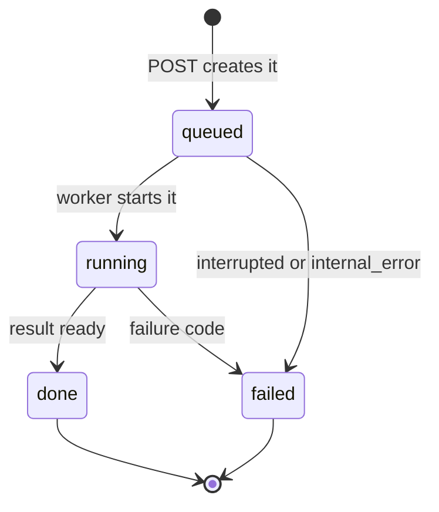

# API Contract: Jobs, Candidates, Media and Exports

| | |
|---|---|
| **Status** | **Proposed — awaiting team adoption (#13).** A draft for review, not a ratified contract. Nothing here is implemented. Until the team adopts it, building against it follows the rules for proposals in the [ADR index](../decisions/README.md#statuses). |
| **Last updated** | 2026-10-19 |
| **Related** | [ADR-0007](../decisions/0007-web-application-stack.md) · [ADR-0009](../decisions/0009-analysis-and-evaluation-contract-repair.md) · [Data model § candidates](data-model.md#candidates-apicli-output-json) · [Overview § 4.6–4.7](overview.md#46-export) · [Decision points](#11-decision-points-for-reviewers) |

The shared contract between the FastAPI backend (`src/autoclipper/api/`) and the Next.js app (`web/`), and the JSON that `autoclipper analyze` writes. It is meant to let the mock job API (#28), the screens (#29–#31), the export endpoint (#32) and the integration (#33) be built in parallel from this page alone, and to give real analysis and media (#44–#46) a fixed target.

It deliberately does **not** decide candidate generation rules (#27, ADR-0009), the training target (OQ-1), which media route is allowed for preview/export (OQ-17, #7) or hosting and the app database (OQ-18). Where the contract touches those, it defines a state the client can render whichever way they're decided.

## 1. Conventions

- **Base path:** every endpoint is under `/api/v1`. Bodies are JSON (`application/json; charset=utf-8`), except media and export files.
- **Field names** are `snake_case` in JSON, matching the [data model](data-model.md) and the CLI output. The TypeScript client uses the same names (no camelCase mapping).
- **VOD positions and durations** are JSON numbers in **seconds from VOD start**, with names ending `_s` ([conventions § 3](../development/conventions.md#3-units-time-and-ids)). They are **source time**: already aligned, never chat-lag shifted again.
- **Wall-clock times** are **UTC ISO-8601 strings with a `Z` suffix**, with names ending `_at`, e.g. `"2026-10-19T15:00:00Z"`.
- **IDs are strings.** Twitch IDs (`video_id`, `broadcaster_id`) stay exactly as Twitch uses them (digits, never cast to a number). IDs that AutoClipper generates (`job_id`, `export_id`, `candidate_id`, and `media_id` in file URLs) are opaque, match `^[A-Za-z0-9_-]{1,64}$` and must not be parsed.
- **Job, export and media IDs are random and never reused**, including across server restarts: a short prefix plus at least 64 bits from a cryptographic random source (e.g. `"job_" + secrets.token_hex(8)`), never a counter or anything derived from the VOD. So a stale ID kept in a page URL from before a restart gets a `404`, never another VOD's job (§ 8.3). `candidate_id` only has to be unique within its result, because it's always used together with a `job_id`.
- **Returned URLs are root-relative** (`PreviewMedia.url`, `Export.download_url`, `Location`), e.g. `/api/v1/exports/{export_id}/file`, so the server never needs to know its public address. Clients resolve them against the API origin they're configured with (e.g. `new URL(url, apiOrigin)`, § 8.4) and otherwise use them as given. If a later media route returns an absolute URL, the same resolution leaves it unchanged.
- **Every field is always present.** An optional value is `null`, never omitted; an empty list is `[]`. Numbers are finite (no `NaN` or `Infinity`).
- **Requests are strict, responses are tolerant.** The server rejects unknown request fields and invalid values (`422 invalid_request`). Clients ignore unknown response fields and give *open* enums a default branch (§ 9).
- **Messages are for people.** `message` fields are short English sentences that are safe to show in the UI: no secrets, tokens, file paths or chat usernames. Clients branch on `code`, never on `message`.
- **No auth, no pagination, no push.** It's a single-user local app ([PRD non-goals](../product/prd.md#non-goals-for-the-course-project)); clients poll (§ 8). Hosting (OQ-18) may revisit this.

**Model mapping.** Response models live in one FastAPI-free module (e.g. `autoclipper.schemas`) so the CLI can use them too (ADR-0007: Pydantic models are shared with the CLI output schema). TypeScript types are hand-written from this page or generated from FastAPI's OpenAPI document; #29 picks.

| JSON | Pydantic (Python 3.12) | TypeScript |
|---|---|---|
| string, ID | `str` | `string` |
| `*_s`, `score`, fractions | `float` | `number` |
| counts, `rank`, indexes | `int` | `number` |
| `*_at` | timezone-aware UTC `datetime` | `string` |
| nullable | `T \| None`, always serialized | `T \| null` |
| enum | `Literal[...]` or `StrEnum` | string-literal union |

Model names used below: `CreateJobRequest`, `Job`, `Progress`, `AnalysisWarning`, `ApiError`, `ErrorResponse`, `AnalysisResult`, `VodSummary`, `ScorerInfo`, `Candidate`, `CandidateMedia`, `PreviewMedia`, `ExportAvailability`, `CreateExportRequest`, `Export`, `Health`.

## 2. Endpoints

| Method | Path | Purpose | Success |
|---|---|---|---|
| `GET` | `/api/v1/health` | Liveness and which job runner is active | `200` `Health` |
| `POST` | `/api/v1/jobs` | Start analyzing a VOD | `201` new `Job`; `200` if the same VOD is already queued/running |
| `GET` | `/api/v1/jobs/{job_id}` | Job status and progress (poll this) | `200` `Job` |
| `GET` | `/api/v1/jobs/{job_id}/result` | Ranked candidates of a `done` job | `200` `AnalysisResult` |
| `GET` | `/api/v1/jobs/{job_id}/candidates/{candidate_id}/media` | Preview and export availability for one candidate | `200` `CandidateMedia` |
| `GET` | `/api/v1/media/{media_id}` | Preview video file, reached only through `PreviewMedia.url` (§ 5.1) | `200`/`206` `video/mp4` |
| `POST` | `/api/v1/exports` | Start exporting a trimmed candidate | `201` new `Export`; `200` if an identical export is queued/running |
| `GET` | `/api/v1/exports/{export_id}` | Export status (poll this) | `200` `Export` |
| `GET` | `/api/v1/exports/{export_id}/file` | Download the finished MP4 | `200` `video/mp4` |

Clients never build media or file URLs; they use `PreviewMedia.url` and `Export.download_url` as returned (§ 1). Errors for every endpoint are in § 7. There's no list, cancel or delete endpoint in v1 (decision point D10).

## 3. Jobs

### 3.1 Create a job

`POST /api/v1/jobs` with a `CreateJobRequest`:

| Field | Type | Notes |
|---|---|---|
| `vod` | str | A Twitch VOD link or bare video ID, as the user typed it |

The request handler only validates and normalizes `vod`; it makes no Twitch calls. Whether the VOD exists and is a past broadcast is checked by the worker, and those problems arrive as job failures (§ 3.5).

**Accepted inputs** (anything else is `422 invalid_vod_link`). Matching is case-insensitive, after trimming surrounding whitespace:

1. A **bare ID**: one or more ASCII digits, e.g. `9000000001`.
2. A **VOD URL**: optional `https://` or `http://` scheme (none means `https://`), host `twitch.tv`, `www.twitch.tv` or `m.twitch.tv`, path `/videos/<digits>` with an optional trailing `/`. A query string (e.g. `?t=1h2m3s`) or fragment is ignored.

The digits become `video_id`. Not accepted in v1: clip links, channel pages, other Twitch URL shapes (channel-scoped video paths, player embeds) and `v`-prefixed IDs. Clients may pre-validate with this regex (case-insensitive; the ID is in group 1 or 2), but the server is authoritative:

```text
^(?:(?:https?://)?(?:www\.|m\.)?twitch\.tv/videos/([0-9]+)/?(?:[?#].*)?|([0-9]+))$
```

**Responses.** `201 Created` with the new `Job` (`queued`) and `Location: /api/v1/jobs/{job_id}`. If a job for the same `video_id` is already `queued` or `running`, nothing new is created and that job comes back with `200 OK`, so double-clicks and reloads don't start duplicate work. A finished (`done` or `failed`) job is never reused: posting again re-analyzes. Reusing finished analyses is the optional "Cache processed VODs" task.

### 3.2 The `Job` resource

| Field | Type | Notes |
|---|---|---|
| `job_id` | str | Server-generated, opaque, random, never reused (§ 1) |
| `video_id` | str | Normalized from the request |
| `state` | `queued` \| `running` \| `done` \| `failed` | § 3.3 |
| `progress` | `Progress` \| null | § 3.4 |
| `warnings` | list<`AnalysisWarning`> | Degradations found so far (§ 3.5); `[]` if none |
| `error` | `ApiError` \| null | Non-null **iff** `state` is `failed`; codes in § 3.5 |
| `created_at` | timestamp | Job accepted |
| `started_at` | timestamp \| null | Entered `running` |
| `updated_at` | timestamp | Last change to any field |
| `finished_at` | timestamp \| null | Entered `done` or `failed` |

### 3.3 States



`done` and `failed` are terminal. `done` means `GET …/result` returns a result. It does **not** mean every signal was available (check `warnings`) or that there's at least one candidate. Exports use the same four states (§ 6).

### 3.4 Progress

`Progress` describes the work in hand without claiming more precision than the server has:

| Field | Type | Notes |
|---|---|---|
| `stage` | str (open enum) | Analysis stages below; export stages in § 6.3 |
| `stage_index` | int | 1-based position of `stage` in its list |
| `stage_count` | int | Number of stages for this resource type: 6 for jobs, 3 for exports |
| `stage_fraction` | float \| null | Fraction of **the current stage** done, 0–1, only when actually measured (e.g. bytes downloaded of a known total, windows scored of the total). `null` when unknown. |
| `message` | str | Short status for display, e.g. "Downloading chat replay" |

There's no overall percentage: stage durations vary too much for one honest number. Show a stepper ("Step 4 of 6") and add a bar only when `stage_fraction` isn't `null`.

`progress` is `null` while `queued` and once `done`. While `running` it describes the current stage. When `failed` it keeps the last value (or `null` if the job never started), so the UI can say where it stopped.

Analysis stages, in order. Skipped stages (e.g. served from a cache) are passed over. If work overlaps, the server reports the earliest unfinished stage.

| # | `stage` | Pipeline step ([overview § 3](overview.md#3-pipeline)) |
|---|---|---|
| 1 | `resolving_vod` | Resolve VOD metadata (1a) |
| 2 | `fetching_clips` | Fetch viewer clips (1b) |
| 3 | `downloading_chat` | Chat replay and pseudonymization (1c) |
| 4 | `downloading_audio` | Audio (1d) |
| 5 | `computing_features` | Windows and chat/audio features (2b, 3) |
| 6 | `ranking` | Scoring and candidate generation (4) |

### 3.5 Degraded results and failures

**Proposed (decision point D1): a missing signal degrades the result instead of failing the job.** The PRD requires moments for VODs with no viewer clips and robustness to missing chat (NFR-6), #44 asks the pipeline to *report* missing chat or audio clearly, and [overview § 4.6](overview.md#46-export) keeps analytical results usable when video is missing. So when one input can't be obtained, the job carries on with the rest, finishes `done` and records an `AnalysisWarning` (`{ "code": str, "message": str }`). Under D1, the "missing chat" and "missing audio" codes that #13, #44 and #45 ask for are these warnings.

| Warning `code` | When |
|---|---|
| `chat_missing` | No chat replay could be obtained, for any reason (see **Precedence** below). Chat signals are absent. |
| `audio_missing` | No audio could be obtained, for any reason. Audio signals are absent. |
| `audio_partly_muted` | Twitch muted part of the VOD's audio, so audio signals are unreliable there. |
| `viewer_clips_missing` | The viewer clip list couldn't be fetched. No candidate is `viewer_clips` or `both`, and `n_viewer_clips_total` is `null` (unknown, not zero). |
| `viewer_clips_incomplete` | Clip discovery hit a known query limit ([data sources](../data/data-sources.md), Get Clips), so some clips may be missing. |

Warning codes are an open enum: clients show `message` for any code, including ones they don't know. The server never fills a missing signal with placeholder values; how a scorer copes with a missing signal family is up to #44 and is visible in `scorer`. A VOD that genuinely has **zero viewer clips is not a warning**: `n_viewer_clips_total` is `0` and every candidate is `discovered`.

A job **fails** only when it can't produce a meaningful result. `Job.error.code` is then one of:

| Failure `code` | When | Typical stage |
|---|---|---|
| `vod_unavailable` | Twitch has no accessible video with this ID: not found, deleted or expired, or not publicly viewable (e.g. subscriber-only) | `resolving_vod` |
| `vod_unsupported` | The video exists but isn't a past broadcast (Helix `type` other than `archive`, e.g. a highlight or upload) | `resolving_vod` |
| `no_usable_signals` | Nothing to rank (chat and audio both missing, no viewer clips with VOD offsets) and none of those inputs failed transiently, so trying again won't help | `downloading_audio` (after the last input) |
| `upstream_unavailable` | Twitch or a download tool kept failing after retries (network, rate limit, tool breakage) while resolving the VOD, or while fetching inputs that left nothing to rank. Trying again later may work. | `resolving_vod` or `downloading_audio` |
| `interrupted` | The server stopped while the job was queued or running (§ 8.3) | any |
| `internal_error` | A bug. Details go to the server log; `message` stays generic. | any |

**Precedence.** Every step first retries transient errors (network, rate limits, `5xx`; [overview § 6](overview.md#6-cross-cutting-concerns)). What remains is classified like this:

1. **Resolving the VOD is required.** Twitch says the video doesn't exist or isn't viewable → `vod_unavailable`; it isn't an archive → `vod_unsupported`; Twitch or the network keeps failing → `upstream_unavailable`.
2. **A per-input step never fails the job on its own.** If viewer clips, chat or audio still can't be obtained, whatever the cause (the VOD has none, TwitchDownloader or yt-dlp broke, the network dropped), the job records `viewer_clips_missing`, `chat_missing` or `audio_missing` and carries on. The warning's `message` says whether analyzing again later may help; there's no machine-readable retry flag in v1 (D1).
3. **Nothing to rank fails the job** once all inputs have been tried: `upstream_unavailable` if any missing input failed transiently (tool and network errors count as transient; when unsure, treat as transient), otherwise `no_usable_signals`.
4. Anything unexpected is `internal_error`.

*If the team rejects D1:* `chat_missing` and `audio_missing` become failure codes for input that's genuinely absent (stages `downloading_chat` and `downloading_audio`); a transient chat or audio failure becomes `upstream_unavailable`; `no_usable_signals` can no longer happen and is dropped. Also update the precedence rules, the degraded job and result examples (§ 3.6, § 4.7) and the `chat_missing`/`audio_missing` warning examples, which become failure examples; mock scenarios `9000000003` and `9000000005` (§ 10); the CLI exit codes (§ 4.6); and D1 itself. #44's and #45's "missing chat or audio" criteria then mean failing the job instead of warning.

### 3.6 Examples

All IDs, names and timestamps are synthetic.

Create a job:

```http
POST /api/v1/jobs
Content-Type: application/json

{ "vod": "https://www.twitch.tv/videos/9000000001" }
```

`201 Created`, `Location: /api/v1/jobs/job_3f9c2b7a1d4e4c8b`:

```json
{
  "job_id": "job_3f9c2b7a1d4e4c8b",
  "video_id": "9000000001",
  "state": "queued",
  "progress": null,
  "warnings": [],
  "error": null,
  "created_at": "2026-10-19T15:00:00Z",
  "started_at": null,
  "updated_at": "2026-10-19T15:00:00Z",
  "finished_at": null
}
```

`GET /api/v1/jobs/job_3f9c2b7a1d4e4c8b` while running:

```json
{
  "job_id": "job_3f9c2b7a1d4e4c8b",
  "video_id": "9000000001",
  "state": "running",
  "progress": {
    "stage": "downloading_audio",
    "stage_index": 4,
    "stage_count": 6,
    "stage_fraction": 0.35,
    "message": "Downloading audio"
  },
  "warnings": [],
  "error": null,
  "created_at": "2026-10-19T15:00:00Z",
  "started_at": "2026-10-19T15:00:01Z",
  "updated_at": "2026-10-19T15:01:30Z",
  "finished_at": null
}
```

When it finishes, the same job has `"state": "done"`, `"progress": null` and `"finished_at": "2026-10-19T15:02:41Z"`. A degraded job (another VOD) finishes `done` with warnings:

```json
{
  "job_id": "job_8d2e6f0a9b1c4d7e",
  "video_id": "9000000003",
  "state": "done",
  "progress": null,
  "warnings": [
    {
      "code": "chat_missing",
      "message": "Chat replay isn't available for this VOD, so moments are ranked from audio and viewer clips only."
    }
  ],
  "error": null,
  "created_at": "2026-10-19T15:08:00Z",
  "started_at": "2026-10-19T15:08:01Z",
  "updated_at": "2026-10-19T15:10:12Z",
  "finished_at": "2026-10-19T15:10:12Z"
}
```

A failed job:

```json
{
  "job_id": "job_c4b3a2918f7e4d6c",
  "video_id": "9000000004",
  "state": "failed",
  "progress": {
    "stage": "resolving_vod",
    "stage_index": 1,
    "stage_count": 6,
    "stage_fraction": null,
    "message": "Looking up the VOD"
  },
  "warnings": [],
  "error": {
    "code": "vod_unavailable",
    "message": "This VOD isn't available on Twitch. It may have been deleted, expired or made private.",
    "details": null
  },
  "created_at": "2026-10-19T15:12:00Z",
  "started_at": "2026-10-19T15:12:01Z",
  "updated_at": "2026-10-19T15:12:03Z",
  "finished_at": "2026-10-19T15:12:03Z"
}
```

The other failure and warning codes, one object per line:

```jsonc
// Job.error
{ "code": "vod_unsupported", "message": "This video is a highlight or upload. AutoClipper analyzes past broadcasts only.", "details": null }
{ "code": "no_usable_signals", "message": "This VOD has no chat replay, no usable audio and no viewer clips, so there's nothing to rank.", "details": null }
{ "code": "upstream_unavailable", "message": "Twitch or a download tool isn't responding. Try again in a few minutes.", "details": null }
{ "code": "interrupted", "message": "The server stopped while this analysis was running. Analyze the VOD again.", "details": null }
{ "code": "internal_error", "message": "Something went wrong on the server. Try again.", "details": null }

// Job.warnings[] and AnalysisResult.warnings[]
{ "code": "chat_missing", "message": "Chat replay couldn't be downloaded right now, so moments are ranked from audio and viewer clips only. Analyzing the VOD again later may include it." }
{ "code": "audio_missing", "message": "Audio isn't available for this VOD, so moments are ranked from chat and viewer clips only." }
{ "code": "audio_partly_muted", "message": "Twitch muted parts of this VOD's audio, so audio signals are unreliable there." }
{ "code": "viewer_clips_missing", "message": "Viewer clips couldn't be loaded, so only discovered moments are shown." }
{ "code": "viewer_clips_incomplete", "message": "Twitch may not have returned every viewer clip for this VOD." }
```

HTTP errors for jobs use the envelope from § 7:

```jsonc
// 422 from POST /api/v1/jobs with { "vod": "twitch.tv/user_001" }
{ "error": { "code": "invalid_vod_link", "message": "That isn't a Twitch VOD link. Paste a link like twitch.tv/videos/<id> or just the numeric ID.", "details": null } }

// 409 from GET /api/v1/jobs/job_3f9c2b7a1d4e4c8b/result before it's done
{ "error": { "code": "job_not_done", "message": "This analysis hasn't finished yet.", "details": { "state": "running" } } }

// 404 from GET /api/v1/jobs/job_0000000000000000
{ "error": { "code": "job_not_found", "message": "This analysis no longer exists. The server may have restarted; analyze the VOD again.", "details": null } }
```

(The `//` comments label the examples; real bodies are plain JSON.)

## 4. Results and candidates

`GET /api/v1/jobs/{job_id}/result` returns an `AnalysisResult` once the job is `done` (otherwise `409 job_not_done`). It's the same model `autoclipper analyze` writes (§ 4.6).

### 4.1 `AnalysisResult`

| Field | Type | Notes |
|---|---|---|
| `schema_version` | str | `"1.0"` for this contract (§ 9) |
| `generated_at` | timestamp | When the analysis finished |
| `vod` | `VodSummary` | What the header and timeline need |
| `scorer` | `ScorerInfo` | What produced `score` |
| `n_viewer_clips_total` | int \| null | Distinct viewer clips linked to this VOD with a VOD offset, as retrieved. `null` when clips couldn't be fetched. |
| `warnings` | list<`AnalysisWarning`> | Same as the job's final `warnings` |
| `candidates` | list<`Candidate`> | In `rank` order; 0 to 200 items |

`VodSummary`:

| Field | Type | Notes |
|---|---|---|
| `video_id` | str | |
| `title` | str | Stream title |
| `broadcaster_id` | str | |
| `broadcaster_display_name` | str | Public channel display name |
| `duration_s` | float | Greater than 0. The timeline spans `[0, duration_s]`. |
| `created_at` | timestamp | Twitch's video creation time, not a verified stream-start clock ([data model § vods](data-model.md#vods)) |

`ScorerInfo`:

| Field | Type | Notes |
|---|---|---|
| `kind` | `heuristic` \| `trained_model` \| `mock` | `mock` marks synthetic output from the mock job. The UI should label it so fake results are never mistaken for analysis. |
| `name` | str | E.g. `B4` ([baselines](../ml/evaluation.md#2-baselines)), a model family such as `logreg`, or `mock` |
| `run_id` | str \| null | Experiment run of a trained artifact (e.g. `exp-012`, [experiments](../ml/experiments.md)); `null` otherwise |

### 4.2 `Candidate`

| Field | Type | Notes |
|---|---|---|
| `candidate_id` | str | Opaque. Unique within this result and meaningful only within it. |
| `rank` | int | 1 = best; exactly `1..N` |
| `score` | float | § 4.3 |
| `start_s` | float | Start of the interval to review, source time |
| `end_s` | float | End of the interval (exclusive) |
| `source` | `viewer_clips` \| `discovered` \| `both` | How it was generated (§ 4.4) |
| `n_viewer_clips` | int | Distinct viewer clip IDs merged into this candidate |
| `top_signals` | list<str> \| null | Feature names that contributed most, strongest first (names from [features](../ml/features.md), e.g. `chat_msg_rate_z`). `null` when not computed for this candidate. An explanation aid (US-9), not evidence of quality. |

`start_s` and `end_s` are the interval exactly as the candidate generator produced it, including any context padding it chose. They're already source time: a chat-time heuristic was converted once during generation ([labeling § 5](../data/labeling.md#5-chat-lag)). Preview and export use them as given; the server never shifts or pads them again.

### 4.3 Score, rank and ties

- **Higher score means a better candidate** according to `scorer`. Scores are comparable **only within one result** (one VOD, one scorer). They aren't probabilities or percentages, can be negative (e.g. sums of z-scores for B4) and mean nothing across VODs or scorers. Show rank prominently. If a score is shown, show it as a plain number or as a bar scaled within this result, never as a "% chance".
- **Rank follows score.** Candidates are ordered by `score` descending. Ties go to the earlier `start_s`, then to the smaller `candidate_id` (code-point order). `rank` is the 1-based position in that order, and the `candidates` array is in that order; clients don't re-sort it.
- **Not in this contract:** how viewer-clip and discovered candidates are put on one score scale, the candidate budget and the deduplication policy. Those are candidate generation rules (#27, ADR-0009).

### 4.4 `source`

`source` says **how the candidate was generated**. It never says whether the moment is a "true" highlight or whether ground truth overlaps it ([glossary: candidate](../project/glossary.md)).

| Value | Meaning | `n_viewer_clips` |
|---|---|---|
| `viewer_clips` | Built only from one or more viewer clips Twitch returned for this VOD (merged when they overlap). Signal-based discovery didn't propose it. | ≥ 1 |
| `discovered` | Proposed only by signal-based discovery (chat/audio heuristics or a trained scorer) without clip information. No viewer clip was merged into it. | 0 |
| `both` | Discovery proposed it **and** the generator merged it with one or more viewer clips under its deduplication policy | ≥ 1 |

So `source` is `discovered` exactly when `n_viewer_clips` is 0. A `discovered` candidate doesn't prove nobody clipped that time: the clip list can be incomplete and overlap handling is the generator's policy. Suggested badge labels: "Viewer clip", "Discovered", "Both".

### 4.5 Invariants

The server checks every result against these before returning it, and the CLI before writing it (Pydantic validators):

1. `0 ≤ start_s < end_s ≤ vod.duration_s` for every candidate. Intervals are half-open, `[start_s, end_s)` ([labeling § 2](../data/labeling.md#2-from-clips-to-moments)).
2. `candidate_id` values are unique. `rank` values are exactly `1..N` in array order, and `score` never increases along the array, with ties ordered as in § 4.3.
3. `n_viewer_clips == 0` exactly when `source == "discovered"`.
4. `top_signals` is `null` or a list of distinct strings.
5. At most 200 candidates. Zero is valid (e.g. a very short VOD) and the UI shows an empty state.
6. All numbers are finite.
7. `n_viewer_clips_total` is `null` exactly when `warnings` contains `viewer_clips_missing`, and then every candidate is `discovered`. Otherwise `n_viewer_clips ≤ n_viewer_clips_total` for every candidate.

Candidates may overlap each other; the timeline has to cope with overlapping markers.

**Across API responses** (checked by the server, not by the result model alone): `AnalysisResult.vod.video_id`, `CandidateMedia.video_id` and `Export.video_id` equal the job's `video_id`; `CandidateMedia.job_id` and `candidate_id` echo the request path; and a `done` job's `warnings` equal its result's `warnings`.

### 4.6 Relation to the CLI

`autoclipper analyze <vod>` (#44) accepts the same inputs as `POST /jobs` (one shared normalization function) and writes one `AnalysisResult` as JSON: the same Pydantic model and `schema_version` the API returns, so a saved CLI result is also a valid frontend fixture. Warnings go into `warnings` and are also printed to stderr. If analysis fails, the CLI writes no result, prints the failure `code` and `message` to stderr and exits per [conventions § 7](../development/conventions.md#7-cli):

- `1` (this input can't be analyzed): `invalid_vod_link`, `vod_unavailable`, `vod_unsupported` and `no_usable_signals`, which by the precedence in § 3.5 means the inputs are genuinely absent.
- `2` (external failure; trying again later may work): `upstream_unavailable`.
- Proposed `3` (a bug): `internal_error`. Conventions § 7 has no code for bugs yet; D12 decides, and adoption adds the line there.

`interrupted` is API-only. Jobs, media and exports exist only in the API.

### 4.7 Examples

`GET /api/v1/jobs/job_3f9c2b7a1d4e4c8b/result`, one candidate of each `source` (scores are made up by the mock and measure nothing):

```json
{
  "schema_version": "1.0",
  "generated_at": "2026-10-19T15:02:41Z",
  "vod": {
    "video_id": "9000000001",
    "title": "Synthetic stream 1",
    "broadcaster_id": "9100000001",
    "broadcaster_display_name": "user_001",
    "duration_s": 360.0,
    "created_at": "2026-10-12T18:00:00Z"
  },
  "scorer": { "kind": "mock", "name": "mock", "run_id": null },
  "n_viewer_clips_total": 4,
  "warnings": [],
  "candidates": [
    {
      "candidate_id": "c001",
      "rank": 1,
      "score": 3.42,
      "start_s": 118.0,
      "end_s": 148.0,
      "source": "both",
      "n_viewer_clips": 3,
      "top_signals": ["chat_msg_rate_z", "audio_rms_max_z"]
    },
    {
      "candidate_id": "c002",
      "rank": 2,
      "score": 2.87,
      "start_s": 251.5,
      "end_s": 276.5,
      "source": "discovered",
      "n_viewer_clips": 0,
      "top_signals": ["audio_rms_max_z"]
    },
    {
      "candidate_id": "c003",
      "rank": 3,
      "score": 1.05,
      "start_s": 40.0,
      "end_s": 62.0,
      "source": "viewer_clips",
      "n_viewer_clips": 1,
      "top_signals": null
    }
  ]
}
```

Degraded result for `job_8d2e6f0a9b1c4d7e` (chat missing):

```json
{
  "schema_version": "1.0",
  "generated_at": "2026-10-19T15:10:12Z",
  "vod": {
    "video_id": "9000000003",
    "title": "Synthetic stream 3",
    "broadcaster_id": "9100000001",
    "broadcaster_display_name": "user_001",
    "duration_s": 300.0,
    "created_at": "2026-10-13T18:00:00Z"
  },
  "scorer": { "kind": "mock", "name": "mock", "run_id": null },
  "n_viewer_clips_total": 1,
  "warnings": [
    {
      "code": "chat_missing",
      "message": "Chat replay isn't available for this VOD, so moments are ranked from audio and viewer clips only."
    }
  ],
  "candidates": [
    { "candidate_id": "c001", "rank": 1, "score": 2.1, "start_s": 75.0, "end_s": 100.0, "source": "discovered", "n_viewer_clips": 0, "top_signals": ["audio_rms_max_z"] },
    { "candidate_id": "c002", "rank": 2, "score": 1.3, "start_s": 190.0, "end_s": 215.0, "source": "viewer_clips", "n_viewer_clips": 1, "top_signals": null }
  ]
}
```

A VOD with no viewer clips has the same shape with `"n_viewer_clips_total": 0` and only `discovered` candidates, e.g. `{ "candidate_id": "c001", "rank": 1, "score": 1.8, "start_s": 12.0, "end_s": 40.0, "source": "discovered", "n_viewer_clips": 0, "top_signals": ["chat_msg_rate_z"] }`. A result with no candidates has `"candidates": []`.

## 5. Media (preview)

The app gets something playable without knowing which route OQ-17 will allow. When the user selects a candidate, the client calls `GET /api/v1/jobs/{job_id}/candidates/{candidate_id}/media` and gets a `CandidateMedia`. It says separately whether the candidate can be **previewed** and whether it can be **exported**, because a route may allow one and not the other (e.g. playback through Twitch's player without a basis to download; see [governance § OQ-17](../data/data-governance.md#authorization-boundary-before-real-collection-oq-17)). Analysis never depends on media: a job is `done` even if nothing can be previewed. Errors: `404 job_not_found`/`candidate_not_found`, `409 job_not_done`.

`CandidateMedia`:

| Field | Type | Notes |
|---|---|---|
| `job_id` | str | |
| `candidate_id` | str | |
| `video_id` | str | |
| `preview` | `PreviewMedia` | |
| `export` | `ExportAvailability` | |

`PreviewMedia`:

| Field | Type | Notes |
|---|---|---|
| `status` | `available` \| `preparing` \| `unavailable` | `preparing`: the server is obtaining media (e.g. a permitted segment); poll again (§ 8.1) |
| `kind` | `video_file` \| null | Non-null iff `available`. Open enum: treat an unknown kind as unavailable. |
| `url` | str \| null | Root-relative URL (§ 1) of an MP4 (H.264/AAC) that an HTML `<video>` element can play, with range support for seeking (§ 5.1). Non-null iff `kind` is `video_file`. |
| `media_start_s` | float \| null | VOD time at media time 0. Non-null iff `available`. |
| `media_end_s` | float \| null | VOD time at the end of the media. Non-null iff `available`. |
| `reason` | str \| null | `MediaUnavailableReason`; non-null iff `unavailable` |
| `message` | str \| null | Explanation for the user. Non-null when `unavailable`; optional while `preparing`. |

**`video_file`:** position *p* seconds into the file shows VOD time `media_start_s + p`, so to play a candidate, seek to `start_s - media_start_s`. The file may cover a segment around the candidate (`media_start_s > 0`) or the whole VOD. If OQ-17 allows playback through Twitch's own player ([governance § OQ-17](../data/data-governance.md#authorization-boundary-before-real-collection-oq-17)), #46 adds a new `kind` for it, a minor change (§ 9) that older clients show as unavailable.

`ExportAvailability`:

| Field | Type | Notes |
|---|---|---|
| `status` | `available` \| `unavailable` | Whether `POST /exports` can succeed for this candidate now |
| `reason` | str \| null | `MediaUnavailableReason`; non-null iff `unavailable` |
| `message` | str \| null | Non-null iff `unavailable` |
| `min_start_s` | float \| null | Earliest export `start_s` allowed; non-null iff `available` |
| `max_end_s` | float \| null | Latest export `end_s` allowed; non-null iff `available` |
| `max_duration_s` | float \| null | Longest export allowed (`end_s - start_s`); non-null iff `available`. Server-configured; proposed default 90 s, the export preset in [labeling § 2](../data/labeling.md#2-from-clips-to-moments). |
| `layouts` | list<str> | Layouts the server can render now (§ 6.1); `[]` iff `unavailable`. Clients ignore values they don't know. |

`MediaUnavailableReason` (open enum):

| `reason` | Meaning |
|---|---|
| `not_permitted` | No approved preview/export basis covers this VOD. Expected for real VODs until OQ-17 is decided and #46 implements a route. |
| `source_unavailable` | The source video is gone (deleted, expired or unpublished) |
| `retention_expired` | Media we were allowed to keep was deleted under the retention rules ([governance § 4](../data/data-governance.md#4-data-retention-proposal)) |
| `fetch_failed` | Obtaining permitted media failed (network or tool error). Trying again later may work. |

**Guarantees.** `0 ≤ media_start_s < media_end_s ≤ vod.duration_s` and `0 ≤ min_start_s < max_end_s ≤ vod.duration_s`. When available, preview coverage and export bounds both contain the candidate's own `[start_s, end_s)`.

**Client behavior.** "Media unavailable" is a normal, designed state, not an error page: disable preview and export independently and show the matching `message`. Playback stays within `[media_start_s, media_end_s]`. Trim controls clamp to `[export.min_start_s, export.max_end_s]` and to `export.max_duration_s`; "reset" restores the candidate's `start_s` and `end_s`. If a candidate is longer than `max_duration_s`, the UI asks the user to shorten it before enabling Export.

**Mock (#28):** every mock VOD previews and exports the synthetic sample video (#15) as `video_file`. Preview coverage and export bounds are both `[0, min(sample length, vod.duration_s)]`, so the guarantees above hold. For that to cover every mock candidate, the sample must be at least as long as the longest mock VOD (360 s in these examples; an FFmpeg test pattern can have any length). If it's shorter, shrink the mock durations and candidate times and update these examples in the same PR, so fixture mode and the mock backend stay identical (D13).

### 5.1 Media files

`GET /api/v1/media/{media_id}` serves the file behind a `video_file` URL. `media_id` is opaque and random (§ 1); the server looks it up in its own records. It returns `200`, or `206 Partial Content` for a `Range` request, with `Content-Type: video/mp4` and `Accept-Ranges: bytes`. An unknown or no longer available media ID gives `404 media_not_found`. This route and the export file route (§ 6.4) resolve IDs only through server records and never join request text into a filesystem path.

### 5.2 Examples

`GET /api/v1/jobs/job_3f9c2b7a1d4e4c8b/candidates/c001/media` (mock):

```json
{
  "job_id": "job_3f9c2b7a1d4e4c8b",
  "candidate_id": "c001",
  "video_id": "9000000001",
  "preview": {
    "status": "available",
    "kind": "video_file",
    "url": "/api/v1/media/med_7b1e4c9a2f3d4e5a",
    "media_start_s": 0.0,
    "media_end_s": 360.0,
    "reason": null,
    "message": null
  },
  "export": {
    "status": "available",
    "reason": null,
    "message": null,
    "min_start_s": 0.0,
    "max_end_s": 360.0,
    "max_duration_s": 90.0,
    "layouts": ["center_crop", "configured_region"]
  }
}
```

Preview still being prepared (e.g. a segment route; `preview` object only):

```json
{
  "status": "preparing",
  "kind": null,
  "url": null,
  "media_start_s": null,
  "media_end_s": null,
  "reason": null,
  "message": "Fetching the video for this moment…"
}
```

No approved route for this VOD:

```json
{
  "job_id": "job_0e1f2a3b4c5d4e6f",
  "candidate_id": "c001",
  "video_id": "9000000007",
  "preview": {
    "status": "unavailable",
    "kind": null,
    "url": null,
    "media_start_s": null,
    "media_end_s": null,
    "reason": "not_permitted",
    "message": "Preview isn't available for this VOD yet: there's no approved way to show its video."
  },
  "export": {
    "status": "unavailable",
    "reason": "not_permitted",
    "message": "Export isn't available for this VOD yet: there's no approved way to obtain its video.",
    "min_start_s": null,
    "max_end_s": null,
    "max_duration_s": null,
    "layouts": []
  }
}
```

## 6. Exports

### 6.1 Create an export

`POST /api/v1/exports` with a `CreateExportRequest`:

| Field | Type | Notes |
|---|---|---|
| `job_id` | str | A `done` job |
| `candidate_id` | str | A candidate in that job's result |
| `start_s` | float | Trimmed start, source time |
| `end_s` | float | Trimmed end (exclusive) |
| `layout` | `center_crop` \| `configured_region` | Must be in the candidate's `export.layouts` |
| `captions` | bool | Burn in speech-to-text captions |

Layouts (FR-12, #20):

- `center_crop`: the central 9:16 region of the 16:9 source, scaled to 1080×1920.
- `configured_region`: one fixed 9:16 source region set in server configuration (e.g. where a streamer's layout puts the action). It isn't chosen per request in v1.

Further layouts (e.g. facecam stacked over gameplay, optional polish) would be added as new values (§ 9).

**Exact trim.** The export covers exactly `[start_s, end_s)` of the source as sent, to within one video frame. The server adds **no chat-lag shift and no padding**; a user who wants context trims wider ([overview § 4.6](overview.md#46-export), [labeling § 5](../data/labeling.md#5-chat-lag)). The interval may extend beyond the candidate's own bounds but must satisfy `export.min_start_s ≤ start_s < end_s ≤ export.max_end_s` and `end_s - start_s ≤ export.max_duration_s` (otherwise `422 invalid_export_bounds`). Output is always an MP4, H.264/AAC, 1080×1920 ([PRD § Export](../product/prd.md#export)).

**Responses.** `201 Created` with the new `Export` (`queued`) and `Location: /api/v1/exports/{export_id}`. If an export with the same six request fields is `queued` or `running`, it comes back with `200 OK` instead. Errors: `404 job_not_found` or `candidate_not_found`, `409 job_not_done`, `409 media_unavailable` (export isn't available now; `details.reason` holds the `MediaUnavailableReason`), `422 invalid_request` (including a layout not in `export.layouts`) or `invalid_export_bounds`.

### 6.2 The `Export` resource

| Field | Type | Notes |
|---|---|---|
| `export_id` | str | Server-generated, opaque, random, never reused (§ 1) |
| `job_id` | str | |
| `candidate_id` | str | |
| `video_id` | str | |
| `start_s` | float | Exactly as requested |
| `end_s` | float | Exactly as requested |
| `layout` | str | As requested |
| `captions` | bool | As requested |
| `state` | `queued` \| `running` \| `done` \| `failed` | Same lifecycle as jobs (§ 3.3) |
| `progress` | `Progress` \| null | Export stages (§ 6.3); same rules as § 3.4 |
| `error` | `ApiError` \| null | Non-null iff `failed` |
| `download_url` | str \| null | Root-relative URL (§ 1) of the file endpoint. Non-null iff `done` and the file still exists. |
| `expires_at` | timestamp \| null | When the file is scheduled for deletion under the retention rules; `null` if no deletion is scheduled |
| `created_at` | timestamp | |
| `started_at` | timestamp \| null | |
| `updated_at` | timestamp | |
| `finished_at` | timestamp \| null | |

### 6.3 Export stages and failures

| # | `stage` | Work |
|---|---|---|
| 1 | `obtaining_media` | Fetch the permitted segment or open retained media |
| 2 | `transcribing` | Speech-to-text for captions; skipped when `captions` is false |
| 3 | `rendering` | Cut, reframe, burn in captions and encode |

`stage_count` is 3 whether or not captions are on.

| Failure `code` | When |
|---|---|
| `media_unavailable` | Media couldn't be obtained after the export started; `details.reason` is a `MediaUnavailableReason` |
| `captioning_failed` | Captions were requested but transcription failed. The server never silently delivers an uncaptioned file; the user can retry with captions off. |
| `render_failed` | FFmpeg failed to cut, reframe or encode |
| `interrupted` | The server stopped mid-export (§ 8.3) |
| `internal_error` | A bug |

### 6.4 Download

`GET /api/v1/exports/{export_id}/file` returns `200` with `Content-Type: video/mp4` and `Content-Disposition: attachment` (suggested filename `autoclipper_<video_id>_<start_s>-<end_s>.mp4`). Resolve `download_url` against the API origin (§ 1); a plain link works cross-origin because the header forces a download. Errors: `404 export_not_found`, `409 export_not_done`, `410 export_expired` (deleted under retention; export again). Where files are stored on disk is up to the server, but each export gets its own file keyed by `export_id`, never by `candidate_id` (which repeats across results and trims).

### 6.5 Examples

```http
POST /api/v1/exports
Content-Type: application/json

{
  "job_id": "job_3f9c2b7a1d4e4c8b",
  "candidate_id": "c001",
  "start_s": 115.5,
  "end_s": 150.0,
  "layout": "center_crop",
  "captions": true
}
```

`201 Created`, `Location: /api/v1/exports/exp_5a6b7c8d9e0f4a1b`:

```json
{
  "export_id": "exp_5a6b7c8d9e0f4a1b",
  "job_id": "job_3f9c2b7a1d4e4c8b",
  "candidate_id": "c001",
  "video_id": "9000000001",
  "start_s": 115.5,
  "end_s": 150.0,
  "layout": "center_crop",
  "captions": true,
  "state": "queued",
  "progress": null,
  "error": null,
  "download_url": null,
  "expires_at": null,
  "created_at": "2026-10-19T15:05:00Z",
  "started_at": null,
  "updated_at": "2026-10-19T15:05:00Z",
  "finished_at": null
}
```

While running, `"state": "running"` and, for example, `"progress": { "stage": "transcribing", "stage_index": 2, "stage_count": 3, "stage_fraction": null, "message": "Generating captions" }`. When done:

```json
{
  "export_id": "exp_5a6b7c8d9e0f4a1b",
  "job_id": "job_3f9c2b7a1d4e4c8b",
  "candidate_id": "c001",
  "video_id": "9000000001",
  "start_s": 115.5,
  "end_s": 150.0,
  "layout": "center_crop",
  "captions": true,
  "state": "done",
  "progress": null,
  "error": null,
  "download_url": "/api/v1/exports/exp_5a6b7c8d9e0f4a1b/file",
  "expires_at": null,
  "created_at": "2026-10-19T15:05:00Z",
  "started_at": "2026-10-19T15:05:01Z",
  "updated_at": "2026-10-19T15:05:48Z",
  "finished_at": "2026-10-19T15:05:48Z"
}
```

A failed export has `"state": "failed"`, `"download_url": null` and an `error` such as:

```jsonc
// Export.error
{ "code": "captioning_failed", "message": "Captions couldn't be generated for this clip. Try again, or export without captions.", "details": null }
{ "code": "media_unavailable", "message": "The video for this clip couldn't be fetched. Try again later.", "details": { "reason": "fetch_failed" } }
{ "code": "render_failed", "message": "The clip couldn't be rendered. Try again, or pick another layout.", "details": null }
{ "code": "interrupted", "message": "The server stopped while this export was running. Export the clip again.", "details": null }
```

The download responds with:

```http
HTTP/1.1 200 OK
Content-Type: video/mp4
Content-Disposition: attachment; filename="autoclipper_9000000001_115.5-150.0.mp4"
```

HTTP errors for exports:

```jsonc
// 422 from POST /api/v1/exports with start_s 100.0 and end_s 200.0
{ "error": { "code": "invalid_export_bounds", "message": "Clips can be at most 90 seconds long. Shorten the selection and try again.", "details": { "min_start_s": 0.0, "max_end_s": 360.0, "max_duration_s": 90.0 } } }

// 409 from POST /api/v1/exports for a candidate of VOD 9000000007
{ "error": { "code": "media_unavailable", "message": "Export isn't available for this VOD yet: there's no approved way to obtain its video.", "details": { "reason": "not_permitted" } } }

// 409 from GET /api/v1/exports/exp_5a6b7c8d9e0f4a1b/file while it's running
{ "error": { "code": "export_not_done", "message": "This export hasn't finished yet.", "details": { "state": "running" } } }

// 410 from GET /api/v1/exports/exp_5a6b7c8d9e0f4a1b/file after retention deleted it
{ "error": { "code": "export_expired", "message": "This exported file was deleted. Export the clip again.", "details": null } }
```

## 7. Errors

Every non-2xx response has the same body, `ErrorResponse`. `Job.error` and `Export.error` use the same inner `ApiError`.

```json
{
  "error": {
    "code": "internal_error",
    "message": "Something went wrong on the server. Try again.",
    "details": null
  }
}
```

| Field | Type | Notes |
|---|---|---|
| `code` | str (open enum) | Stable and machine-readable |
| `message` | str | Safe to display |
| `details` | object \| null | Extras for specific codes (below). Never needed to display the error. |

FastAPI's default `{"detail": …}` bodies for validation errors, unknown routes and unhandled exceptions must be replaced by this envelope (#28).

| HTTP | `code` | Returned by | `details` |
|---|---|---|---|
| 404 | `not_found` | Unknown path | `null` |
| 404 | `job_not_found` | `/jobs/{job_id}…`, `POST /exports` | `null` |
| 404 | `candidate_not_found` | Media endpoint, `POST /exports` | `null` |
| 404 | `export_not_found` | `/exports/{export_id}…` | `null` |
| 404 | `media_not_found` | `/media/{media_id}` | `null` |
| 405 | `method_not_allowed` | Known path, wrong method | `null` |
| 409 | `job_not_done` | Result, media, `POST /exports` | `{ "state": "<job state>" }` |
| 409 | `export_not_done` | Export file | `{ "state": "<export state>" }` |
| 409 | `media_unavailable` | `POST /exports` | `{ "reason": "<MediaUnavailableReason>" }` |
| 410 | `export_expired` | Export file | `null` |
| 422 | `invalid_request` | Any body: malformed JSON, missing or unknown field, wrong type, invalid or unavailable enum value | `{ "fields": ["<field>", …] }` |
| 422 | `invalid_vod_link` | `POST /jobs` | `null` |
| 422 | `invalid_export_bounds` | `POST /exports` | `{ "min_start_s": …, "max_end_s": …, "max_duration_s": … }` |
| 500 | `internal_error` | Any | `null` |

Job failure codes (§ 3.5) and export failure codes (§ 6.3) are reported inside `Job.error` or `Export.error` of a `200` status response, because fetching the status itself succeeded. Two codes are also HTTP errors and mean the same in both places: `media_unavailable` (`409` when `POST /exports` can't start an export; an export failure when media is lost after it started) and `internal_error` (`500` for a request; a job or export failure for background work). Examples for each HTTP code are in § 3.6 and § 6.5; the rest are:

```jsonc
// 404, unknown path
{ "error": { "code": "not_found", "message": "There's nothing at this address.", "details": null } }

// 404 from the media endpoint or POST /api/v1/exports with an unknown candidate_id
{ "error": { "code": "candidate_not_found", "message": "This moment isn't part of the analysis.", "details": null } }

// 404 from GET /api/v1/exports/exp_0000000000000000
{ "error": { "code": "export_not_found", "message": "This export no longer exists. The server may have restarted; export the clip again.", "details": null } }

// 404 from GET /api/v1/media/med_0000000000000000
{ "error": { "code": "media_not_found", "message": "This video is no longer available. Reload the moment to get a new link.", "details": null } }

// 405, e.g. DELETE /api/v1/jobs/job_3f9c2b7a1d4e4c8b
{ "error": { "code": "method_not_allowed", "message": "This action isn't supported.", "details": null } }

// 422 from POST /api/v1/exports with "captions": "yes"
{ "error": { "code": "invalid_request", "message": "The request is invalid: captions must be true or false.", "details": { "fields": ["captions"] } } }
```

## 8. Operational behavior

### 8.1 Polling

- Poll `GET /jobs/{job_id}` and `GET /exports/{export_id}` every 2 s while `queued` or `running`, and stop at `done` or `failed`. Then fetch the result (jobs) or offer the download (exports).
- Poll the media endpoint every 2 s while `preview.status` is `preparing`.
- On network errors, back off (e.g. 2, 4, 8 s, capped at 10 s). After about a minute of failures, show "Can't reach the server" with a retry button.
- Status responses send `Cache-Control: no-store`.
- Keeping `job_id` in the page URL lets a reload resume polling.
- No WebSockets or server-sent events in v1: polling a local server every 2 s is cheap and easy to mock.

### 8.2 Duplicates

- `POST /jobs` for a `video_id` that's already `queued` or `running` returns that job (`200`).
- `POST /exports` with the same six fields as an export that's `queued` or `running` returns it (`200`).
- `GET` requests are safe and idempotent. There's no `Idempotency-Key` header: matching on content is enough for one local user.

### 8.3 Worker, concurrency and restarts (local demo)

- Long work runs in an in-process background worker, never in the request handler ([overview § 4.7](overview.md#47-interfaces)). Recommended bound: one analysis job and one export at a time; others wait in `queued`, first in, first out. There's no cancel in v1 (D10): a mistaken long job finishes, or restarting the server stops it (and forgets every record, below).
- Job, export and media records live in memory. **A server restart forgets them**: their IDs return `404 job_not_found`, `export_not_found` or `media_not_found` and nothing resumes. Because IDs are never reused (§ 1), a stale ID can't reach a newer job. A client that gets a 404 for an ID it was polling says the job no longer exists (the server may have restarted) and offers to start again. On-disk pipeline caches may make the rerun faster but aren't part of the contract.
- If a later store keeps records across restarts (OQ-18), the server must mark anything that was `queued` or `running` at shutdown as `failed` with `interrupted` when it starts, never leave it `running`.

### 8.4 CORS and local setup

- The API allows cross-origin requests from a configured list of origins, by default the local Next.js dev server (`http://localhost:3000` and `http://127.0.0.1:3000`): methods `GET` and `POST`, request header `Content-Type`, no credentials. It exposes the `Location` and `Content-Disposition` headers. Ports in this doc are examples; #28 and #33 set the real ones.
- The frontend reads the API origin (scheme, host and port, no path) from an environment variable (#33) and resolves every returned URL against it (§ 1). A Next.js rewrite of `/api/v1/*` to the API is an acceptable alternative: the API origin is then the app's own origin, and returned URLs still work because they're root-relative.
- With no auth, the local server binds to `127.0.0.1` by default. Hosting (OQ-18) must revisit both.

### 8.5 Health

`GET /api/v1/health` returns `200`:

```json
{ "status": "ok", "schema_version": "1.0", "job_runner": "mock" }
```

`job_runner` is `mock` (#28) or `pipeline` (#45), so the UI can show a "mock data" badge. Which runner is active is server configuration, not part of a job request; both produce the same shapes.

## 9. Versioning

- The path prefix `/api/v1` is the major version. `schema_version` (`"MAJOR.MINOR"`) appears in `AnalysisResult` and `Health`; this contract is `1.0`.
- **Minor change** (same path, `1.x`): a new endpoint, a new response field, or a new value in an **open** enum. Clients must already ignore unknown fields and handle unknown open-enum values with a default branch.
- **Major change** (`/api/v2`): anything else, such as renaming or removing a field, changing a type, unit or meaning, adding a required request field, or adding a value to a **closed** enum.
- **Open enums:** error `code`, warning `code`, `progress.stage`, `MediaUnavailableReason`, `PreviewMedia.kind`, and layouts listed in `export.layouts`. **Closed enums:** job and export `state`, `source`, `preview.status`, `export.status`, `scorer.kind`. A request's `layout` must be one the server lists.
- Once adopted, any change updates this doc, its examples and [data model § candidates](data-model.md#candidates-apicli-output-json), with an ADR-0009 note or a focused ADR in the same PR ([AGENTS.md § 6](../../AGENTS.md#6-hard-rules-never-break-these), rule 4). Before adoption, the draft can change without a version bump.

## 10. Mock scenarios (recommended for #28)

Fixed synthetic inputs let the frontend exercise every state against the mock backend and in fixture mode with the same values:

| `vod` | Mock outcome |
|---|---|
| `9000000001`, or any valid ID not listed below | `done` with the § 4.7 result (one candidate of each `source`), with `vod.video_id` set to the requested ID (§ 4.5) |
| `9000000002` | `done`; no viewer clips: `n_viewer_clips_total` is 0 and every candidate is `discovered` |
| `9000000003` | `done` with a `chat_missing` warning |
| `9000000004` | `failed` with `vod_unavailable` at `resolving_vod` |
| `9000000005` | `failed` with `no_usable_signals` |
| `9000000006` | `done` with zero candidates |
| `9000000007` | `done`; the media endpoint returns preview and export `unavailable` (`not_permitted`) |
| `twitch.tv/user_001` | `422 invalid_vod_link` (normal validation, not mock-specific) |

Each mock job should take a few seconds so `queued` and `running` are visible, and report `scorer.kind: "mock"`.

## 11. Decision points for reviewers

Each row needs an explicit yes, or a chosen alternative, before adoption.

| # | Decision | Recommendation | Main alternative |
|---|---|---|---|
| D1 | Missing inputs and failure precedence | Degraded `done` with warnings. A per-input failure after retries is always a warning, whatever the cause; the job fails only when the VOD can't be resolved, or when nothing can be ranked: `upstream_unavailable` if a missing input failed transiently, else `no_usable_signals`. Warnings say in `message` whether retrying may help, with no retry flag in v1 (a flag can be added later as a minor change) (§ 3.5) | Fail the job with `chat_missing` / `audio_missing`; or fail with `upstream_unavailable` whenever a download tool fails |
| D2 | `source` values | `viewer_clips` / `discovered` / `both` as generation provenance, with `discovered` exactly when `n_viewer_clips` is 0 (§ 4.4) | Singular `viewer_clip`, or a list of provenance tags |
| D3 | Score and rank | Uncalibrated score comparable within one result; rank strictly follows score, ties by `start_s` then `candidate_id`; at most 200 candidates, no pagination (§ 4.3, § 4.5) | Rank set independently of score (e.g. interleaving sources) |
| D4 | Accepted VOD input | Bare digits or `twitch.tv/videos/<id>` (`www.`/`m.`, http(s) or no scheme, query ignored); highlights and uploads rejected as `vod_unsupported` (§ 3.1, § 3.5) | Also accept channel-scoped or player URLs; allow highlights |
| D5 | Export options | Layouts `center_crop` and `configured_region`; server-configured maximum length, default 90 s; a caption failure fails the export (§ 6) | Per-request crop region; deliver uncaptioned output with a warning |
| D6 | Media | Per-candidate descriptor with separate preview and export availability, a `preparing` state, and only `video_file` for now; OQ-17 can add a Twitch player kind later as a minor change (§ 5) | One per-VOD media URL inside the result; reserve a `twitch_embed` kind now |
| D7 | Restarts, duplicates and IDs | In-memory records (restart gives 404, no resume); random job/export/media IDs with ≥ 64 bits, never reused across restarts; identical non-terminal requests deduplicated; one job and one export at a time (§ 1, § 8) | Persist job records on disk now (overlaps OQ-18); sequential IDs |
| D8 | Progress | Stage enum, index/count and a measured within-stage fraction; no overall percentage (§ 3.4) | An estimated overall percentage |
| D9 | Versioning and shape | `/api/v1` plus `schema_version` `"1.0"`; `snake_case`; every field always present; open vs. closed enums (§ 1, § 9) | camelCase JSON via aliases; omit null fields |
| D10 | Cancel | No cancel, list or delete in v1: mock jobs take seconds, and restarting the local server stops a mistaken real job. A later cancel endpoint that fails the job with a new `cancelled` code is a minor change (§ 2, § 8.3, § 9) | Add `POST /api/v1/jobs/{job_id}/cancel` (and one for exports) now |
| D11 | File routes and URLs | Media at `GET /api/v1/media/{media_id}` with range support; file routes resolve IDs only through server records; every returned URL is root-relative and resolved by the client against its API origin (§ 1, § 5.1, § 8.4) | Absolute URLs built from a configured public base URL; keep the media path server-private |
| D12 | CLI exit codes | `1` input can't be analyzed (incl. `no_usable_signals`), `2` `upstream_unavailable`, a new `3` for `internal_error` (§ 4.6) | `internal_error` exits `1` (Python's default for an unhandled exception) and conventions § 7 stays as is |
| D13 | Mock data | Fixed synthetic VOD IDs per state (§ 10); one sample video (#15) at least as long as the longest mock VOD, covering `[0, min(sample length, duration_s)]` (§ 5) | Take mock durations from #15's actual video length, making these examples illustrative |

**To adopt:** settle each row in review, then change this doc's status to "Adopted (date)" in the same PR or a follow-up, update the [ADR-0009 note](../decisions/0009-analysis-and-evaluation-contract-repair.md#api-contract-proposal-13) and the [data model § candidates](data-model.md#candidates-apicli-output-json) status, add any exit code chosen in D12 to [conventions § 7](../development/conventions.md#7-cli), and re-check #27–#33 (later #44–#46) for swapping `needs-decision` to `agent-ready`.

## 12. Not decided here

- **Candidate generation:** budget, smoothing and peaks, padding, deduplication, and how viewer clips and discovered candidates share one score scale ([modeling plan § 3](../ml/modeling-plan.md#3-v2-candidate-generation), #27, ADR-0009).
- **Scorer and target:** which scorer ships (#47) and the training target (OQ-1).
- **Media route:** which real media may be fetched, kept and shown, and for how long (OQ-17, OQ-9, #7, #46).
- **Hosting:** persistence, auth and multi-user operation (OQ-18).
