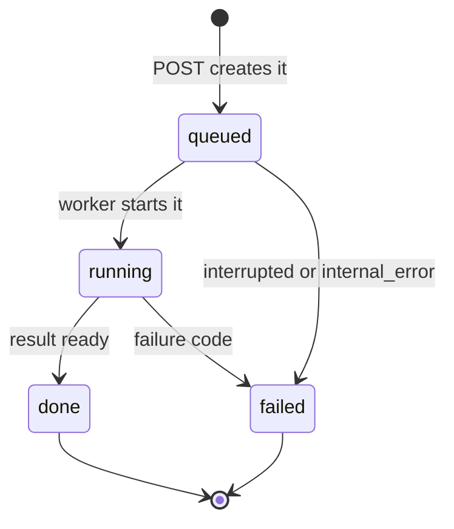

# API Contract: Jobs, Candidates, Media, Exports and Highlights

| | |
|---|---|
| **Status** | Current (2026-10-31). Nothing here is implemented yet. Update this contract and its examples alongside implementation changes; see [§ 10](#10-versioning). |
| **Last updated** | 2026-10-31 |
| **Related** | [Application stack](../decisions/0007-web-application-stack.md) · [Modeling plan](../ml/modeling-plan.md) · [Data sources and delivery defaults](../decisions/0011-data-sources-and-local-delivery.md) · [Data model § candidates](data-model.md#candidates-apicli-output-json) · [Overview § 4.6–4.7](overview.md#46-export) |

The shared contract between the FastAPI backend (`src/autoclipper/api/`) and the Next.js app (`web/`), and the JSON that `autoclipper analyze` writes. It lets the mock job API (#28), the screens (#29–#31), the export endpoint (#32), the highlights video (#71, #72) and the integration (#33) be built in parallel from this page alone, and gives real analysis and media (#44–#46) a fixed target.

The initial setup uses `autoclipper serve` on a development machine and the app in a browser ([delivery defaults](../decisions/0011-data-sources-and-local-delivery.md)). Shared collection/storage and hosted deployment can reuse the pipeline; deployment work extends authentication, persistence and media inputs as needed. How candidates are generated and which scorer ships are defined elsewhere (§ 12); this page defines the shapes, states and codes every scorer and media source produces.

## 1. Conventions

- **Base path:** every endpoint is under `/api/v1`. Bodies are JSON (`application/json; charset=utf-8`), except media, export and highlights files.
- **Field names** are `snake_case` in JSON, matching the [data model](data-model.md) and the CLI output. The TypeScript client uses the same names (no camelCase mapping).
- **VOD positions and durations** are JSON numbers in **seconds from VOD start**, with names ending `_s` ([conventions § 3](../development/conventions.md#3-units-time-and-ids)). They are **source time**: already aligned, never chat-lag shifted again.
- **Wall-clock times** are **UTC ISO-8601 strings with a `Z` suffix**, with names ending `_at`, e.g. `"2026-10-19T15:00:00Z"`.
- **IDs are strings.** Twitch IDs (`video_id`, `broadcaster_id`) stay exactly as Twitch uses them (digits, never cast to a number). IDs that AutoClipper generates (`job_id`, `export_id`, `highlights_id`, `candidate_id`, and `media_id` in file URLs) are opaque, match `^[A-Za-z0-9_-]{1,64}$` and must not be parsed.
- **Job, export, highlights and media IDs are random and never reused**, including across server restarts: a short prefix plus at least 64 bits from a cryptographic random source (e.g. `"job_" + secrets.token_hex(8)`), never a counter or anything derived from the VOD. So a stale ID kept in a page URL from before a restart gets a `404`, never another VOD's job (§ 9.3). `candidate_id` only has to be unique within its result, because it's always used together with a `job_id`.
- **Returned URLs are root-relative** (`PreviewMedia.url`, `Export.download_url`, `HighlightsVideo.download_url`, `Location`), e.g. `/api/v1/exports/{export_id}/file`, so the server never needs to know its public address. Clients resolve them against the API origin they're configured with (e.g. `new URL(url, apiOrigin)`, § 9.4) and otherwise use them as given. If a later media route returns an absolute URL, the same resolution leaves it unchanged.
- **Every field is always present.** An optional value is `null`, never omitted; an empty list is `[]`. Numbers are finite (no `NaN` or `Infinity`).
- **Requests are strict, responses are tolerant.** The server rejects unknown request fields and invalid values (`422 invalid_request`). Request models use Pydantic strict mode with unknown fields forbidden (`ConfigDict(strict=True, extra="forbid")`): default (lax) mode would accept `"yes"` or `1` for a boolean and `"115.5"` for a number. Strict mode still accepts a JSON integer for a float field, so `115` is a valid `start_s`. Request enums are `Literal[...]`: FastAPI validates the parsed body as Python data, where strict mode rejects a plain string for a `StrEnum` field, so `"center_crop"` would fail. A request field with a default (e.g. `CreateJobRequest.video_path`, `CreateHighlightsRequest.count`) may be omitted. Clients ignore unknown response fields and give *open* enums a default branch (§ 10).
- **Messages are for people.** `message` fields are short English sentences that are safe to show in the UI: no secrets, tokens, file paths or chat usernames. Clients branch on `code`, never on `message`.
- **Initial API scope:** single-user operation, polling (§ 9), no authentication or pagination. Deployment work can extend this setup ([PRD § Delivery](../product/prd.md#5-delivery)).

**Model mapping.** Response models live in one FastAPI-free module (e.g. `autoclipper.schemas`) so the CLI can use them too ([app stack](../decisions/0007-web-application-stack.md): Pydantic models are shared with the CLI output schema). TypeScript types are hand-written from this page, in one module the screens share (e.g. `web/src/lib/api/types.ts`), so #29–#31 don't wait for a backend. Generating them from FastAPI's OpenAPI document is an option once #28 exists; the hand-written types must then match it.

| JSON | Pydantic (Python 3.12) | TypeScript |
|---|---|---|
| string, ID | `str` | `string` |
| `*_s`, `score`, fractions | `float` | `number` |
| counts, `rank`, indexes | `int` | `number` |
| `*_at` | timezone-aware UTC `datetime` | `string` |
| nullable | `T \| None`, always serialized | `T \| null` |
| enum | `Literal[...]` (always in request models, § 1) or `StrEnum` | string-literal union |

Model names used below: `CreateJobRequest`, `Job`, `Progress`, `AnalysisWarning`, `ApiError`, `ErrorResponse`, `AnalysisResult`, `VodSummary`, `ScorerInfo`, `Candidate`, `CandidateMedia`, `PreviewMedia`, `ExportAvailability`, `CreateExportRequest`, `Export`, `CreateHighlightsRequest`, `HighlightsSegment`, `HighlightsVideo`, `Health`.

## 2. Endpoints

| Method | Path | Purpose | Success |
|---|---|---|---|
| `GET` | `/api/v1/health` | Liveness and which job runner is active | `200` `Health` |
| `POST` | `/api/v1/jobs` | Start analyzing a VOD | `201` new `Job`; `200` if the same VOD is already queued/running |
| `GET` | `/api/v1/jobs/{job_id}` | Job status and progress (poll this) | `200` `Job` |
| `GET` | `/api/v1/jobs/{job_id}/result` | Ranked candidates of a `done` job | `200` `AnalysisResult` |
| `GET` | `/api/v1/jobs/{job_id}/candidates/{candidate_id}/media` | Preview and export availability for one candidate | `200` `CandidateMedia` |
| `GET` | `/api/v1/media/{media_id}` | Preview video file, reached only through `PreviewMedia.url` (§ 5.1) | `200`/`206` `video/mp4` |
| `POST` | `/api/v1/exports` | Start exporting a trimmed candidate | `201` new `Export`; `200` if an identical export is queued/running |
| `GET` | `/api/v1/exports/{export_id}` | Export status (poll this) | `200` `Export` |
| `GET` | `/api/v1/exports/{export_id}/file` | Download the finished MP4 | `200` `video/mp4` |
| `POST` | `/api/v1/highlights` | Start rendering a highlights video from chosen candidates | `201` new `HighlightsVideo`; `200` if an identical one is queued/running |
| `GET` | `/api/v1/highlights/{highlights_id}` | Highlights video status (poll this) | `200` `HighlightsVideo` |
| `GET` | `/api/v1/highlights/{highlights_id}/file` | Download the finished MP4 | `200` `video/mp4` |

Clients never build media or file URLs; they use `PreviewMedia.url`, `Export.download_url` and `HighlightsVideo.download_url` as returned (§ 1). Errors for every endpoint are in § 8. There's no list, cancel or delete endpoint in v1 (§ 9.3).

## 3. Jobs

### 3.1 Create a job

`POST /api/v1/jobs` with a `CreateJobRequest`:

| Field | Type | Notes |
|---|---|---|
| `vod` | str | A Twitch VOD link or bare video ID, as the user typed it. Always required: chat and viewer clips come from Twitch. |
| `video_path` | str \| null | Optional, default `null`. Absolute path on the server machine to a video file of this VOD the user already downloaded. When given, preview and export read this file instead of downloading video (§ 5). |

The request handler validates and normalizes `vod` and checks `video_path`; it makes no Twitch calls. Whether the VOD exists, is a past broadcast and matches `video_path` is checked by the worker, and those problems arrive as job failures (§ 3.5).

**Accepted inputs** (anything else is `422 invalid_vod_link`). Matching is case-insensitive, after trimming surrounding whitespace:

1. A **bare ID**: one or more ASCII digits, e.g. `9000000001`.
2. A **VOD URL**: optional `https://` or `http://` scheme (none means `https://`), host `twitch.tv`, `www.twitch.tv` or `m.twitch.tv`, path `/videos/<digits>` with an optional trailing `/`. A query string (e.g. `?t=1h2m3s`) or fragment is ignored.

The digits become `video_id`. Not accepted in v1: clip links, channel pages, other Twitch URL shapes (channel-scoped video paths, player embeds) and `v`-prefixed IDs. Clients may pre-validate with this regex (case-insensitive; the ID is in group 1 or 2), but the server is authoritative:

```text
^(?:(?:https?://)?(?:www\.|m\.)?twitch\.tv/videos/([0-9]+)/?(?:[?#].*)?|([0-9]+))$
```

**Local video file.** If `video_path` is not `null`, it must be an absolute path to an existing file that the shared media probe (#51) reads as a video with a known duration; otherwise the request fails with `422 invalid_video_path` and no job is created. The handler probes only the local file. Comparing the file with the VOD needs Twitch's duration, so the worker does it while resolving the VOD: if the file's duration differs from the VOD's `duration_s` by more than 2 s, the job fails with `video_mismatch` (§ 3.5). The pipeline may also take the VOD's audio from this file instead of downloading it (#44).

**Responses.** `201 Created` with the new `Job` (`queued`) and `Location: /api/v1/jobs/{job_id}`. If a job with the same `video_id` and `video_path` is already `queued` or `running`, nothing new is created and that job comes back with `200 OK`, so double-clicks and reloads don't start duplicate work. A finished (`done` or `failed`) job is never reused: posting again re-analyzes. Reusing finished analyses is the "caching analyzed VODs" Should item in the [PRD](../product/prd.md#scope-at-a-glance).

### 3.2 The `Job` resource

| Field | Type | Notes |
|---|---|---|
| `job_id` | str | Server-generated, opaque, random, never reused (§ 1) |
| `video_id` | str | Normalized from the request |
| `video_path` | str \| null | As requested; `null` when video is downloaded |
| `state` | `queued` \| `running` \| `done` \| `failed` | § 3.3 |
| `progress` | `Progress` \| null | § 3.4 |
| `warnings` | list<`AnalysisWarning`> | Degradations found so far (§ 3.5); `[]` if none |
| `error` | `ApiError` \| null | Non-null **iff** `state` is `failed`; codes in § 3.5 |
| `created_at` | timestamp | Job accepted |
| `started_at` | timestamp \| null | Entered `running` |
| `updated_at` | timestamp | Last change to any field |
| `finished_at` | timestamp \| null | Entered `done` or `failed` |

### 3.3 States



`done` and `failed` are terminal. `done` means `GET …/result` returns a result. It does **not** mean every signal was available (check `warnings`) or that there's at least one candidate. Exports and highlights videos use the same four states (§ 6, § 7).

### 3.4 Progress

`Progress` describes the work in hand without claiming more precision than the server has:

| Field | Type | Notes |
|---|---|---|
| `stage` | str (open enum) | Analysis stages below; export stages in § 6.3, highlights stages in § 7.3 |
| `stage_index` | int | 1-based position of `stage` in its list |
| `stage_count` | int | Number of stages for this resource type: 6 for jobs, 3 for exports and highlights videos |
| `stage_fraction` | float \| null | Fraction of **the current stage** done, 0–1, only when actually measured (e.g. bytes downloaded of a known total, windows scored of the total). `null` when unknown. |
| `message` | str | Short status for display, e.g. "Downloading chat replay" |

There's no overall percentage: stage durations vary too much for one honest number. Show a stepper ("Step 4 of 6") and add a bar only when `stage_fraction` isn't `null`.

`progress` is `null` while `queued` and once `done`. While `running` it describes the current stage. When `failed` it keeps the last value (or `null` if the job never started), so the UI can say where it stopped.

Analysis stages, in order. Skipped stages (e.g. served from a cache) are passed over. If work overlaps, the server reports the earliest unfinished stage.

| # | `stage` | Pipeline step ([overview § 3](overview.md#3-pipeline)) |
|---|---|---|
| 1 | `resolving_vod` | Resolve VOD metadata (1a) |
| 2 | `fetching_clips` | Fetch viewer clips (1b) |
| 3 | `downloading_chat` | Chat replay and pseudonymization (1c) |
| 4 | `downloading_audio` | Audio (1d) |
| 5 | `computing_features` | Windows and chat/audio features (2b, 3) |
| 6 | `ranking` | Scoring and candidate generation (4) |

### 3.5 Degraded results and failures

**A missing signal degrades the result instead of failing the job.** The PRD requires moments for VODs with no viewer clips and tolerance of missing chat, #44 asks the pipeline to *report* missing chat or audio clearly, and [overview § 4.6](overview.md#46-export) keeps analytical results usable when video is missing. So when one input can't be obtained, the job carries on with the rest, finishes `done` and records an `AnalysisWarning` (`{ "code": str, "message": str }`). The "missing chat" and "missing audio" codes that #13, #44 and #45 ask for are these warnings.

| Warning `code` | When |
|---|---|
| `chat_missing` | No chat replay could be obtained, for any reason (see **Precedence** below). Chat signals are absent. |
| `audio_missing` | No audio could be obtained, for any reason. Audio signals are absent. |
| `audio_partly_muted` | Twitch muted part of the VOD's audio, so audio signals are unreliable there. |
| `viewer_clips_missing` | The viewer clip list couldn't be fetched. No candidate is `viewer_clips` or `both`, and `n_viewer_clips_total` is `null` (unknown, not zero). |
| `viewer_clips_incomplete` | Clip discovery hit a known query limit ([data sources](../data/data-sources.md), Get Clips), so some clips may be missing. |

Warning codes are an open enum: clients show `message` for any code, including ones they don't know. The server never fills a missing signal with placeholder values; how a scorer copes with a missing signal family is up to #44 and is visible in `scorer`. A VOD that genuinely has **zero viewer clips is not a warning**: `n_viewer_clips_total` is `0` and every candidate is `discovered`.

A job **fails** only when it can't produce a meaningful result. `Job.error.code` is then one of:

| Failure `code` | When | Typical stage |
|---|---|---|
| `vod_unavailable` | Twitch has no accessible video with this ID: not found, deleted or expired, or not publicly viewable (e.g. subscriber-only) | `resolving_vod` |
| `vod_unsupported` | The video exists but isn't a past broadcast (Helix `type` other than `archive`, e.g. a highlight or upload) | `resolving_vod` |
| `video_mismatch` | `video_path` was given and the file's duration differs from the VOD's by more than 2 s, so it isn't this VOD (or is incomplete) | `resolving_vod` |
| `no_usable_signals` | Nothing to rank (chat and audio both missing, no viewer clips with VOD offsets) and none of those inputs failed transiently, so trying again won't help | `downloading_audio` (after the last input) |
| `upstream_unavailable` | Twitch or a download tool kept failing after retries (network, rate limit, tool breakage) while resolving the VOD, or while fetching inputs that left nothing to rank. Trying again later may work. | `resolving_vod` or `downloading_audio` |
| `interrupted` | The server stopped while the job was queued or running (§ 9.3) | any |
| `internal_error` | A bug. Details go to the server log; `message` stays generic. | any |

**Precedence.** Every step first retries transient errors (network, rate limits, `5xx`; [overview § 6](overview.md#6-cross-cutting-concerns)). What remains is classified like this:

1. **Resolving the VOD is required.** Twitch says the video doesn't exist or isn't viewable → `vod_unavailable`; it isn't an archive → `vod_unsupported`; Twitch or the network keeps failing → `upstream_unavailable`; a `video_path` file that doesn't match the VOD's duration → `video_mismatch`.
2. **A per-input step never fails the job on its own.** If viewer clips, chat or audio still can't be obtained, whatever the cause (the VOD has no chat or audio, TwitchDownloader or yt-dlp broke, the network dropped), the job records `viewer_clips_missing`, `chat_missing` or `audio_missing` and carries on. The warning's `message` says whether analyzing again later may help; there's no machine-readable retry flag in v1 (one can be added later as a minor change, § 10). A clip list that was fetched and is empty isn't missing: that's the zero-clips case above, with no warning.
3. **Nothing to rank fails the job** once all inputs have been tried: `upstream_unavailable` if any missing input failed transiently (tool and network errors count as transient; when unsure, treat as transient), otherwise `no_usable_signals`.
4. Anything unexpected is `internal_error`.

### 3.6 Examples

All IDs, names and timestamps are synthetic.

Create a job:

```http
POST /api/v1/jobs
Content-Type: application/json

{ "vod": "https://www.twitch.tv/videos/9000000001" }
```

`201 Created`, `Location: /api/v1/jobs/job_3f9c2b7a1d4e4c8b`:

```json
{
  "job_id": "job_3f9c2b7a1d4e4c8b",
  "video_id": "9000000001",
  "video_path": null,
  "state": "queued",
  "progress": null,
  "warnings": [],
  "error": null,
  "created_at": "2026-10-19T15:00:00Z",
  "started_at": null,
  "updated_at": "2026-10-19T15:00:00Z",
  "finished_at": null
}
```

`GET /api/v1/jobs/job_3f9c2b7a1d4e4c8b` while running:

```json
{
  "job_id": "job_3f9c2b7a1d4e4c8b",
  "video_id": "9000000001",
  "video_path": null,
  "state": "running",
  "progress": {
    "stage": "downloading_audio",
    "stage_index": 4,
    "stage_count": 6,
    "stage_fraction": 0.35,
    "message": "Downloading audio"
  },
  "warnings": [],
  "error": null,
  "created_at": "2026-10-19T15:00:00Z",
  "started_at": "2026-10-19T15:00:01Z",
  "updated_at": "2026-10-19T15:01:30Z",
  "finished_at": null
}
```

When it finishes, the same job has `"state": "done"`, `"progress": null` and `"finished_at": "2026-10-19T15:02:41Z"`. A degraded job (another VOD) finishes `done` with warnings:

```json
{
  "job_id": "job_8d2e6f0a9b1c4d7e",
  "video_id": "9000000003",
  "video_path": null,
  "state": "done",
  "progress": null,
  "warnings": [
    {
      "code": "chat_missing",
      "message": "Chat replay isn't available for this VOD, so moments are ranked from audio and viewer clips only."
    }
  ],
  "error": null,
  "created_at": "2026-10-19T15:08:00Z",
  "started_at": "2026-10-19T15:08:01Z",
  "updated_at": "2026-10-19T15:10:12Z",
  "finished_at": "2026-10-19T15:10:12Z"
}
```

A failed job:

```json
{
  "job_id": "job_c4b3a2918f7e4d6c",
  "video_id": "9000000004",
  "video_path": null,
  "state": "failed",
  "progress": {
    "stage": "resolving_vod",
    "stage_index": 1,
    "stage_count": 6,
    "stage_fraction": null,
    "message": "Looking up the VOD"
  },
  "warnings": [],
  "error": {
    "code": "vod_unavailable",
    "message": "This VOD isn't available on Twitch. It may have been deleted, expired or made private.",
    "details": null
  },
  "created_at": "2026-10-19T15:12:00Z",
  "started_at": "2026-10-19T15:12:01Z",
  "updated_at": "2026-10-19T15:12:03Z",
  "finished_at": "2026-10-19T15:12:03Z"
}
```

The other failure and warning codes, one object per line:

```jsonc
// Job.error
{ "code": "vod_unsupported", "message": "This video is a highlight or upload. AutoClipper analyzes past broadcasts only.", "details": null }
{ "code": "video_mismatch", "message": "The video file you chose doesn't match this VOD's length. Check that it's the right VOD and fully downloaded.", "details": null }
{ "code": "no_usable_signals", "message": "This VOD has no chat replay, no usable audio and no viewer clips, so there's nothing to rank.", "details": null }
{ "code": "upstream_unavailable", "message": "Twitch or a download tool isn't responding. Try again in a few minutes.", "details": null }
{ "code": "interrupted", "message": "The server stopped while this analysis was running. Analyze the VOD again.", "details": null }
{ "code": "internal_error", "message": "Something went wrong on the server. Try again.", "details": null }

// Job.warnings[] and AnalysisResult.warnings[]
{ "code": "chat_missing", "message": "Chat replay couldn't be downloaded right now, so moments are ranked from audio and viewer clips only. Analyzing the VOD again later may include it." }
{ "code": "audio_missing", "message": "Audio isn't available for this VOD, so moments are ranked from chat and viewer clips only." }
{ "code": "audio_partly_muted", "message": "Twitch muted parts of this VOD's audio, so audio signals are unreliable there." }
{ "code": "viewer_clips_missing", "message": "Viewer clips couldn't be loaded, so only discovered moments are shown." }
{ "code": "viewer_clips_incomplete", "message": "Twitch may not have returned every viewer clip for this VOD." }
```

HTTP errors for jobs use the envelope from § 8:

```jsonc
// 422 from POST /api/v1/jobs with { "vod": "twitch.tv/user_001" }
{ "error": { "code": "invalid_vod_link", "message": "That isn't a Twitch VOD link. Paste a link like twitch.tv/videos/<id> or just the numeric ID.", "details": null } }

// 422 from POST /api/v1/jobs with a video_path that doesn't exist or isn't a video
{ "error": { "code": "invalid_video_path", "message": "That video file can't be opened. Check the path and that it's a complete video file.", "details": null } }

// 409 from GET /api/v1/jobs/job_3f9c2b7a1d4e4c8b/result before it's done
{ "error": { "code": "job_not_done", "message": "This analysis hasn't finished yet.", "details": { "state": "running" } } }

// 404 from GET /api/v1/jobs/job_0000000000000000
{ "error": { "code": "job_not_found", "message": "This analysis no longer exists. The server may have restarted; analyze the VOD again.", "details": null } }
```

(The `//` comments label the examples; real bodies are plain JSON.)

## 4. Results and candidates

`GET /api/v1/jobs/{job_id}/result` returns an `AnalysisResult` once the job is `done` (otherwise `409 job_not_done`). It's the same model `autoclipper analyze` writes (§ 4.6).

### 4.1 `AnalysisResult`

| Field | Type | Notes |
|---|---|---|
| `schema_version` | str | `"1.0"` for this contract (§ 10) |
| `generated_at` | timestamp | When the analysis finished |
| `vod` | `VodSummary` | What the header and timeline need |
| `scorer` | `ScorerInfo` | What produced `score` |
| `n_viewer_clips_total` | int \| null | Distinct viewer clips linked to this VOD with a VOD offset, as retrieved. `null` when clips couldn't be fetched. |
| `warnings` | list<`AnalysisWarning`> | Same as the job's final `warnings` |
| `candidates` | list<`Candidate`> | In `rank` order; 0 to 200 items |

`VodSummary`:

| Field | Type | Notes |
|---|---|---|
| `video_id` | str | |
| `title` | str | Stream title |
| `broadcaster_id` | str | |
| `broadcaster_display_name` | str | Public channel display name |
| `duration_s` | float | Greater than 0. The timeline spans `[0, duration_s]`. |
| `created_at` | timestamp | Twitch's video creation time, not a verified stream-start clock ([data model § vods](data-model.md#vods)) |

`ScorerInfo`:

| Field | Type | Notes |
|---|---|---|
| `kind` | `heuristic` \| `trained_model` \| `mock` | `mock` marks synthetic output from the mock job. The UI should label it so fake results are never mistaken for analysis. |
| `name` | str | A baseline such as `chat_loudness` ([baselines](../ml/evaluation.md#2-baselines)), a model family such as `logreg`, or `mock` |
| `run_id` | str \| null | Experiment run of a trained artifact (e.g. `exp-012`, [experiments](../ml/experiments.md)); `null` otherwise |

### 4.2 `Candidate`

| Field | Type | Notes |
|---|---|---|
| `candidate_id` | str | Opaque. Unique within this result and meaningful only within it. |
| `rank` | int | 1 = best; exactly `1..N` |
| `score` | float | § 4.3 |
| `start_s` | float | Start of the interval to review, source time |
| `end_s` | float | End of the interval (exclusive) |
| `source` | `viewer_clips` \| `discovered` \| `both` | How it was generated (§ 4.4) |
| `n_viewer_clips` | int | Distinct viewer clip IDs merged into this candidate |
| `top_signals` | list<str> | Feature names that contributed most, strongest first (names from [features](../ml/features.md), e.g. `chat_msg_rate_z`). Always present; empty only when no signal stands out (then the card says "Viewers clipped this moment" if `n_viewer_clips` > 0, else "Steady activity throughout"). The clip card's one-line reason is built from it. An explanation aid, not evidence of quality. |

`start_s` and `end_s` are the interval exactly as the candidate generator produced it, including any context padding it chose. They're already source time: a chat-time heuristic was converted once during generation ([labeling § 5](../data/labeling.md#5-chat-lag)). Preview, export and highlights use them as given; the server never shifts or pads them again.

### 4.3 Score, rank and ties

- **Higher score means a better candidate** according to `scorer`. Scores are comparable **only within one result** (one VOD, one scorer). They aren't probabilities or percentages, can be negative (e.g. sums of z-scores for the chat + loudness baseline) and mean nothing across VODs or scorers. Show rank prominently. If a score is shown, show it as a plain number or as a bar scaled within this result, never as a "% chance".
- **Rank follows score.** Candidates are ordered by `score` descending. Ties go to the earlier `start_s`, then to the smaller `candidate_id` (code-point order). `rank` is the 1-based position in that order, and the `candidates` array is in that order; clients don't re-sort it.
- **Not in this contract:** how viewer-clip and discovered candidates are put on one score scale, the candidate budget and the deduplication policy. Those are candidate generation rules (§ 12).

### 4.4 `source`

`source` says **how the candidate was generated**. It never says whether the moment is a "true" highlight or whether ground truth overlaps it ([glossary: candidate](../project/glossary.md)).

| Value | Meaning | `n_viewer_clips` |
|---|---|---|
| `viewer_clips` | Built only from one or more viewer clips Twitch returned for this VOD (merged when they overlap). Signal-based discovery didn't produce it. | ≥ 1 |
| `discovered` | Found only by signal-based discovery (chat/audio heuristics or a trained scorer) without clip information. No viewer clip was merged into it. | 0 |
| `both` | Discovery produced it **and** the generator merged it with one or more viewer clips under its deduplication policy | ≥ 1 |

So `source` is `discovered` exactly when `n_viewer_clips` is 0. A `discovered` candidate doesn't prove nobody clipped that time: the clip list can be incomplete and overlap handling is the generator's policy. Suggested badge labels: "Viewer clip", "Discovered", "Both".

### 4.5 Invariants

The server checks every result against these before returning it, and the CLI before writing it (Pydantic validators):

1. `0 ≤ start_s < end_s ≤ vod.duration_s` for every candidate. Intervals are half-open, `[start_s, end_s)` ([labeling § 2](../data/labeling.md#2-from-clips-to-moments)).
2. `candidate_id` values are unique. `rank` values are exactly `1..N` in array order, and `score` never increases along the array, with ties ordered as in § 4.3.
3. `n_viewer_clips == 0` exactly when `source == "discovered"`.
4. `top_signals` is a list (possibly empty) of distinct strings.
5. At most 200 candidates. Zero is valid (e.g. a very short VOD) and the UI shows an empty state.
6. All numbers are finite.
7. `n_viewer_clips_total` is `null` exactly when `warnings` contains `viewer_clips_missing`, and then every candidate is `discovered`. Otherwise `n_viewer_clips ≤ n_viewer_clips_total` for every candidate.

Candidates may overlap each other; the timeline has to cope with overlapping markers.

**Across API responses** (checked by the server, not by the result model alone): `AnalysisResult.vod.video_id`, `CandidateMedia.video_id`, `Export.video_id` and `HighlightsVideo.video_id` equal the job's `video_id`; `CandidateMedia.job_id` and `candidate_id` echo the request path; and a `done` job's `warnings` equal its result's `warnings`.

### 4.6 Relation to the CLI

`autoclipper analyze <vod>` (#44) accepts the same inputs as `POST /jobs` (one shared normalization function; `--video <path>` is `video_path`, with the same checks) and writes one `AnalysisResult` as JSON: the same Pydantic model and `schema_version` the API returns, so a saved CLI result is also a valid frontend fixture. Warnings go into `warnings` and are also printed to stderr. If analysis fails, the CLI writes no result, prints the failure `code` and `message` to stderr and exits per [conventions § 7](../development/conventions.md#7-cli):

- `1` (this input can't be analyzed): `invalid_vod_link`, `invalid_video_path`, `vod_unavailable`, `vod_unsupported`, `video_mismatch` and `no_usable_signals`, which by the precedence in § 3.5 means the inputs are genuinely absent.
- `2` (external failure; trying again later may work): `upstream_unavailable`.
- `3` (a bug): `internal_error`.

`autoclipper highlights <result.json> --video <path>` (#71) renders a highlights video (§ 7) from a saved `AnalysisResult` and a local file of the VOD's video, with the same options as `CreateHighlightsRequest`: `--count`, `--order chronological|rank`, `--captions`, and optionally `--segments <file.json>` holding a `segments` list. It applies the same rules as § 7.1, with the whole VOD as every candidate's export bounds and the server's configured maximum clip and highlights lengths, and writes `autoclipper_<video_id>_highlights.mp4` to `artifacts/highlights/` (or to `--out <path>`). It exits `1` when the input can't be rendered (`invalid_highlights_bounds`, `invalid_video_path`, `video_mismatch`, `captioning_failed`, `render_failed`) and `3` for `internal_error`.

`interrupted` is API-only. Job, media, export and highlights records (and their IDs) exist only in the API.

### 4.7 Examples

`GET /api/v1/jobs/job_3f9c2b7a1d4e4c8b/result`, one candidate of each `source` (scores are made up by the mock and measure nothing):

```json
{
  "schema_version": "1.0",
  "generated_at": "2026-10-19T15:02:41Z",
  "vod": {
    "video_id": "9000000001",
    "title": "Synthetic stream 1",
    "broadcaster_id": "9100000001",
    "broadcaster_display_name": "user_001",
    "duration_s": 360.0,
    "created_at": "2026-10-12T18:00:00Z"
  },
  "scorer": { "kind": "mock", "name": "mock", "run_id": null },
  "n_viewer_clips_total": 4,
  "warnings": [],
  "candidates": [
    {
      "candidate_id": "c001",
      "rank": 1,
      "score": 3.42,
      "start_s": 118.0,
      "end_s": 148.0,
      "source": "both",
      "n_viewer_clips": 3,
      "top_signals": ["chat_msg_rate_z", "audio_rms_max_z"]
    },
    {
      "candidate_id": "c002",
      "rank": 2,
      "score": 2.87,
      "start_s": 251.5,
      "end_s": 276.5,
      "source": "discovered",
      "n_viewer_clips": 0,
      "top_signals": ["audio_rms_max_z"]
    },
    {
      "candidate_id": "c003",
      "rank": 3,
      "score": 1.05,
      "start_s": 40.0,
      "end_s": 62.0,
      "source": "viewer_clips",
      "n_viewer_clips": 1,
      "top_signals": []
    }
  ]
}
```

Degraded result for `job_8d2e6f0a9b1c4d7e` (chat missing):

```json
{
  "schema_version": "1.0",
  "generated_at": "2026-10-19T15:10:12Z",
  "vod": {
    "video_id": "9000000003",
    "title": "Synthetic stream 3",
    "broadcaster_id": "9100000001",
    "broadcaster_display_name": "user_001",
    "duration_s": 300.0,
    "created_at": "2026-10-13T18:00:00Z"
  },
  "scorer": { "kind": "mock", "name": "mock", "run_id": null },
  "n_viewer_clips_total": 1,
  "warnings": [
    {
      "code": "chat_missing",
      "message": "Chat replay isn't available for this VOD, so moments are ranked from audio and viewer clips only."
    }
  ],
  "candidates": [
    { "candidate_id": "c001", "rank": 1, "score": 2.1, "start_s": 75.0, "end_s": 100.0, "source": "discovered", "n_viewer_clips": 0, "top_signals": ["audio_rms_max_z"] },
    { "candidate_id": "c002", "rank": 2, "score": 1.3, "start_s": 190.0, "end_s": 215.0, "source": "viewer_clips", "n_viewer_clips": 1, "top_signals": ["chat_msg_rate_z"] }
  ]
}
```

A VOD with no viewer clips has the same shape with `"n_viewer_clips_total": 0` and only `discovered` candidates, e.g. `{ "candidate_id": "c001", "rank": 1, "score": 1.8, "start_s": 12.0, "end_s": 40.0, "source": "discovered", "n_viewer_clips": 0, "top_signals": ["chat_msg_rate_z"] }`. A result with no candidates has `"candidates": []`.

## 5. Media (preview)

Preview, export and highlights all use the VOD's video. If the job was created with a `video_path` (§ 3.1), the server reads that file and downloads no video. Otherwise it downloads what it needs with TwitchDownloader or yt-dlp ([data sources](../data/data-sources.md), #46), either the whole VOD or a segment around a candidate. Media is unavailable only for technical reasons (the reasons below), and analysis never depends on it: a job is `done` even if nothing can be previewed.

When the user selects a candidate, the client calls `GET /api/v1/jobs/{job_id}/candidates/{candidate_id}/media` and gets a `CandidateMedia`. It says separately whether the candidate can be **previewed** and whether it can be **exported**, because the two can differ: preview may still be `preparing` while export is already `available` (an export obtains its own media in its first stage, § 6.3). Errors: `404 job_not_found`/`candidate_not_found`, `409 job_not_done`.

`CandidateMedia`:

| Field | Type | Notes |
|---|---|---|
| `job_id` | str | |
| `candidate_id` | str | |
| `video_id` | str | |
| `preview` | `PreviewMedia` | |
| `export` | `ExportAvailability` | Also governs highlights (§ 7.1) |

`PreviewMedia`:

| Field | Type | Notes |
|---|---|---|
| `status` | `available` \| `preparing` \| `unavailable` | `preparing`: the server is obtaining media (e.g. downloading the segment around the candidate); poll again (§ 9.1) |
| `kind` | `video_file` \| null | Non-null iff `available`. Open enum: treat an unknown kind as unavailable. |
| `url` | str \| null | Root-relative URL (§ 1) of an MP4 (H.264/AAC) that an HTML `<video>` element can play, with range support for seeking (§ 5.1). Non-null iff `kind` is `video_file`. |
| `media_start_s` | float \| null | VOD time at media time 0. Non-null iff `available`. |
| `media_end_s` | float \| null | VOD time at the end of the media. Non-null iff `available`. |
| `reason` | str \| null | `MediaUnavailableReason`; non-null iff `unavailable` |
| `message` | str \| null | Explanation for the user. Non-null when `unavailable`; optional while `preparing`. |

**`video_file`:** position *p* seconds into the file shows VOD time `media_start_s + p`, so to play a candidate, seek to `start_s - media_start_s`. The file may cover a segment around the candidate (`media_start_s > 0`) or the whole VOD. Another `kind` (e.g. Twitch's embedded player) can be added later as a minor change (§ 10) that older clients show as unavailable.

`ExportAvailability`:

| Field | Type | Notes |
|---|---|---|
| `status` | `available` \| `unavailable` | Whether `POST /exports` can succeed for this candidate now |
| `reason` | str \| null | `MediaUnavailableReason`; non-null iff `unavailable` |
| `message` | str \| null | Non-null iff `unavailable` |
| `min_start_s` | float \| null | Earliest export `start_s` allowed; non-null iff `available` |
| `max_end_s` | float \| null | Latest export `end_s` allowed; non-null iff `available` |
| `max_duration_s` | float \| null | Longest export allowed (`end_s - start_s`); non-null iff `available`. Server-configured; default 90 s, the export preset in [labeling § 2](../data/labeling.md#2-from-clips-to-moments). |
| `layouts` | list<str> | Layouts the server can render now (§ 6.1); `[]` iff `unavailable`. Clients ignore values they don't know. |

`MediaUnavailableReason` (open enum):

| `reason` | Meaning |
|---|---|
| `source_unavailable` | Twitch doesn't serve this VOD's video for download: it was deleted or expired, or it's restricted (e.g. subscriber-only). Trying again won't help; analyzing again with a `video_path` will. |
| `local_file_missing` | The job's `video_path` file is missing or can no longer be read (moved, deleted or on a disconnected drive). |
| `fetch_failed` | Downloading the video failed after retries (network or tool error). Trying again later may work. |

**Guarantees.** `0 ≤ media_start_s < media_end_s ≤ vod.duration_s` and `0 ≤ min_start_s < max_end_s ≤ vod.duration_s`. When available, preview coverage and export bounds both contain the candidate's own `[start_s, end_s)`.

**Client behavior.** "Media unavailable" is a normal, designed state, not an error page: disable preview and export independently and show the matching `message`. Playback stays within `[media_start_s, media_end_s]`. Trim controls clamp to `[export.min_start_s, export.max_end_s]` and to `export.max_duration_s`; "reset" restores the candidate's `start_s` and `end_s`. If a candidate is longer than `max_duration_s`, the UI asks the user to shorten it before enabling Export.

**Mock (#28):** every mock VOD except `9000000007` (§ 11) previews and exports one sample video as `video_file`. #28 generates that sample itself, as an FFmpeg test pattern with a tone (via the shared FFmpeg runner, #51), into a git-ignored directory, at least as long as the longest mock VOD (360 s in these examples), so it doesn't depend on the length of any other task's output (#15's synthetic video may be reused only if it meets that length). Preview coverage and export bounds are both `[0, vod.duration_s]`, so the guarantees above hold for every mock candidate.

### 5.1 Media files

`GET /api/v1/media/{media_id}` serves the file behind a `video_file` URL. `media_id` is opaque and random (§ 1); the server looks it up in its own records. It returns `200`, or `206 Partial Content` for a `Range` request, with `Content-Type: video/mp4` and `Accept-Ranges: bytes`. An unknown or no longer available media ID gives `404 media_not_found`. This route and the export and highlights file routes (§ 6.4, § 7.4) resolve IDs only through server records and never join request text into a filesystem path. On all three file routes, a `Range` header that can't be satisfied gets `416` and a malformed one `400`, as plain responses from the file server (Starlette's `FileResponse` builds them inside the response, where error handlers can't wrap them); these are the only non-2xx responses without an `ErrorResponse` body (§ 8). Clients treat them as a failed load.

### 5.2 Examples

`GET /api/v1/jobs/job_3f9c2b7a1d4e4c8b/candidates/c001/media` (mock):

```json
{
  "job_id": "job_3f9c2b7a1d4e4c8b",
  "candidate_id": "c001",
  "video_id": "9000000001",
  "preview": {
    "status": "available",
    "kind": "video_file",
    "url": "/api/v1/media/med_7b1e4c9a2f3d4e5a",
    "media_start_s": 0.0,
    "media_end_s": 360.0,
    "reason": null,
    "message": null
  },
  "export": {
    "status": "available",
    "reason": null,
    "message": null,
    "min_start_s": 0.0,
    "max_end_s": 360.0,
    "max_duration_s": 90.0,
    "layouts": ["center_crop", "configured_region"]
  }
}
```

Preview still being prepared (e.g. while the segment around the candidate downloads; `preview` object only):

```json
{
  "status": "preparing",
  "kind": null,
  "url": null,
  "media_start_s": null,
  "media_end_s": null,
  "reason": null,
  "message": "Fetching the video for this moment…"
}
```

The VOD's video can't be downloaded (mock `9000000007`):

```json
{
  "job_id": "job_0e1f2a3b4c5d4e6f",
  "candidate_id": "c001",
  "video_id": "9000000007",
  "preview": {
    "status": "unavailable",
    "kind": null,
    "url": null,
    "media_start_s": null,
    "media_end_s": null,
    "reason": "source_unavailable",
    "message": "Preview isn't available: Twitch doesn't offer this VOD's video for download. It may have been deleted or be subscriber-only."
  },
  "export": {
    "status": "unavailable",
    "reason": "source_unavailable",
    "message": "Export isn't available: Twitch doesn't offer this VOD's video for download. If you have the video file, analyze the VOD again with it.",
    "min_start_s": null,
    "max_end_s": null,
    "max_duration_s": null,
    "layouts": []
  }
}
```

## 6. Exports

### 6.1 Create an export

`POST /api/v1/exports` with a `CreateExportRequest`:

| Field | Type | Notes |
|---|---|---|
| `job_id` | str | A `done` job |
| `candidate_id` | str | A candidate in that job's result |
| `start_s` | float | Trimmed start, source time |
| `end_s` | float | Trimmed end (exclusive) |
| `layout` | `center_crop` \| `configured_region` | Must be in the candidate's `export.layouts` |
| `captions` | bool | Burn in speech-to-text captions |

Layouts ([PRD § Export](../product/prd.md#export), #20):

- `center_crop`: the central 9:16 region of the 16:9 source, scaled to 1080×1920.
- `configured_region`: one fixed 9:16 source region set in server configuration (e.g. where a streamer's layout puts the action). It isn't chosen per request in v1.

Further layouts (e.g. facecam stacked over gameplay, optional polish) would be added as new values (§ 10).

**Exact trim.** The export covers exactly `[start_s, end_s)` of the source as sent, to within one video frame. The server adds **no chat-lag shift and no padding**; a user who wants context trims wider ([overview § 4.6](overview.md#46-export), [labeling § 5](../data/labeling.md#5-chat-lag)). The interval may extend beyond the candidate's own bounds but must satisfy `export.min_start_s ≤ start_s < end_s ≤ export.max_end_s` and `end_s - start_s ≤ export.max_duration_s` (otherwise `422 invalid_export_bounds`). Output is always an MP4, H.264/AAC, 1080×1920 ([PRD § Export](../product/prd.md#export)).

**Responses.** `201 Created` with the new `Export` (`queued`) and `Location: /api/v1/exports/{export_id}`. If an export with the same six request fields is `queued` or `running`, it comes back with `200 OK` instead. Errors: `404 job_not_found` or `candidate_not_found`, `409 job_not_done`, `409 media_unavailable` (export isn't available now; `details.reason` holds the `MediaUnavailableReason`), `422 invalid_request` (including a layout not in `export.layouts`) or `invalid_export_bounds`. Checks run in this order and the first failure is returned: the body's shape and types (`422 invalid_request`), the job (`404 job_not_found`, then `409 job_not_done`), the candidate (`404 candidate_not_found`), export availability (`409 media_unavailable`), the layout (`422 invalid_request`), then the bounds (`422 invalid_export_bounds`). So when export is unavailable, an empty `export.layouts` and null bounds never produce a `422`.

### 6.2 The `Export` resource

| Field | Type | Notes |
|---|---|---|
| `export_id` | str | Server-generated, opaque, random, never reused (§ 1) |
| `job_id` | str | |
| `candidate_id` | str | |
| `video_id` | str | |
| `start_s` | float | Exactly as requested |
| `end_s` | float | Exactly as requested |
| `layout` | str | As requested |
| `captions` | bool | As requested |
| `state` | `queued` \| `running` \| `done` \| `failed` | Same lifecycle as jobs (§ 3.3) |
| `progress` | `Progress` \| null | Export stages (§ 6.3); same rules as § 3.4 |
| `error` | `ApiError` \| null | Non-null iff `failed` |
| `download_url` | str \| null | Root-relative URL (§ 1) of the file endpoint. Non-null iff `done`. |
| `created_at` | timestamp | |
| `started_at` | timestamp \| null | |
| `updated_at` | timestamp | |
| `finished_at` | timestamp \| null | |

### 6.3 Export stages and failures

| # | `stage` | Work |
|---|---|---|
| 1 | `obtaining_media` | Open the job's `video_path` file, or download the needed segment (§ 5) |
| 2 | `transcribing` | Speech-to-text for captions; skipped when `captions` is false |
| 3 | `rendering` | Cut, reframe, burn in captions and encode |

`stage_count` is 3 whether or not captions are on.

| Failure `code` | When |
|---|---|
| `media_unavailable` | Media couldn't be obtained after the export started; `details.reason` is a `MediaUnavailableReason` |
| `captioning_failed` | Captions were requested but transcription failed. The server never silently delivers an uncaptioned file; the user can retry with captions off. |
| `render_failed` | FFmpeg failed to cut, reframe or encode |
| `interrupted` | The server stopped mid-export (§ 9.3) |
| `internal_error` | A bug |

### 6.4 Download

`GET /api/v1/exports/{export_id}/file` returns `200` with `Content-Type: video/mp4` and `Content-Disposition: attachment` (suggested filename `autoclipper_<video_id>_<start_s>-<end_s>.mp4`). Resolve `download_url` against the API origin (§ 1); a plain link works cross-origin because the header forces a download. Errors: `404 export_not_found`, `409 export_not_done`, `404 export_file_missing` (the file is no longer on disk, e.g. the user cleaned the output folder; export again). Where files are stored on disk is up to the server, but each export gets its own file keyed by `export_id`, never by `candidate_id` (which repeats across results and trims). The server never deletes export files on its own in v1.

### 6.5 Examples

```http
POST /api/v1/exports
Content-Type: application/json

{
  "job_id": "job_3f9c2b7a1d4e4c8b",
  "candidate_id": "c001",
  "start_s": 115.5,
  "end_s": 150.0,
  "layout": "center_crop",
  "captions": true
}
```

`201 Created`, `Location: /api/v1/exports/exp_5a6b7c8d9e0f4a1b`:

```json
{
  "export_id": "exp_5a6b7c8d9e0f4a1b",
  "job_id": "job_3f9c2b7a1d4e4c8b",
  "candidate_id": "c001",
  "video_id": "9000000001",
  "start_s": 115.5,
  "end_s": 150.0,
  "layout": "center_crop",
  "captions": true,
  "state": "queued",
  "progress": null,
  "error": null,
  "download_url": null,
  "created_at": "2026-10-19T15:05:00Z",
  "started_at": null,
  "updated_at": "2026-10-19T15:05:00Z",
  "finished_at": null
}
```

While running, `"state": "running"` and, for example, `"progress": { "stage": "transcribing", "stage_index": 2, "stage_count": 3, "stage_fraction": null, "message": "Generating captions" }`. When done:

```json
{
  "export_id": "exp_5a6b7c8d9e0f4a1b",
  "job_id": "job_3f9c2b7a1d4e4c8b",
  "candidate_id": "c001",
  "video_id": "9000000001",
  "start_s": 115.5,
  "end_s": 150.0,
  "layout": "center_crop",
  "captions": true,
  "state": "done",
  "progress": null,
  "error": null,
  "download_url": "/api/v1/exports/exp_5a6b7c8d9e0f4a1b/file",
  "created_at": "2026-10-19T15:05:00Z",
  "started_at": "2026-10-19T15:05:01Z",
  "updated_at": "2026-10-19T15:05:48Z",
  "finished_at": "2026-10-19T15:05:48Z"
}
```

A failed export has `"state": "failed"`, `"download_url": null` and an `error` such as:

```jsonc
// Export.error
{ "code": "captioning_failed", "message": "Captions couldn't be generated for this clip. Try again, or export without captions.", "details": null }
{ "code": "media_unavailable", "message": "The video for this clip couldn't be fetched. Try again later.", "details": { "reason": "fetch_failed" } }
{ "code": "render_failed", "message": "The clip couldn't be rendered. Try again, or pick another layout.", "details": null }
{ "code": "interrupted", "message": "The server stopped while this export was running. Export the clip again.", "details": null }
```

The download responds with:

```http
HTTP/1.1 200 OK
Content-Type: video/mp4
Content-Disposition: attachment; filename="autoclipper_9000000001_115.5-150.0.mp4"
```

HTTP errors for exports:

```jsonc
// 422 from POST /api/v1/exports with start_s 100.0 and end_s 200.0
{ "error": { "code": "invalid_export_bounds", "message": "Clips can be at most 90 seconds long. Shorten the selection and try again.", "details": { "min_start_s": 0.0, "max_end_s": 360.0, "max_duration_s": 90.0 } } }

// 409 from POST /api/v1/exports for a candidate of VOD 9000000007
{ "error": { "code": "media_unavailable", "message": "Export isn't available: Twitch doesn't offer this VOD's video for download. If you have the video file, analyze the VOD again with it.", "details": { "reason": "source_unavailable" } } }

// 409 from GET /api/v1/exports/exp_5a6b7c8d9e0f4a1b/file while it's running
{ "error": { "code": "export_not_done", "message": "This export hasn't finished yet.", "details": { "state": "running" } } }

// 404 from GET /api/v1/exports/exp_5a6b7c8d9e0f4a1b/file after the file was removed from disk
{ "error": { "code": "export_file_missing", "message": "This exported file is no longer on disk. Export the clip again.", "details": null } }
```

## 7. Highlights video

The second product output, for someone who wants to watch the best of a stream: the chosen moments joined into one 16:9 video ([PRD § Export](../product/prd.md#export)). It's rendered only on request, from the "Make highlights video" button on the results screen (#72); unlike the top 10 vertical clips, which are rendered automatically after analysis, nothing renders a highlights video by itself. The renderer is #71; the mock backend serves the same endpoints (#28, § 11).

### 7.1 Create a highlights video

`POST /api/v1/highlights` with a `CreateHighlightsRequest`:

| Field | Type | Notes |
|---|---|---|
| `job_id` | str | A `done` job |
| `segments` | list<`HighlightsSegment`> \| null | Default `null`. The moments to include, 1–20 items (`[]` is `422 invalid_request`). `null` means the top `count` candidates by rank, each with its own `start_s` and `end_s`. |
| `count` | int | Default 10, 1–20. Used only when `segments` is `null`; if the result has fewer candidates, all of them are used. |
| `order` | `chronological` \| `rank` | Default `chronological` (stream order); `rank` puts the best first |
| `captions` | bool | Default `false`. Burn in speech-to-text captions. |

`HighlightsSegment`:

| Field | Type | Notes |
|---|---|---|
| `candidate_id` | str | A candidate in the job's result |
| `start_s` | float | Trimmed start, source time |
| `end_s` | float | Trimmed end (exclusive) |

The results screen sends `segments` explicitly: the ticked moments (all of the top 10 by default) with their current trims. `null` is the shortcut for "top `count` as generated".

**Order.** `chronological` sorts segments by `start_s`, then `end_s`, then the candidate's `rank`. `rank` sorts them by the candidate's `rank`, then `start_s`. Segments may overlap or repeat a candidate (candidates can overlap, § 4.5); each is rendered as given.

**Output.** One MP4, H.264/AAC, 1920×1080 (16:9). Original framing: no 9:16 crop; a source that isn't 16:9 is scaled to fit and letterboxed. Each segment covers exactly `[start_s, end_s)` of the source, like an export (§ 6.1): no chat-lag shift, no padding. Consecutive segments are joined with a 0.5 s fade through black (the last 0.25 s of one segment fades out, the first 0.25 s of the next fades in, picture and sound together), so fades add no time and the video's duration is the sum of the segment durations. With `captions`, captions are burned in at the bottom of the frame.

**Bounds.** Every segment must satisfy its candidate's export bounds: `export.min_start_s ≤ start_s < end_s ≤ export.max_end_s` and `end_s - start_s ≤ export.max_duration_s` (§ 5). The total duration must not exceed a server-configured maximum, default 900 s (15 minutes). A violation, or `segments: null` on a result with no candidates, is `422 invalid_highlights_bounds`. Its `details` name the first offending segment (0-based index into the resolved, ordered list; `null` when the total or an empty result is the problem) and the limits.

**Responses.** `201 Created` with the new `HighlightsVideo` (`queued`) and `Location: /api/v1/highlights/{highlights_id}`. If one with the same `job_id`, resolved `segments`, `order` and `captions` is `queued` or `running`, it comes back with `200 OK` instead, so a `null` request and its explicit equivalent deduplicate. Checks run in this order and the first failure is returned: the body's shape and types (`422 invalid_request`), the job (`404 job_not_found`, then `409 job_not_done`), each segment's candidate (`404 candidate_not_found`), export availability for those candidates (`409 media_unavailable`), then the bounds (`422 invalid_highlights_bounds`).

### 7.2 The `HighlightsVideo` resource

| Field | Type | Notes |
|---|---|---|
| `highlights_id` | str | Server-generated, opaque, random, never reused (§ 1) |
| `job_id` | str | |
| `video_id` | str | |
| `segments` | list<`HighlightsSegment`> | Resolved: explicit segments as sent, or the top `count` candidates' own bounds; in the order they appear in the video |
| `order` | `chronological` \| `rank` | As requested |
| `captions` | bool | As requested |
| `state` | `queued` \| `running` \| `done` \| `failed` | Same lifecycle as jobs (§ 3.3) |
| `progress` | `Progress` \| null | Highlights stages (§ 7.3); same rules as § 3.4 |
| `error` | `ApiError` \| null | Non-null iff `failed` |
| `download_url` | str \| null | Root-relative URL (§ 1) of the file endpoint. Non-null iff `done`. |
| `duration_s` | float \| null | Duration of the finished file. Non-null iff `done`. |
| `created_at` | timestamp | |
| `started_at` | timestamp \| null | |
| `updated_at` | timestamp | |
| `finished_at` | timestamp \| null | |

### 7.3 Stages and failures

| # | `stage` | Work |
|---|---|---|
| 1 | `obtaining_media` | Open the job's `video_path` file, or download the needed segments (§ 5) |
| 2 | `transcribing` | Speech-to-text for captions; skipped when `captions` is false |
| 3 | `rendering` | Cut, scale, burn in captions, join with fades and encode |

`stage_count` is 3 whether or not captions are on. Failure codes are the export ones (§ 6.3): `media_unavailable`, `captioning_failed`, `render_failed` (FFmpeg failed to cut, scale, join or encode), `interrupted` and `internal_error`. Highlights share the export worker: one render (export or highlights video) runs at a time (§ 9.3).

### 7.4 Download

`GET /api/v1/highlights/{highlights_id}/file` returns `200` with `Content-Type: video/mp4` and `Content-Disposition: attachment` (suggested filename `autoclipper_<video_id>_highlights.mp4`). Errors: `404 highlights_not_found`, `409 highlights_not_done`, `404 highlights_file_missing` (the file is no longer on disk; make the video again). Each highlights video gets its own file keyed by `highlights_id`, and the server never deletes it on its own in v1.

### 7.5 Examples

```http
POST /api/v1/highlights
Content-Type: application/json

{
  "job_id": "job_3f9c2b7a1d4e4c8b",
  "segments": [
    { "candidate_id": "c001", "start_s": 115.5, "end_s": 150.0 },
    { "candidate_id": "c002", "start_s": 251.5, "end_s": 276.5 },
    { "candidate_id": "c003", "start_s": 40.0, "end_s": 62.0 }
  ],
  "order": "chronological",
  "captions": false
}
```

`201 Created`, `Location: /api/v1/highlights/hl_2c3d4e5f6a7b4c8d`. When done:

```json
{
  "highlights_id": "hl_2c3d4e5f6a7b4c8d",
  "job_id": "job_3f9c2b7a1d4e4c8b",
  "video_id": "9000000001",
  "segments": [
    { "candidate_id": "c003", "start_s": 40.0, "end_s": 62.0 },
    { "candidate_id": "c001", "start_s": 115.5, "end_s": 150.0 },
    { "candidate_id": "c002", "start_s": 251.5, "end_s": 276.5 }
  ],
  "order": "chronological",
  "captions": false,
  "state": "done",
  "progress": null,
  "error": null,
  "download_url": "/api/v1/highlights/hl_2c3d4e5f6a7b4c8d/file",
  "duration_s": 81.5,
  "created_at": "2026-10-19T15:20:00Z",
  "started_at": "2026-10-19T15:20:01Z",
  "updated_at": "2026-10-19T15:21:10Z",
  "finished_at": "2026-10-19T15:21:10Z"
}
```

HTTP errors for highlights:

```jsonc
// 422 from POST /api/v1/highlights where the second segment (after ordering) is 120 s long
{ "error": { "code": "invalid_highlights_bounds", "message": "Each moment can be at most 90 seconds long. Shorten it and try again.", "details": { "segment_index": 1, "max_duration_s": 90.0, "max_total_duration_s": 900.0 } } }

// 409 from GET /api/v1/highlights/hl_2c3d4e5f6a7b4c8d/file while it's running
{ "error": { "code": "highlights_not_done", "message": "This highlights video hasn't finished yet.", "details": { "state": "running" } } }
```

## 8. Errors

Every non-2xx response has the same body, `ErrorResponse`, except `Range` errors on the file routes (§ 5.1). `Job.error`, `Export.error` and `HighlightsVideo.error` use the same inner `ApiError`.

```json
{
  "error": {
    "code": "internal_error",
    "message": "Something went wrong on the server. Try again.",
    "details": null
  }
}
```

| Field | Type | Notes |
|---|---|---|
| `code` | str (open enum) | Stable and machine-readable |
| `message` | str | Safe to display |
| `details` | object \| null | Extras for specific codes (below). Never needed to display the error. |

FastAPI's default `{"detail": …}` bodies for validation errors, unknown routes and unhandled exceptions must be replaced by this envelope (#28).

| HTTP | `code` | Returned by | `details` |
|---|---|---|---|
| 404 | `not_found` | Unknown path | `null` |
| 404 | `job_not_found` | `/jobs/{job_id}…`, `POST /exports`, `POST /highlights` | `null` |
| 404 | `candidate_not_found` | Media endpoint, `POST /exports`, `POST /highlights` | `null` |
| 404 | `export_not_found` | `/exports/{export_id}…` | `null` |
| 404 | `export_file_missing` | Export file | `null` |
| 404 | `highlights_not_found` | `/highlights/{highlights_id}…` | `null` |
| 404 | `highlights_file_missing` | Highlights file | `null` |
| 404 | `media_not_found` | `/media/{media_id}` | `null` |
| 405 | `method_not_allowed` | Known path, wrong method | `null` |
| 409 | `job_not_done` | Result, media, `POST /exports`, `POST /highlights` | `{ "state": "<job state>" }` |
| 409 | `export_not_done` | Export file | `{ "state": "<export state>" }` |
| 409 | `highlights_not_done` | Highlights file | `{ "state": "<highlights state>" }` |
| 409 | `media_unavailable` | `POST /exports`, `POST /highlights` | `{ "reason": "<MediaUnavailableReason>" }` |
| 422 | `invalid_request` | Any body: malformed JSON, missing or unknown field, wrong type, invalid or unavailable enum value | `{ "fields": ["<field>", …] }` |
| 422 | `invalid_vod_link` | `POST /jobs` | `null` |
| 422 | `invalid_video_path` | `POST /jobs` | `null` |
| 422 | `invalid_export_bounds` | `POST /exports` | `{ "min_start_s": …, "max_end_s": …, "max_duration_s": … }` |
| 422 | `invalid_highlights_bounds` | `POST /highlights` | `{ "segment_index": <int or null>, "max_duration_s": …, "max_total_duration_s": … }` |
| 500 | `internal_error` | Any | `null` |

Job failure codes (§ 3.5, including `video_mismatch`), export failure codes (§ 6.3) and highlights failure codes (§ 7.3) are reported inside `Job.error`, `Export.error` or `HighlightsVideo.error` of a `200` status response, because fetching the status itself succeeded. Two codes are also HTTP errors and mean the same in both places: `media_unavailable` (`409` when `POST /exports` or `POST /highlights` can't start; a render failure when media is lost after it started) and `internal_error` (`500` for a request; a job, export or highlights failure for background work). Examples for each HTTP code are in § 3.6, § 6.5 and § 7.5; the rest are:

```jsonc
// 404, unknown path
{ "error": { "code": "not_found", "message": "There's nothing at this address.", "details": null } }

// 404 from the media endpoint, POST /api/v1/exports or POST /api/v1/highlights with an unknown candidate_id
{ "error": { "code": "candidate_not_found", "message": "This moment isn't part of the analysis.", "details": null } }

// 404 from GET /api/v1/exports/exp_0000000000000000
{ "error": { "code": "export_not_found", "message": "This export no longer exists. The server may have restarted; export the clip again.", "details": null } }

// 404 from GET /api/v1/highlights/hl_0000000000000000
{ "error": { "code": "highlights_not_found", "message": "This highlights video no longer exists. The server may have restarted; make it again.", "details": null } }

// 404 from GET /api/v1/highlights/hl_2c3d4e5f6a7b4c8d/file after the file was removed from disk
{ "error": { "code": "highlights_file_missing", "message": "This highlights video is no longer on disk. Make it again.", "details": null } }

// 404 from GET /api/v1/media/med_0000000000000000
{ "error": { "code": "media_not_found", "message": "This video is no longer available. Reload the moment to get a new link.", "details": null } }

// 405, e.g. DELETE /api/v1/jobs/job_3f9c2b7a1d4e4c8b
{ "error": { "code": "method_not_allowed", "message": "This action isn't supported.", "details": null } }

// 422 from POST /api/v1/exports with "captions": "yes"
{ "error": { "code": "invalid_request", "message": "The request is invalid: captions must be true or false.", "details": { "fields": ["captions"] } } }
```

## 9. Operational behavior

### 9.1 Polling

- Poll `GET /jobs/{job_id}`, `GET /exports/{export_id}` and `GET /highlights/{highlights_id}` every 2 s while `queued` or `running`, and stop at `done` or `failed`. Then fetch the result (jobs) or offer the download (exports and highlights).
- Poll the media endpoint every 2 s while `preview.status` is `preparing`.
- On network errors, back off (e.g. 2, 4, 8 s, capped at 10 s). After about a minute of failures, show "Can't reach the server" with a retry button.
- Status responses send `Cache-Control: no-store`.
- Keeping `job_id` in the page URL lets a reload resume polling.
- No WebSockets or server-sent events in v1: polling a local server every 2 s is cheap and easy to mock.

### 9.2 Duplicates

- `POST /jobs` for a `video_id` and `video_path` that are already `queued` or `running` returns that job (`200`).
- `POST /exports` with the same six fields as an export that's `queued` or `running` returns it (`200`).
- `POST /highlights` with the same `job_id`, resolved `segments`, `order` and `captions` as a highlights video that's `queued` or `running` returns it (`200`).
- `GET` requests are safe and idempotent. There's no `Idempotency-Key` header: matching on content is enough for one local user.

### 9.3 Worker, concurrency and restarts

- Long work runs in an in-process background worker, never in the request handler ([overview § 4.7](overview.md#47-interfaces)). One analysis job and one render run at a time; exports and highlights videos share the render queue. Others wait in `queued`, first in, first out.
- There's no cancel, list or delete in v1: mock jobs take seconds, and restarting the local server stops a mistaken real job (and forgets every record, below). A later cancel endpoint that fails the job with a new `cancelled` code would be a minor change (§ 10).
- Job, export, highlights and media records live in memory. **A server restart forgets them**: their IDs return `404 job_not_found`, `export_not_found`, `highlights_not_found` or `media_not_found` and nothing resumes. Because IDs are never reused (§ 1), a stale ID can't reach a newer job. A client that gets a 404 for an ID it was polling says the job no longer exists (the server may have restarted) and offers to start again. On-disk pipeline caches may make the rerun faster but aren't part of the contract.
- If a later version keeps records across restarts, the server must mark anything that was `queued` or `running` at shutdown as `failed` with `interrupted` when it starts, never leave it `running`.

### 9.4 CORS and local setup

- The API allows cross-origin requests from a configured list of origins, by default the local Next.js dev server (`http://localhost:3000` and `http://127.0.0.1:3000`): methods `GET` and `POST`, request header `Content-Type`, no credentials. It exposes the `Location` and `Content-Disposition` headers. Ports in this doc are examples; #28 and #33 set the real ones.
- The frontend reads the API origin (scheme, host and port, no path) from an environment variable (#33) and resolves every returned URL against it (§ 1). A Next.js rewrite of `/api/v1/*` to the API is an acceptable alternative: the API origin is then the app's own origin, and returned URLs still work because they're root-relative.
- The initial unauthenticated server binds to `127.0.0.1` by default. Hosted deployment can add authentication, configured origins and an upload or media-reference route for remote inputs ([delivery defaults](../decisions/0011-data-sources-and-local-delivery.md)); a browser's local path is not a path on a remote server.

### 9.5 Health

`GET /api/v1/health` returns `200`:

```json
{ "status": "ok", "schema_version": "1.0", "job_runner": "mock" }
```

`job_runner` is `mock` (#28) or `pipeline` (#45), so the UI can show a "mock data" badge. Which runner is active is server configuration, not part of a job request; both produce the same shapes.

## 10. Versioning

- The path prefix `/api/v1` is the major version. `schema_version` (`"MAJOR.MINOR"`) appears in `AnalysisResult` and `Health`; this contract is `1.0`.
- **Minor change** (same path, `1.x`): a new endpoint, a new response field, an optional request field with a default, or a new value in an **open** enum. Clients must already ignore unknown fields and handle unknown open-enum values with a default branch.
- **Major change** (`/api/v2`): anything else, such as renaming or removing a field, changing a type, unit or meaning, adding a required request field, or adding a value to a **closed** enum.
- **Open enums:** error `code`, warning `code`, `progress.stage`, `MediaUnavailableReason`, `PreviewMedia.kind`, and layouts listed in `export.layouts`. **Closed enums:** job, export and highlights `state`, `source`, `preview.status`, `export.status`, `scorer.kind`, highlights `order`. A request's `layout` must be one the server lists.
- Update this doc, its examples and [data model § candidates](data-model.md#candidates-apicli-output-json) with the implementation in the same PR ([AGENTS.md § 6](../../AGENTS.md#6-engineering-basics), rule 5).

## 11. Mock scenarios (#28)

Fixed synthetic inputs let the frontend exercise every state against the mock backend. Unless its row says otherwise, a `done` scenario returns the first § 4.7 result (one candidate of each `source`) with `vod.video_id` set to the requested ID (§ 4.5), and its job has no warnings:

| `vod` | Mock outcome |
|---|---|
| `9000000001`, or any valid ID not listed below | `done` with that result |
| `9000000002` | `done`; no viewer clips: `n_viewer_clips_total` is 0 and `candidates` holds only the `discovered` candidate shown at the end of § 4.7 (`c001`, score 1.8, 12.0–40.0 s) |
| `9000000003` | `done` with a `chat_missing` warning: the degraded job and result in § 3.6 and § 4.7, including their `vod` |
| `9000000004` | `failed` with `vod_unavailable` at `resolving_vod`: the failed job in § 3.6 |
| `9000000005` | `failed` with the § 3.6 `no_usable_signals` error; `progress` is that of the § 3.6 running job (`downloading_audio`) with `stage_fraction` `null` |
| `9000000006` | `done` with zero candidates: `n_viewer_clips_total` is 0 and `candidates` is `[]` |
| `9000000007` | `done`; the media endpoint returns preview and export `unavailable` (`source_unavailable`), as in § 5.2, so `POST /exports` and `POST /highlights` return `409 media_unavailable` |
| `twitch.tv/user_001` | `422 invalid_vod_link` (normal validation, not mock-specific) |

Each mock job should take a few seconds so `queued` and `running` are visible, and report `scorer.kind: "mock"`. The mock applies the normal `video_path` check (`422 invalid_video_path`), never reports `video_mismatch`, and always serves its own sample video. It **simulates** rendering: an export or highlights request validates exactly as in § 6 and § 7, steps through the same stages, and finishes with a pre-generated sample MP4 (an FFmpeg test pattern at 1080×1920 for clips and 1920×1080 for highlights videos, generated once by #28 like the preview sample). So every scenario with candidates and available export can make a clip and a highlights video, and #28 needs nothing from the real renderers. Real rendering replaces the simulation in #32 (clips) and #72 (highlights).

**Fixture mode.** The frontend can also run without any backend, from static JSON fixtures (#29–#31). Fixtures follow the examples in this document and the scenarios above. Parity with the mock backend means the same shapes, states, codes and business values (`video_id`, `vod`, candidate fields and order, warnings, failure codes, availability and bounds). It does not cover volatile values, which differ per run and must never be hard-coded or compared: `job_id`, `export_id`, `highlights_id`, `media_id` and every URL containing them, the server-clock timestamps (`created_at`, `started_at`, `updated_at` and `finished_at` on jobs, exports and highlights videos, and `generated_at`; `vod.created_at` is a business value), and progress timing. A fixture's `PreviewMedia.url` is any root-relative URL the frontend's dev setup serves a locally generated, git-ignored MP4 from (or the mock backend's media route when it's running); media files are never committed. The table above and the examples it points to fix the business values of each scenario's job, result and media, with one exception: the `warnings` of `9000000005`'s failed job. So fixtures written by hand before #28 exists already match the mock. For that exception, and anything else this page leaves open, the mock's response is canonical: until #28 exists a fixture may use any value the field tables and § 4.5 allow, and it's updated to match the mock afterward.

## 12. Defined elsewhere

- **Candidate generation:** budget, smoothing and peaks, padding, deduplication, and how viewer clips and discovered candidates share one score scale are in the [modeling plan § 3](../ml/modeling-plan.md#3-candidate-generation) (#27).
- **Shipped scorer:** chosen by evaluation against the baselines (#47); `scorer` reports which one produced a result.
- **Media:** fetched with TwitchDownloader or yt-dlp, or read from the job's `video_path` (#46, § 5).
- **Initial defaults:** in-memory records and a single-user server (§ 9.3, § 9.4). Persistence, authentication and multi-user operation can be added with the deployment or feature that needs them, following § 10 versioning.
