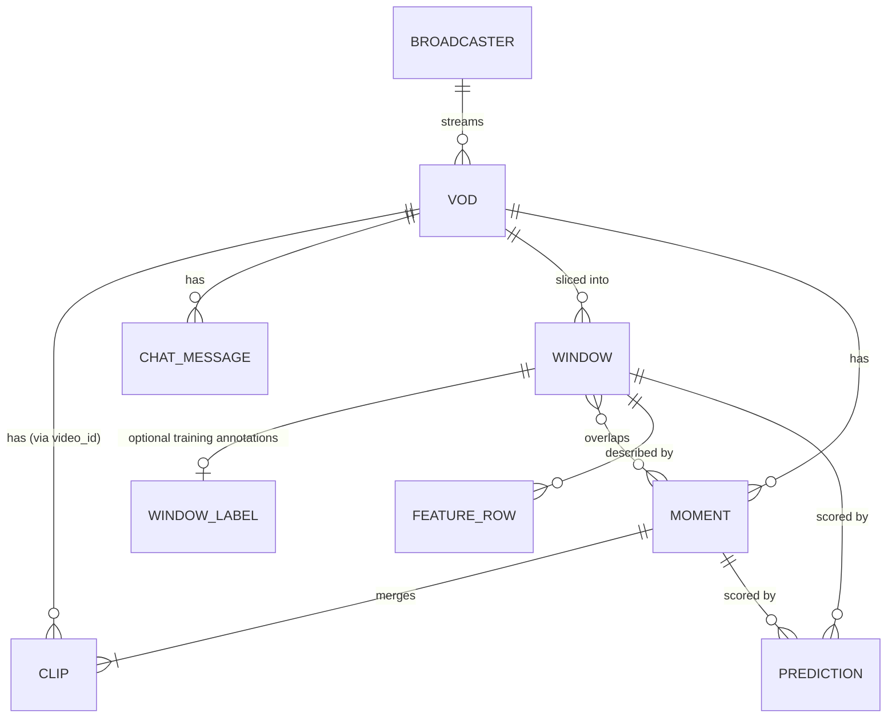

# Data Model

| | |
|---|---|
| **Status** | Proposal. Storage acceptance alone does not ratify schemas; adopt the relevant contracts explicitly under ADR-0009/OQ-15. |
| **Last updated** | 2026-10-13 |

These are the tables that pipeline stages exchange. **Any schema change, including adding a nullable column, requires an ADR or ADR update in the same PR** (see [AGENTS.md § Hard rules](../../AGENTS.md#6-hard-rules-never-break-these)), because it can break downstream stages and invalidate past results. Document the change here too.

## Conventions

- **Storage:** Parquet, one file per table, or partitioned by `video_id` for large tables.
- **IDs:** Twitch IDs are **strings**, kept exactly as the API returns them.
- **VOD time:** `float64` seconds from VOD start, with column names ending `_s`.
- **Wall-clock time:** `timestamp[us, tz=UTC]`, column names ending `_at`.
- **Pseudonymized user identifiers:** `str` HMAC-SHA256 hex digests (salted, see `.env.example`), column names ending `_hash`.
- **Nullability:** every column is non-null unless marked *nullable*.

## Entity relationships



---

## `broadcasters`

| Column | Type | Notes |
|---|---|---|
| `broadcaster_id` | str | Twitch user ID |
| `login` | str | Channel login name (public) |
| `display_name` | str | |
| `broadcaster_type` | str | `partner`, `affiliate` or `""` (affects VOD retention) |
| `fetched_at` | timestamp | |

Streamer identities are public and not pseudonymized. Chatters are (see `chat_messages`).

## `vods`

Source: Helix **Get Videos**.

| Column | Type | Notes |
|---|---|---|
| `video_id` | str | Primary key |
| `broadcaster_id` | str | FK → `broadcasters` |
| `stream_id` | str, *nullable* | |
| `title` | str | |
| `created_at` | timestamp | API video creation time; not a verified live-stream clock origin |
| `duration_s` | float | Parsed from Twitch's `"3h8m33s"` format |
| `type` | str | `archive` (past broadcast), `highlight`, `upload`. We use `archive`. |
| `language` | str | |
| `view_count` | int | At fetch time |
| `muted_segments` | list<struct<offset_s: float, duration_s: float>> | Normalize the API's documented `null` (none muted) to `[]`; an absent/malformed field is a validation error, not implicitly no muting |
| `game_ids` | list<str>, *nullable* | If derivable. Clip-derived categories are analysis metadata, excluded from independent-discovery inputs. |
| `fetched_at` | timestamp | |

## `clips`

Source: Helix **Get Clips**. Proposed immutable snapshot files: one row per `clip_id` **within a snapshot**, stored under `data/processed/clips/<snapshot_id>.parquet`. Deduplicate query overlaps within that snapshot; never overwrite an earlier observation. A manifest pins snapshot ID, capture start/end in UTC, discovery ranges/horizon, coverage status and file path. Each row retains its actual `fetched_at`; a paginated capture is not an instantaneous historical snapshot. The logical observation key is `(snapshot_id, clip_id)`.

| Column | Type | Notes |
|---|---|---|
| `clip_id` | str | Unique within the selected snapshot |
| `video_id` | str, *nullable* | FK → `vods`. Normalize the API's empty string to null when no VOD link exists. |
| `broadcaster_id` | str | |
| `creator_hash` | str | Pseudonymized clip creator |
| `title` | str | Written by the clipper. May be useful as weak text signal. |
| `game_id` | str | Category at clip time |
| `language` | str | |
| `created_at` | timestamp | When the clip was made |
| `vod_offset_s` | float, *nullable* | Clip start in the VOD. **Null** happens (VOD deleted, processing delay). Such rows are excluded from labeling. |
| `duration_s` | float | Source interval length; parse the API value, do not assume a universal 60 s maximum |
| `view_count` | int | At `fetched_at`. Grows over time, so always store when it was observed. |
| `is_featured` | bool, *nullable* | |
| `fetched_at` | timestamp | |

## `chat_messages`

Source: TwitchDownloader chat replay (proposed) or live chat. This is a **transient parsing representation**, partitioned by `video_id`, not authorization to retain/share per-message text or persistent hashes. OQ-9 chooses aggregate-only retention (source design) versus sanitized messages for a justified period before real ingestion. Hashes are needed only for approved features such as unique-chatter counts; retained messages remain potentially identifying.

| Column | Type | Notes |
|---|---|---|
| `video_id` | str | |
| `offset_s` | float | Message time from VOD start |
| `user_hash` | str | Pseudonymized author. **Never store raw names.** |
| `text` | str | Message text. May contain other users' @-mentions. See governance for the redaction policy. |
| `emote_ids` | list<str> | Native Twitch emotes in the message |
| `n_emotes` | int | Including third-party emotes where detectable |
| `is_subscriber` | bool, *nullable* | From badges |
| `is_moderator` | bool, *nullable* | From badges |
| `bits` | int | 0 if none |
| `source` | str | `replay` or `live` |

## `moments`

Derived from **one pinned clips snapshot** and one label-rules version in [labeling](../data/labeling.md#2-from-clips-to-moments). Record these in the dataset manifest; do not aggregate historical rows across snapshots or count them as distinct clips. Early-ranking candidates and later outcome groups are separate populations with explicit mapping (OQ-1).

| Column | Type | Notes |
|---|---|---|
| `moment_id` | str | Deterministic and unique within the pinned dataset; exact format awaits grouping adoption (ADR-0009). Rounded starts alone do not guarantee uniqueness. |
| `video_id` | str | |
| `start_s` | float | Earliest start among member clips |
| `end_s` | float | Latest end among member clips |
| `n_clips` | int | Number of distinct viewer clips merged |
| `total_views` | int | Sum of member clip views (at observation time) |
| `max_views` | int | |
| `first_clip_created_at` | timestamp | Lets us measure how fast viewers clipped the moment |
| `clip_ids` | list<str> | |
| `views_observed_at` | timestamp | Latest member `fetched_at` in the selected snapshot; not an assertion that all counts were observed simultaneously |

## `windows`

Fixed-length slices of each VOD, available **without labels or a training split**. Built using the proposed [windowing rules](../data/labeling.md#3-windows); feature extraction consumes these signal windows.

| Column | Type | Notes |
|---|---|---|
| `window_id` | str | `{video_id}:{index}` |
| `video_id` | str | |
| `index` | int | 0-based |
| `start_s` | float | |
| `end_s` | float | |
| `is_muted` | bool | Overlaps a muted segment |

## `window_labels` (training/evaluation only, proposal)

Separate annotations keyed by `window_id`, derived from a pinned observed-clips snapshot and saved split. No annotation row means **unavailable ground truth**, not `False`. Never require this table to analyze a new VOD. In a covered weak-label dataset, `False` denotes no observed overlap, not verified absence of a highlight.

| Column | Type | Notes |
|---|---|---|
| `window_id` | str | FK → `windows`, unique in the dataset version |
| `label_pos` | bool | Window overlaps an observed moment in source-video time; labels are never chat-lag shifted |
| `label_n_clips` | int | Graded label: clips overlapping this window |
| `label_moment_id` | str, *nullable* | |
| `split` | str | `train`, `val` or `test`, from the saved split file |

## `features_<family>`

One table per adopted signal family (`features_chat`, `features_audio`, optional `features_video`), keyed by `window_id`. Proposed definitions live in [features](../ml/features.md); adopt the task's relevant subset explicitly.

| Column | Type | Notes |
|---|---|---|
| `window_id` | str | Join key |
| `<feature columns>` | float | Named `<family>_<signal>_<stat>`, e.g. `chat_msg_rate_z` |
| `feature_version` | str | Bumped when a feature's definition changes |

## `predictions`

| Column | Type | Notes |
|---|---|---|
| `run_id` | str | Experiment/run that produced it |
| `target_type` | str | `window` or `moment` |
| `target_id` | str | `window_id` or `moment_id` |
| `score` | float | Higher = more clip-worthy |
| `top_signals` | list<str>, *nullable* | For explanations (v2) |

## `candidates` (API/CLI output, JSON)

What `autoclipper analyze` returns and what the UI renders.

```json
{
  "video_id": "1234567890",
  "model_run_id": "exp-007",
  "candidates": [
    {
      "candidate_id": "1234567890:15342",
      "rank": 1,
      "score": 0.93,
      "start_s": 15342.0,
      "end_s": 15372.0,
      "source": "viewer_clips",
      "n_viewer_clips": 14,
      "top_signals": ["chat_msg_rate_z", "audio_rms_max_z"]
    }
  ]
}
```

The example is synthetic and describes no run or measured score. `source` describes **how the candidate was generated**, not whether ground truth overlaps it. API, heuristic, learned or combined provenance and the final enum/output shape require adoption under ADR-0009; the earlier binary `viewer_clips`/`model` example is not sufficient for all proposed strategies.

## `catalog`

| Column | Type | Notes |
|---|---|---|
| `object_type` | str | `vod_meta`, `clips`, `chat`, `audio`, … |
| `object_key` | str | Usually `video_id` |
| `status` | str | `ok`, `failed`, `unavailable` (e.g. VOD deleted) |
| `tool` | str | e.g. `helix`, `twitchdownloader@1.x`, `yt-dlp@2026.x` |
| `stage_version` | str | |
| `created_at` | timestamp | |
| `error` | str, *nullable* | |

## Dataset versioning

A **dataset version** (e.g. `v1`) pins: VOD IDs, immutable snapshot IDs/manifests, capture times and coverage, label/feature/preprocessing versions, retained source availability and the saved split. It's recorded in `data/splits/<version>.json` with counts. Inference runs record their inputs and stage versions without inventing a training split. Experiments always cite a dataset version; bump it when any pinned input or contract changes, never edit one in place.
