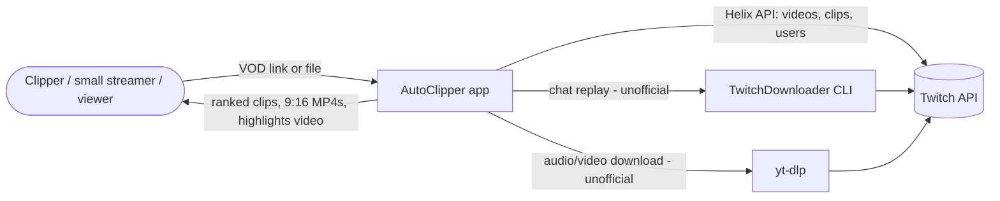
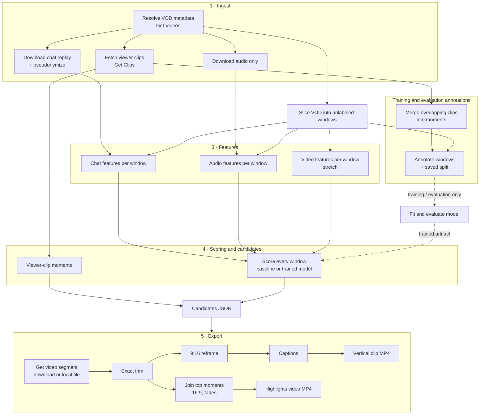

# Architecture Overview

| | |
|---|---|
| **Status** | The plan of record. Ingest, config, the FFmpeg runner and the synthetic dataset exist ([status](../project/status.md)); the rest is being built. |
| **Last updated** | 2026-10-31 |
| **Related** | [Data model](data-model.md) · [API contract](api-contract.md) · [Conventions](../development/conventions.md) · [Tooling](../decisions/0002-language-and-tooling.md) · [Storage](../decisions/0005-local-storage-parquet-duckdb.md) · [Application stack](../decisions/0007-web-application-stack.md) |

---

## 1. Design principles

1. **A pipeline of idempotent stages.** Each stage reads files and writes files. Re-running a stage with the same inputs produces the same outputs and skips work that's already done. This makes the system debuggable, cacheable and agent-friendly: every stage can be built and tested on its own.
2. **Files are the interface.** Stages communicate through versioned Parquet/JSON artifacts with documented schemas ([data model](data-model.md)), not through in-memory coupling. Any stage can be swapped as long as it honors the contract.
3. **Reusable processing, parallel interface development.** Pipeline logic lives in the `autoclipper` Python package; CLI/app adapters call it. Build UI and export prototypes with synthetic candidates while processing/ML develops. The product includes the complete app flow, initially runnable on a laptop and adaptable to hosted deployment.
4. **Cheap signals first.** Chat and audio are per-second numbers that are cheap to compute and strong. Video is expensive and optional ([build order](../decisions/0004-staged-scope-chat-and-audio-first.md)).
5. **Practical compute.** Start with laptop-scale chat/audio analysis. Shared workers, storage and hosted deployment can be added for the workload; the initial setup needs no cloud services.
6. **One time base.** Inside the pipeline, every position is **seconds from VOD start** (`*_s`). Wall-clock time is only used for metadata.

## 2. System context



## 3. Pipeline



### Stage responsibilities

| # | Stage | Input | Output | Planned module |
|---|---|---|---|---|
| 1a | Resolve VOD | VOD URL or ID | `vods` row | `autoclipper.ingest.twitch_api` |
| 1b | Fetch clips | `video_id` (+ broadcaster, date range) | `clips` rows | `autoclipper.ingest.twitch_api` |
| 1c | Chat replay | `video_id` | `chat_messages` (pseudonymized) | `autoclipper.ingest.chat` |
| 1d | Audio | `video_id` | audio file (e.g. 16 kHz mono) | `autoclipper.ingest.media` |
| 2a | Moments | `clips` | `moments` | `autoclipper.labels.moments` |
| 2b | Windows | `vods` | unlabeled `windows` | `autoclipper.labels.windows` |
| — | Training annotations | `windows`, pinned `moments`, split | `window_labels` | `autoclipper.labels.windows` |
| 3 | Features | `windows`, chat, audio | `features_*` tables | `autoclipper.features.{chat,audio,video}` |
| 4 | Scoring | signal features + trained artifact (or a baseline); viewer-clip moments when the VOD has them | `predictions`, candidates | `autoclipper.models` |
| — | Training | features + annotations + split | model artifact | `autoclipper.models` |
| — | Evaluation | predictions + labels + split | metrics report | `autoclipper.eval` |
| 5a | Clip export | candidate + video | 9:16 MP4 | `autoclipper.export` |
| 5b | Highlights video | list of candidates + video | 16:9 MP4 | `autoclipper.export.highlights` |

## 4. Components in more detail

### 4.1 Ingest

- **Twitch API client:** app access token via the OAuth client-credentials flow, cached until expiry. One small wrapper per endpoint used, with typed response models. Handles pagination cursors, `429` + `Ratelimit-Reset` backoff, and retries on `5xx`. See [data sources](../data/data-sources.md).
- **Chat:** the TwitchDownloader wrapper parses the raw JSON, hashes and redacts identities, and deletes the raw file; the ingest command keeps the pseudonymized messages and features are per-window aggregates ([data sources and delivery](../decisions/0011-data-sources-and-local-delivery.md)).
- **Media:** download audio for analysis with yt-dlp or TwitchDownloader. For previews and exports, fetch only the needed video segments, or read the VOD file the user already has. Keep the demo VODs' media locally before they expire.
- **Catalog:** every ingested object is recorded in a catalog table (what, when, tool version, status) so collection is resumable and auditable.

### 4.2 Moments and labels

- **Moments:** overlapping viewer clips for the same VOD are clustered into one *moment* with aggregate stats (clip count, total views, earliest creation). This removes duplicate-clip noise.
- **Windows:** 10 s slices cover the VOD independently of labels. Training/evaluation annotations come from pinned moments in a separate table; inference windows need no labels or split. Window size stays tunable in experiments ([labeling](../data/labeling.md)).

### 4.3 Features

Pure functions from (unlabeled window table + signal) → feature table. Normalize within the current input VOD offline, or use a rolling baseline; fit learned cross-dataset transforms on train only. Apply the same versioned clip-announcement filter during training/inference. Candidate features are in [features](../ml/features.md).

### 4.4 Models

- A thin, consistent interface: `fit(train_df) → model`, `score(df) → scores`, `save/load`.
- Baselines implement the same interface, so evaluation code treats every model the same way.
- Model artifacts are saved under `artifacts/models/<run_id>/` with their config, feature list, dataset version and git SHA.

One scorer scores every window of the VOD from chat and audio; candidates (20–45 s) are built around score peaks and merged with viewer-clip moments when the VOD has clips ([modeling plan](../ml/modeling-plan.md), #27). The app ships whichever scorer wins the evaluation (#47). Zero-clip evaluation hides clip data from the scorer; ground truth joins afterward.

### 4.5 Evaluation

A single harness takes predictions + labels + a saved split and produces the metric suite from [evaluation](../ml/evaluation.md), with bootstrap confidence intervals. All reported numbers come from this harness.

### 4.6 Export

FFmpeg-based. Every FFmpeg call goes through `autoclipper.ffmpeg`: commands are argument lists run with a timeout, and `probe` reads duration and streams. There are two outputs.

**Vertical clips** (the app requests them for the top 10 when analysis finishes, and again after a trim):

1. Get the video: fetch the segment with TwitchDownloader or yt-dlp, or read the user's local VOD file.
2. Preview and trim the already aligned VOD interval, respecting manual adjustments and clamping to media bounds. Chat-time heuristics align once during candidate generation; export never applies another lag shift. Context padding is separate and explicit.
3. Basic 9:16 crop or configured layout; other aspect ratios and detection-based smart crop are optional.
4. Captions: speech-to-text (faster-whisper, CPU-capable) → word timestamps → burned-in subtitles.
5. Encode H.264/AAC, 1080×1920, at most 90 s.

**Highlights video** (on request):

1. Take the chosen moments (default: the top 10 with their current trims), in stream order or rank order.
2. Cut each exactly like a clip, keeping the original 16:9 framing at 1920×1080 (letterboxed if the source isn't 16:9).
3. Optional captions, off by default.
4. Join with a 0.5 s fade through black and encode one H.264/AAC MP4, at most 15 minutes.

Clip exports and highlights videos share one render queue (one render at a time). Rendered files stay in `artifacts/` until the user deletes them; the server never deletes them on its own.

Analytical results stay usable when video is unavailable (VOD deleted, subscriber-only, download failed): return candidates with a clear media-unavailable status and disable preview/export with an actionable explanation. Never claim an export succeeded or invent replacement media.

### 4.7 Interfaces

- **CLI** (`autoclipper …`) is the primary interface for development and data work. Planned subcommands: `ingest`, `build-dataset`, `features`, `train`, `evaluate`, `analyze`, `export`, `highlights`, `serve`.
- **Web API** (FastAPI, [web stack](../decisions/0007-web-application-stack.md)), versioned under `/api/v1` and started by `autoclipper serve` on localhost: jobs, results, per-candidate media, clip exports and the highlights video, as specified in the [API contract](api-contract.md). Long-running work runs in an in-process background worker with bounded concurrency and explicit failure states; that's enough for a local single-user app.
- **Web app** (Next.js + TypeScript + Tailwind): start → progress → ranked clip cards → preview and trim → download, plus "Make highlights video". Built early against mock data; preview plays local files.
- **Distribution** (stretch, #70): a project website with a packaged app download, and a link to a hosted app if deployed. Local execution is the first supported setup; hosting can extend it as needed.

## 5. Storage layout

Everything below is **git-ignored**. See [storage](../decisions/0005-local-storage-parquet-duckdb.md).

```text
data/
├── raw/                         # exactly as downloaded; never edited
│   ├── api/<endpoint>/<date>/…json
│   ├── chat/<video_id>.json     # TwitchDownloader output; deleted after parsing
│   └── audio/<video_id>.m4a
├── interim/                     # parsed, pseudonymized, per-VOD
│   ├── chat/<video_id>.parquet # pseudonymized messages (hashed authors, redacted text)
│   └── audio/<video_id>.wav     # 16 kHz mono, for feature extraction
├── processed/                   # analysis-ready tables (see data-model.md)
│   ├── vods.parquet
│   ├── clips/<snapshot_id>.parquet  # immutable observation + manifest
│   ├── moments.parquet
│   ├── windows.parquet
│   ├── window_labels.parquet    # training/evaluation only
│   └── features/<family>.parquet
├── splits/<dataset_version>.json
└── catalog.parquet
artifacts/
├── models/<run_id>/
├── reports/<run_id>/
├── exports/<export_id>.mp4      # one file per clip export; candidate_id repeats across results
└── highlights/<highlights_id>.mp4  # one file per highlights video
```

## 6. Cross-cutting concerns

| Concern | Approach |
|---|---|
| Configuration | One config module that reads env vars (`.env.example`) with typed defaults. CLI flags override env. |
| Logging | Python `logging`, structured key=value messages. Never log secrets. |
| Errors | Fail loudly with actionable messages. Stage-level retry for network errors only. Never silently drop rows: count and log them. |
| Idempotency | Key outputs by inputs (including snapshot/dataset IDs) and stage version. A refresh is a new observation; `--force` must not overwrite pinned historical inputs. |
| Versioning | `dataset_version` for processed data. Each stage records its code version. Each run records its git SHA. |
| Chat | Author IDs hashed at parse time (enough for unique-chatter counts); the raw replay file is deleted after parsing to save space; features are per-window aggregates. See [data handling](../data/data-governance.md). |
| Testing | Unit tests on pure functions with synthetic fixtures. No network in unit tests. See [testing](../development/testing.md). |

## 7. Initial infrastructure defaults

- Parquet + DuckDB for pipeline data; in-memory API job records and files for results and exports.
- An in-process worker for analysis and rendering; a separate worker or queue can be added when needed.
- A laptop for the first development and demo setup. Shared collection, shared storage and hosted deployment are valid options.
- Load the trained model in the API process initially; add serving infrastructure only when it solves a measured need.

These defaults keep the first implementation small. Adapt them in the same change as the feature or deployment that needs something different, keeping the API and data contracts current.
