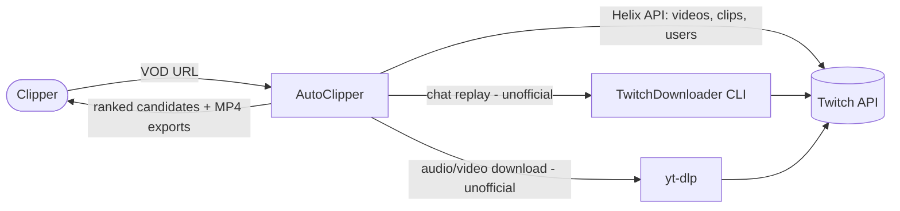
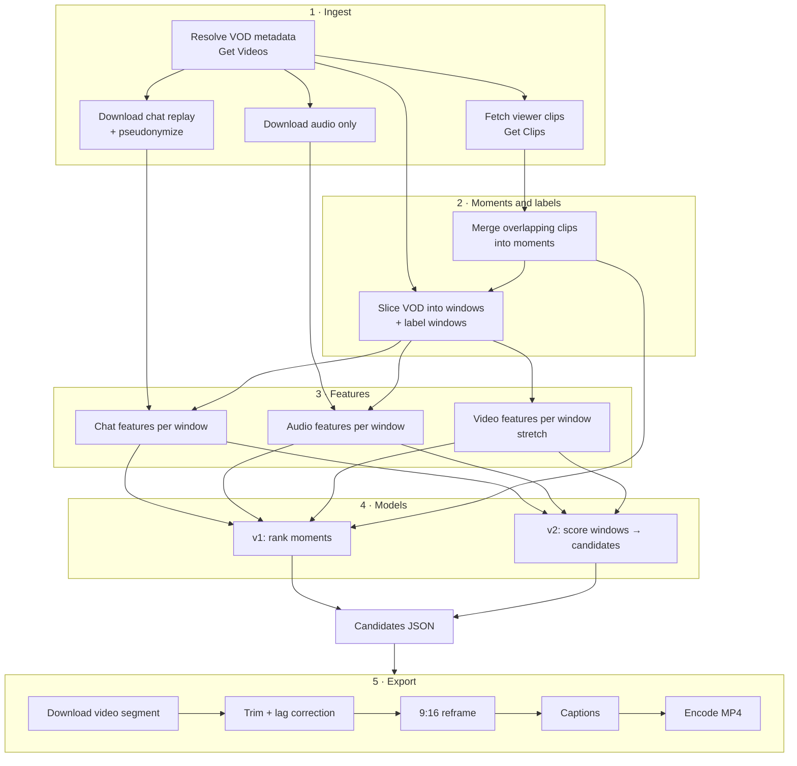

# Architecture Overview

| | |
|---|---|
| **Status** | Proposal. Describes the planned system. **Nothing here is implemented yet.** |
| **Last updated** | 2026-10-09 |
| **Related** | [Data model](data-model.md) · ADR [0002](../decisions/0002-language-and-tooling.md), [0003](../decisions/0003-repository-layout.md), [0005](../decisions/0005-local-storage-parquet-duckdb.md), [0007](../decisions/0007-web-application-stack.md) |

---

## 1. Design principles

1. **A pipeline of idempotent stages.** Each stage reads files and writes files. Re-running a stage with the same inputs produces the same outputs and skips work that's already done. This makes the system debuggable, cacheable and agent-friendly: every stage can be built and tested on its own.
2. **Files are the interface.** Stages communicate through versioned Parquet/JSON artifacts with documented schemas ([data model](data-model.md)), not through in-memory coupling. Any stage can be swapped as long as it honors the contract.
3. **Library first, then CLI, then API and UI.** All logic lives in the `autoclipper` Python package. The CLI is a thin wrapper. The web API is a thin wrapper around the same functions. Nothing important lives only in a notebook or only in the UI.
4. **Cheap signals first.** Chat and audio are per-second numbers that are cheap to compute and strong. Video is expensive and optional ([ADR-0004](../decisions/0004-staged-scope-chat-and-audio-first.md)).
5. **Laptop scale.** No GPU, cluster or cloud dependency for v1/v2. Audio-only downloads keep data small.
6. **One time base.** Inside the pipeline, every position is **seconds from VOD start** (`*_s`). Wall-clock time is only used for metadata.

## 2. System context



## 3. Pipeline



### Stage responsibilities

| # | Stage | Input | Output | Planned module |
|---|---|---|---|---|
| 1a | Resolve VOD | VOD URL or ID | `vods` row | `autoclipper.ingest.twitch_api` |
| 1b | Fetch clips | `video_id` (+ broadcaster, date range) | `clips` rows | `autoclipper.ingest.twitch_api` |
| 1c | Chat replay | `video_id` | `chat_messages` (pseudonymized) | `autoclipper.ingest.chat` |
| 1d | Audio | `video_id` | audio file (e.g. 16 kHz mono) | `autoclipper.ingest.media` |
| 2a | Moments | `clips` | `moments` | `autoclipper.labels.moments` |
| 2b | Windows | `vods`, `moments` | `windows` (+ labels) | `autoclipper.labels.windows` |
| 3 | Features | `windows`, chat, audio | `features_*` tables | `autoclipper.features.{chat,audio,video}` |
| 4 | Models | features + labels + split | model artifact, `predictions` | `autoclipper.models` |
| — | Evaluation | predictions + labels + split | metrics report | `autoclipper.eval` |
| 5 | Export | candidate + video | MP4 | `autoclipper.export` |

## 4. Components in more detail

### 4.1 Ingest

- **Twitch API client:** app access token via the OAuth client-credentials flow, cached until expiry. One small wrapper per endpoint used, with typed response models. Handles pagination cursors, `429` + `Ratelimit-Reset` backoff, and retries on `5xx`. See [data sources](../data/data-sources.md).
- **Chat:** wraps the TwitchDownloader CLI (subprocess). Parses its JSON into `chat_messages`, hashing usernames and user IDs at parse time. The raw JSON is deleted or kept only in the ignored `data/raw/` folder.
- **Media:** wraps yt-dlp (subprocess or Python API). The default is **audio only**. Video segments are fetched on demand at export time, never the full video.
- **Catalog:** every ingested object is recorded in a catalog table (what, when, tool version, status) so collection is resumable and auditable.

### 4.2 Moments and labels

- **Moments:** overlapping viewer clips for the same VOD are clustered into one *moment* with aggregate stats (clip count, total views, earliest creation). This removes duplicate-clip noise.
- **Windows:** fixed-length windows (proposal: 10 s, with a stride equal to the length) cover the VOD. Each window gets labels derived from moments (binary + graded). The exact rules, including chat-lag handling and clip-start bias, are in [labeling](../data/labeling.md).

### 4.3 Features

Pure functions from (window table + raw signal) → feature table, one module per signal family. Window-relative normalization (z-scores against the stream's own rolling baseline) is essential, because chat rate varies by orders of magnitude between channels. The catalog is in [features](../ml/features.md).

### 4.4 Models

- A thin, consistent interface: `fit(train_df) → model`, `predict(df) → scores`, `save/load`.
- Baselines implement the same interface, so evaluation code treats every model the same way.
- Model artifacts are saved under `artifacts/models/<run_id>/` with their config, feature list, dataset version and git SHA.

### 4.5 Evaluation

A single harness takes predictions + labels + a saved split and produces the metric suite from [evaluation](../ml/evaluation.md), with bootstrap confidence intervals. All reported numbers come from this harness.

### 4.6 Export

FFmpeg-based:

1. Fetch only the needed video segment (with padding).
2. Trim, applying lag correction and padding rules.
3. Reframe to 9:16. v1: center crop or a fixed "facecam on top, gameplay below" layout with configurable crop boxes. v2: detection-based (face detector to locate the facecam).
4. Captions: speech-to-text (faster-whisper, CPU-capable) → word timestamps → burned-in subtitles.
5. Encode H.264/AAC, 1080×1920.

### 4.7 Interfaces

- **CLI** (`autoclipper …`) is the primary interface for development and data work. Planned subcommands: `ingest`, `collect`, `build-dataset`, `features`, `train`, `eval`, `analyze`, `export`.
- **Web API** (FastAPI, proposal): `POST /jobs` (VOD URL) → job ID. `GET /jobs/{id}` → status + candidates. `POST /exports` → MP4. Long-running work runs in a background worker. A simple in-process queue is enough for a single-user demo.
- **Web UI** (Next.js, proposal): paste URL → progress → timeline heat-strip with clip markers and model scores → ranked candidate list → preview → export.

## 5. Storage layout (proposal)

Everything below is **git-ignored**. See [ADR-0005](../decisions/0005-local-storage-parquet-duckdb.md).

```text
data/
├── raw/                         # exactly as downloaded; never edited
│   ├── api/<endpoint>/<date>/…json
│   ├── chat/<video_id>.json     # TwitchDownloader output (contains usernames, local only)
│   └── audio/<video_id>.m4a
├── interim/                     # parsed, pseudonymized, per-VOD
│   ├── chat/<video_id>.parquet
│   └── audio/<video_id>.wav     # 16 kHz mono, for feature extraction
├── processed/                   # analysis-ready tables (see data-model.md)
│   ├── vods.parquet
│   ├── clips.parquet
│   ├── moments.parquet
│   ├── windows.parquet
│   └── features/<family>.parquet
├── splits/<dataset_version>.json
└── catalog.parquet
artifacts/
├── models/<run_id>/
├── reports/<run_id>/
└── exports/<candidate_id>.mp4
```

## 6. Cross-cutting concerns

| Concern | Approach |
|---|---|
| Configuration | One config module that reads env vars (`.env.example`) with typed defaults. CLI flags override env. |
| Logging | Python `logging`, structured key=value messages. Never log secrets or raw usernames. |
| Errors | Fail loudly with actionable messages. Stage-level retry for network errors only. Never silently drop rows: count and log them. |
| Idempotency | Stages check for existing outputs (keyed by input IDs + stage version) and skip unless `--force` is passed. |
| Versioning | `dataset_version` for processed data. Each stage records its code version. Each run records its git SHA. |
| Privacy | Pseudonymize at ingest. Raw chat stays local in `data/raw/`. See [governance](../data/data-governance.md). |
| Testing | Unit tests on pure functions with synthetic fixtures. No network in unit tests. See [testing](../development/testing.md). |

## 7. What's deliberately not in the architecture

- No database server. Parquet + DuckDB is enough at our scale.
- No distributed processing or message broker. Revisit only for live mode.
- No cloud deployment requirement for the demo.
- No model serving infrastructure beyond loading a pickled/ONNX model in the API process.
