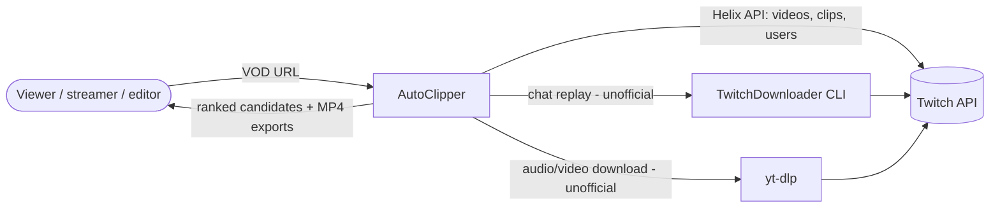
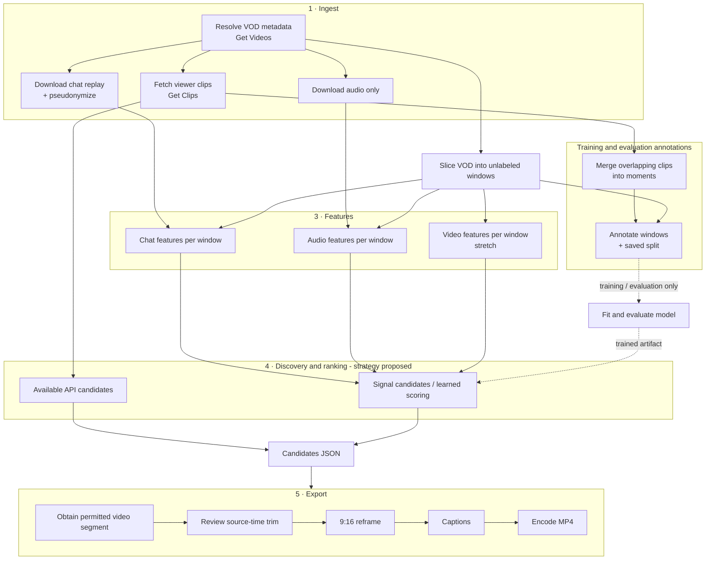

# Architecture Overview

| | |
|---|---|
| **Status** | Planned system. **Nothing here is implemented yet.** Stack choices are accepted in ADR-0002/0003/0005/0007; details marked "proposal" still need agreement. |
| **Last updated** | 2026-10-19 |
| **Related** | [Data model](data-model.md) · [API contract](api-contract.md) (proposed) · ADR [0002](../decisions/0002-language-and-tooling.md), [0003](../decisions/0003-repository-layout.md), [0005](../decisions/0005-local-storage-parquet-duckdb.md), [0007](../decisions/0007-web-application-stack.md) |

---

## 1. Design principles

1. **A pipeline of idempotent stages.** Each stage reads files and writes files. Re-running a stage with the same inputs produces the same outputs and skips work that's already done. This makes the system debuggable, cacheable and agent-friendly: every stage can be built and tested on its own.
2. **Files are the interface.** Stages communicate through versioned Parquet/JSON artifacts with documented schemas ([data model](data-model.md)), not through in-memory coupling. Any stage can be swapped as long as it honors the contract.
3. **Reusable processing, parallel interface development.** Pipeline logic lives in the `autoclipper` Python package; CLI/app adapters call it. Build UI and export prototypes with synthetic candidates while processing/ML develops. The finished semester product is an app, not a CLI demonstration.
4. **Cheap signals first.** Chat and audio are per-second numbers that are cheap to compute and strong. Video is expensive and optional ([ADR-0004](../decisions/0004-staged-scope-chat-and-audio-first.md)).
5. **Laptop scale.** No GPU, cluster or cloud dependency for v1/v2. Audio-only downloads keep data small.
6. **One time base.** Inside the pipeline, every position is **seconds from VOD start** (`*_s`). Wall-clock time is only used for metadata.

## 2. System context



## 3. Pipeline



### Stage responsibilities

| # | Stage | Input | Output | Planned module |
|---|---|---|---|---|
| 1a | Resolve VOD | VOD URL or ID | `vods` row | `autoclipper.ingest.twitch_api` |
| 1b | Fetch clips | `video_id` (+ broadcaster, date range) | `clips` rows | `autoclipper.ingest.twitch_api` |
| 1c | Chat replay | `video_id` | `chat_messages` (pseudonymized) | `autoclipper.ingest.chat` |
| 1d | Audio | `video_id` | audio file (e.g. 16 kHz mono) | `autoclipper.ingest.media` |
| 2a | Moments | `clips` | `moments` | `autoclipper.labels.moments` |
| 2b | Windows | `vods` | unlabeled `windows` | `autoclipper.labels.windows` |
| — | Training annotations | `windows`, pinned `moments`, split | `window_labels` | `autoclipper.labels.windows` |
| 3 | Features | `windows`, chat, audio | `features_*` tables | `autoclipper.features.{chat,audio,video}` |
| 4 | Scoring | signal features + trained artifact; available API info only in declared assisted setups | `predictions`, candidates | `autoclipper.models` |
| — | Training | features + annotations + split | model artifact | `autoclipper.models` |
| — | Evaluation | predictions + labels + split | metrics report | `autoclipper.eval` |
| 5 | Export | candidate + video | MP4 | `autoclipper.export` |

## 4. Components in more detail

### 4.1 Ingest

- **Twitch API client:** app access token via the OAuth client-credentials flow, cached until expiry. One small wrapper per endpoint used, with typed response models. Handles pagination cursors, `429` + `Ratelimit-Reset` backoff, and retries on `5xx`. See [data sources](../data/data-sources.md).
- **Chat:** proposed TwitchDownloader wrapper parses raw JSON transiently, redacts identities and applies the approved privacy policy. OQ-9 must choose retained aggregates versus sanitized messages before real ingestion; ignored storage is not permission to keep raw chat.
- **Media:** obtain authorized audio for analysis and video for review/export using an approved source. On-demand segments are a cost-saving proposal, not a guarantee of future availability. Secure a small permitted demo/evaluation media set before expiry; creator-provided recordings are another source to assess (OQ-17).
- **Catalog:** every ingested object is recorded in a catalog table (what, when, tool version, status) so collection is resumable and auditable.

### 4.2 Moments and labels

- **Moments:** overlapping viewer clips for the same VOD are clustered into one *moment* with aggregate stats (clip count, total views, earliest creation). This removes duplicate-clip noise.
- **Windows:** proposed 10 s slices cover the VOD independently of labels. Training/evaluation annotations come from pinned moments in a separate table; inference windows need no labels or split. Window size and grouping remain proposals ([labeling](../data/labeling.md), ADR-0009).

### 4.3 Features

Pure functions from (unlabeled window table + signal) → feature table. Normalize within the current input VOD offline, or use a rolling baseline; fit learned cross-dataset transforms on train only. Apply the same versioned clip-announcement filter during training/inference. Candidate features are in [features](../ml/features.md).

### 4.4 Models

- A thin, consistent interface: `fit(train_df) → model`, `predict(df) → scores`, `save/load`.
- Baselines implement the same interface, so evaluation code treats every model the same way.
- Model artifacts are saved under `artifacts/models/<run_id>/` with their config, feature list, dataset version and git SHA.

The architecture does not require separate ranker and detector models. API-assisted candidates, whole-VOD scoring or signal shortlisting with learned reranking remain alternatives. Independent-discovery evaluation hides clip metadata through candidate selection; ground truth joins afterward.

### 4.5 Evaluation

A single harness takes predictions + labels + a saved split and produces the metric suite from [evaluation](../ml/evaluation.md), with bootstrap confidence intervals. All reported numbers come from this harness.

### 4.6 Export

FFmpeg-based. Every FFmpeg call goes through `autoclipper.ffmpeg`: commands are argument lists run with a timeout, and `probe` reads duration and streams.

1. Check source-video availability and the approved access/display/export basis; fetch a permitted segment or use retained authorized media.
2. Preview and trim the already aligned VOD interval, respecting manual adjustments and clamping to media bounds. Chat-time heuristics align once during candidate generation; export never applies another lag shift. Context padding is separate and explicit. `autoclipper.export.cut` pads first, then clamps to the span that the video and audio streams used both cover (at the end of a VOD the audio often stops a little before the video), reports the requested and actual intervals separately, and refuses an interval that starts after the media ends or leaves less than 0.5 s inside it. The cut is frame-accurate at non-keyframe starts: decoding begins at the last video keyframe at or before the start (`autoclipper.export.seek`, read from the packet list with ffprobe), however far apart keyframes are and in containers without an index (MPEG-TS).
3. Basic 9:16 crop or configured layout; other aspect ratios and detection-based smart crop are optional. Layouts (`autoclipper.export.reframe`): `center_crop` (the largest centered 9:16 area) and `fixed_region` (a rectangle in normalized source coordinates, padded with black to fit 9:16 by default, or cropped to 9:16 with `fit="crop"`).
4. Captions: speech-to-text (faster-whisper, CPU-capable) → word timestamps → burned-in subtitles.
5. Encode H.264/AAC, 1080×1920 (`autoclipper.export.encode.export_clip`): libx264 `yuv420p`, constant 30 fps by default, `+faststart`, stereo AAC; a source without audio gets a silent AAC track. The MP4 is written to a temporary file and moved into place only after its probe matches (H.264 1080×1920 + AAC, and each stream covering the whole clip, so a clip whose decoding didn't start at the requested frame is an error), so a failed export leaves nothing at the output path. Without `overwrite` the move never replaces a file, even one created during the encode.

Analytical results may remain usable when video is unavailable. Return candidates with clear media-unavailable status and disable preview/export with an actionable explanation; do not claim an export succeeded or invent replacement media. Saved features/audio cannot recreate source video. A saved Twitch clip may cover only part of the desired interval and is not a guarantee that additional context can be fetched. Retained demo media follows source-specific permissions and deletion requirements ([governance](../data/data-governance.md)).

### 4.7 Interfaces

- **CLI** (`autoclipper …`) is the primary interface for development and data work. Planned subcommands: `ingest`, `collect`, `build-dataset`, `features`, `train`, `eval`, `analyze`, `export`.
- **Web API** (FastAPI, ADR-0007), versioned under `/api/v1`: `POST /api/v1/jobs` → job ID; job status, results and per-candidate media endpoints; export create/status/download endpoints. Endpoints, payloads, error codes, polling and restart behavior are drafted in the [API contract](api-contract.md) (**proposed, awaiting team adoption in #13**). Long-running work runs outside request handling with bounded concurrency, explicit failure states and documented restart behavior. An in-process queue is enough for the local single-user demo; hosted infrastructure is decided under OQ-18.
- **Web app** (Next.js + TypeScript + Tailwind, ADR-0007): input → progress/errors → understandable shortlist/timeline → preview → basic trim → export. Build this flow early with synthetic candidates; player/display choice follows OQ-17.

## 5. Storage layout (proposal)

Everything below is **git-ignored**. See [ADR-0005](../decisions/0005-local-storage-parquet-duckdb.md).

```text
data/
├── raw/                         # exactly as downloaded; never edited
│   ├── api/<endpoint>/<date>/…json
│   ├── chat/<video_id>.json     # TwitchDownloader output (contains usernames, local only)
│   └── audio/<video_id>.m4a
├── interim/                     # parsed, pseudonymized, per-VOD
│   ├── chat/<video_id>.parquet # only if message retention is approved (OQ-9)
│   └── audio/<video_id>.wav     # 16 kHz mono, for feature extraction
├── processed/                   # analysis-ready tables (see data-model.md)
│   ├── vods.parquet
│   ├── clips/<snapshot_id>.parquet  # immutable observation + manifest
│   ├── moments.parquet
│   ├── windows.parquet
│   ├── window_labels.parquet    # training/evaluation only
│   └── features/<family>.parquet
├── splits/<dataset_version>.json
└── catalog.parquet
artifacts/
├── models/<run_id>/
├── reports/<run_id>/
└── exports/<export_id>.mp4      # one file per export; candidate_id repeats across results
```

## 6. Cross-cutting concerns

| Concern | Approach |
|---|---|
| Configuration | One config module that reads env vars (`.env.example`) with typed defaults. CLI flags override env. |
| Logging | Python `logging`, structured key=value messages. Never log secrets or raw usernames. |
| Errors | Fail loudly with actionable messages. Stage-level retry for network errors only. Never silently drop rows: count and log them. |
| Idempotency | Key outputs by inputs (including snapshot/dataset IDs) and stage version. A refresh is a new observation; `--force` must not overwrite pinned historical inputs. |
| Versioning | `dataset_version` for processed data. Each stage records its code version. Each run records its git SHA. |
| Privacy | Transient raw handling, approved redaction/retention, no raw sharing; OQ-9 selects retained fields. See [governance](../data/data-governance.md). |
| Testing | Unit tests on pure functions with synthetic fixtures. No network in unit tests. See [testing](../development/testing.md). |

## 7. What's deliberately not in the architecture

- No database server for pipeline data. Parquet + DuckDB is enough at our scale. (The app's job/result store is decided with hosting, OQ-18.)
- No distributed processing or message broker.
- No cloud deployment requirement for the demo. The app must run on a laptop; hosting is optional (OQ-18).
- No model serving infrastructure beyond loading a pickled/ONNX model in the API process.
