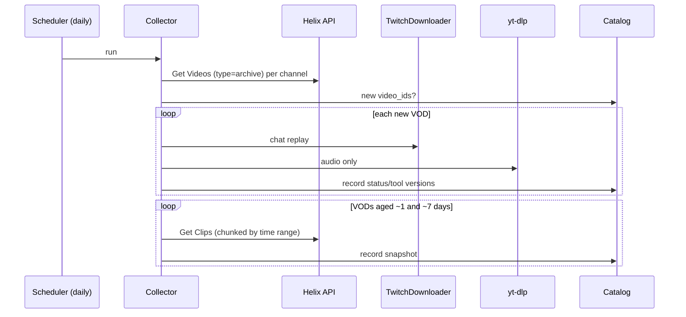

# Data Collection Plan

| | |
|---|---|
| **Status** | Proposal. Real collection requires source authorization, privacy and snapshot decisions (OQ-4/OQ-9/OQ-17, ADR-0009). |
| **Last updated** | 2026-10-13 |

## Why collection is urgent

Twitch VODs expire ([data sources](data-sources.md#vod-retention)), so start a small **authorized** pilot promptly after the necessary decisions. API, synthetic UI/export and evaluation work can proceed alongside permission/source investigation; urgency does not authorize downloading or retaining public content.

## What we collect per VOD

| Item | Source | When | Approx. size (6 h VOD) |
|---|---|---|---|
| VOD metadata | Get Videos | Discovery (daily) | KB |
| Initial clips snapshot | Get Clips | Record actual capture time; ~day 1 is a proposal, not a stream-end observation | KB–MB |
| Later clips snapshot (possible outcomes) | Get Clips | ~day 7, subject to adopted target/retention policy | KB–MB |
| Chat replay | TwitchDownloader | Within retention window | ~10–200 MB JSON, depending on chat volume |
| Audio | yt-dlp (audio only) | Within retention window | ~100–400 MB |
| Video | Approved source | Usually on demand; retain a small permitted demo/evaluation set while available | Measure in pilot |

These are rough planning estimates, not observed costs. Measure in the pilot. Preserve snapshots immutably with capture times, query ranges/horizon, coverage and dataset lineage ([data model](../architecture/data-model.md#clips)). Later-created clips and pagination limits affect membership. Early ranking additionally needs a real inference-cutoff observation; never infer it retrospectively from day-one/day-seven counts.

## Channel selection (proposal)

Agree a small pilot first, then choose an achievable channel mix based on authorization, resource use and grouped-split coverage. The earlier **20–40-channel** estimate is not a required scale. Prefer channels that:

1. **Have an active clip culture:** many viewer clips per stream, so labels are dense.
2. **Are in English** for v1, to keep captions and text features simple.
3. **Mix content types:** "Just Chatting"/IRL, FPS, variety. The model shouldn't learn one game's quirks only.
4. **Span sizes:** mostly large and mid-size channels for dense labels, plus a few small ones to test the "few clips" regime.
5. **Have VOD history enabled** with retention long enough to collect.
6. **Preferably allow clipping or reposting**, so the online experiment remains possible later (see [governance](data-governance.md)).

The concrete list lives in a config file in the repo (planned: `configs/channels.yaml`) with `login` and a short `reason` per channel. Changes go through PRs.

## Targets (proposal)

| Milestone | VODs with clips + chat + audio | Notes |
|---|---|---|
| Pipeline smoke test | 5 | From 2–3 channels |
| Baselines (M2) | Team-agreed after pilot | Diverse channels and usable coverage matter; no count guarantees generalization |
| Models (M3–M4) | Scale based on evidence and budget | Earlier 150/400-VOD estimates are not milestone gates |

Measure disk/download/feature costs before scaling. Proposed: compressed audio in `raw/`, WAV only transiently, and derived features under approved retention. Features alone cannot support video review/export after expiry; retain authorized media needed for demo and human evaluation. Shared storage is OQ-5 and must respect OQ-17 permissions.

## Collector design

- **Idempotent and resumable:** the catalog records what's done. Re-runs pick up failures.
- **Polite:** respect rate limits, run downloads sequentially (or with low concurrency), and add a random delay between media downloads.
- **Scheduling:** proposed is a daily run on whichever team machine is always on, or a cheap VM. A GitHub Actions cron isn't suitable because of media size and runtime limits. See OQ-5.
- **Observability:** a daily summary line (new VODs, failures, disk used) written to a log and, optionally, posted to the team chat.

## Data sharing within the team

Raw data **never goes in git**. Options for sharing processed datasets (OQ-5):

1. A shared cloud drive folder with versioned `processed/` snapshots, which is simplest.
2. An object store bucket (S3/R2) with versioned prefixes.
3. Each member collects their own subset, and only processed tables are shared.

Whatever is chosen, sharing must be authorized. The source design retains aggregate chat statistics; pseudonymized message retention is an alternative awaiting OQ-9, not the default by implication. No raw chat is shared, and neither hashes nor aggregate features automatically remove source restrictions.
