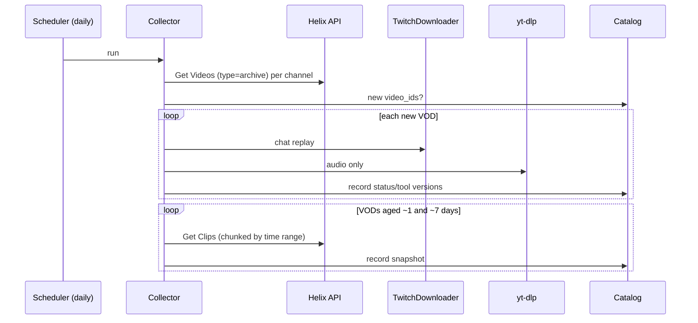

# Data Collection Plan

| | |
|---|---|
| **Status** | Proposal. Channel list and targets need team sign-off (OQ-4). |
| **Last updated** | 2026-10-09 |

## Why collection is urgent

Twitch deletes past broadcasts after a retention period ([data sources § VOD retention](data-sources.md#1-twitch-helix-api-official)). **Every week we don't collect is data we can never get back.** Getting the collector running is the first priority after the scaffold.

## What we collect per VOD

| Item | Source | When | Approx. size (6 h VOD) |
|---|---|---|---|
| VOD metadata | Get Videos | Discovery (daily) | KB |
| Clips snapshot #1 | Get Clips | ~1 day after VOD | KB–MB |
| Clips snapshot #2 (labeling) | Get Clips | ~7 days after VOD | KB–MB |
| Chat replay | TwitchDownloader | Within retention window | ~10–200 MB JSON, depending on chat volume |
| Audio | yt-dlp (audio only) | Within retention window | ~100–400 MB |
| Video | — | **Not collected.** Fetched per segment at export time. | — |

These are rough planning numbers. Measure them on the first 10 VODs and update the table.

## Channel selection (proposal)

Pick **20–40 channels** that:

1. **Have an active clip culture:** many viewer clips per stream, so labels are dense.
2. **Are in English** for v1, to keep captions and text features simple.
3. **Mix content types:** "Just Chatting"/IRL, FPS, variety. The model shouldn't learn one game's quirks only.
4. **Span sizes:** mostly large and mid-size channels for dense labels, plus a few small ones to test the "few clips" regime.
5. **Have VOD history enabled** with retention long enough to collect.
6. **Preferably allow clipping or reposting**, so the online experiment remains possible later (see [governance](data-governance.md)).

The concrete list lives in a config file in the repo (planned: `configs/channels.yaml`) with `login` and a short `reason` per channel. Changes go through PRs.

## Targets (proposal)

| Milestone | VODs with clips + chat + audio | Notes |
|---|---|---|
| Pipeline smoke test | 5 | From 2–3 channels |
| Baselines (M2) | ≥ 150 | Enough for broadcaster-grouped splits |
| v1/v2 models (M3–M4) | ≥ 400 | Keep collecting continuously |

Disk estimate: ~0.5 GB per VOD for audio + chat at the high end, so ~200 GB for 400 VODs. **Store audio as compressed AAC/Opus in `raw/`** and convert to WAV only transiently during feature extraction, or keep only derived features. Decide where shared data lives (OQ-5).

## Collector design

- **Idempotent and resumable:** the catalog records what's done. Re-runs pick up failures.
- **Polite:** respect rate limits, run downloads sequentially (or with low concurrency), and add a random delay between media downloads.
- **Scheduling:** proposed is a daily run on whichever team machine is always on, or a cheap VM. A GitHub Actions cron isn't suitable because of media size and runtime limits. See OQ-5.
- **Observability:** a daily summary line (new VODs, failures, disk used) written to a log and, optionally, posted to the team chat.

## Data sharing within the team

Raw data **never goes in git**. Options for sharing processed datasets (OQ-5):

1. A shared cloud drive folder with versioned `processed/` snapshots, which is simplest.
2. An object store bucket (S3/R2) with versioned prefixes.
3. Each member collects their own subset, and only processed tables are shared.

Whatever is chosen, shared datasets contain **only pseudonymized** data.
