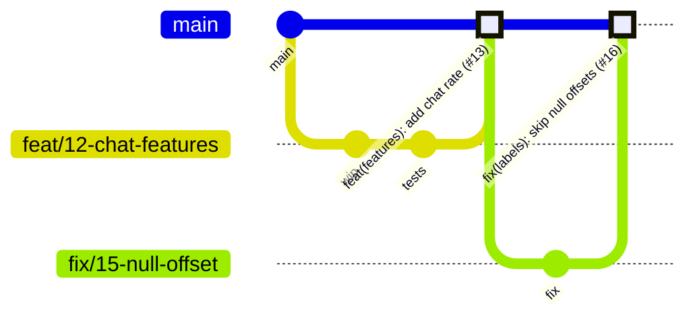

# Git Workflow

| | |
|---|---|
| **Status** | Binding. Branch protection on `main` requires pull requests; second-person review is optional. |
| **Last updated** | 2026-10-21 |

## Model

**Trunk-based development with short-lived branches.** `main` is always releasable and is only changed by squash-merged PRs.



## `main` branch rules (enforced by a repository ruleset)

| Rule | Setting |
|---|---|
| Direct pushes | ❌ Blocked. Changes arrive only through PRs. |
| Required approvals | **0**. The author may merge their own PR. |
| Stale approvals | Not dismissed automatically |
| Last-push approval | Not required |
| Conversation resolution | All review threads must be resolved |
| Merge method | **Squash only** |
| History | Linear. No force pushes, no deletion of `main`. |
| Status checks | None required yet. The `CI` workflow (`Python (ubuntu-latest)`, `Python (windows-latest)`) runs on every PR; the owner makes its checks required once it's green on `main` (#3). |

The repo is also set to **squash merge only** and **delete branches after merge**. The squash commit title defaults to the PR title.

Repository admins have a pull-request-only bypass. It does not permit direct pushes to `main`. Second-person review is optional for all contributors, not just during setup.

## Day-to-day

The commands below are the normal contributor workflow; [CONTRIBUTING](../../CONTRIBUTING.md) walks through each step. AI agents run the push and PR commands only when their human asks.

```bash
# start
git switch main && git pull --ff-only
git switch -c feat/12-chat-features

# work, commit often
git add -p && git commit -m "feat(features): add chat message rate"

# stay current with main (coordinate before rewriting a published branch)
git fetch origin && git rebase origin/main
git push --force-with-lease     # only on YOUR branch, after a rebase

# open PR
gh pr create --fill --base main     # then complete the template
```

## Rules of thumb

- **One issue → one branch → one PR.**
- **Short-lived branches** (a few days). Long-running branches rot and conflict.
- **Rebase your own branch** onto `main` to pick up changes. Don't merge `main` into it, because that clutters review. Never rebase or force-push a branch someone else is working on.
- **`--force-with-lease`, never `--force`.**
- **Draft PRs** for early feedback are encouraged.
- **Don't commit generated or large files.** Check `git status` before committing. `.gitignore` covers the usual suspects, but not everything.

## Commit messages

Short [Conventional Commits](https://www.conventionalcommits.org/). See [CONTRIBUTING § 5](../../CONTRIBUTING.md#5-commit) for types and scopes. Since PRs are squash-merged, the **PR title** is what lands on `main`, so make it a good Conventional Commit:

```text
feat(labels): merge overlapping viewer clips into moments (#21)
```

No AI co-author, contributor or "generated by" lines in commits or PR bodies (see [AGENTS.md § 11](../../AGENTS.md#11-notes-for-specific-agents)). Commit with your own git identity.

## Resolving conflicts

1. `git fetch origin && git rebase origin/main`
2. Fix conflicts file by file. When unsure whose change wins, ask the other PR's author.
3. Re-run tests, then `git push --force-with-lease`.

Agents resolving conflicts must **not** discard another contributor's changes to make tests pass. If a conflict involves semantics (schemas, label rules), stop and ask.

## Releases and tags (later)

No releases yet. Proposal: tag milestones (`m3-v1-ranker`) so results can be reproduced from a tag, and graduate to SemVer if the tool is ever distributed.
