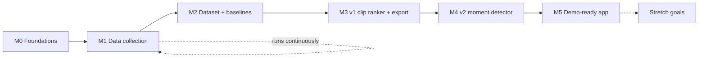

# Roadmap

| | |
|---|---|
| **Status** | Proposal. Milestone order is agreed in principle. Dates are TBD by the team. |
| **Last updated** | 2026-10-09 |

The roadmap is staged so that **every milestone leaves the project in a demoable, defensible state**. If time runs out after M3, we still have a working product and a real result. Later milestones only add to it. The reasoning is in [ADR-0004](../decisions/0004-staged-scope-chat-and-audio-first.md).

> **M1 collection runs continuously from the start.** Twitch VODs expire, so we can't backfill old streams later. Start the collector as early as possible and keep it running.

---

## M0: Foundations

**Goal:** a repo where anyone, human or agent, can pick up a task and ship it consistently.

- [x] Documentation, conventions, ADRs, issue/PR templates *(this PR)*
- [x] Labels and branch protection on `main`
- [ ] Ratify or amend proposed ADRs (tooling, layout, storage, license, web stack)
- [ ] Python project scaffold: `pyproject.toml`, `uv`, Ruff, Pyright, pytest, pre-commit
- [ ] CI on GitHub Actions: lint + type check + tests on every PR. Make these required checks.
- [ ] Config module and `.env` loading
- [ ] Twitch developer application registered (team-owned credentials, shared privately)

**Exit criteria:** `uv sync && uv run pytest` passes on a fresh clone on Windows and macOS/Linux, and CI is green on `main`.

## M1: Data collection

**Goal:** a growing, versioned local corpus of VOD metadata, clips, chat and audio for a fixed set of channels.

- [ ] Choose target channels and categories ([collection plan](../data/collection-plan.md))
- [ ] Twitch API client: app token, Get Users, Get Videos, Get Clips with pagination and rate-limit handling
- [ ] Chat replay downloader wrapper (TwitchDownloader CLI) with username pseudonymization
- [ ] Audio-only VOD downloader (yt-dlp) with resumable downloads
- [ ] Scheduled collector: new VODs per channel, plus a clip refresh N days later so clips can accumulate
- [ ] Backup live-chat logger (official chat interface) for target channels
- [ ] Manifest/catalog of what's been collected, with dataset versioning

**Exit criteria:** at least the target number of VODs from the collection plan ingested end to end, with clips, chat and audio, and a reproducible catalog.

## M2: Dataset and baselines

**Goal:** a clean, versioned training dataset and baseline numbers that every model has to beat.

- [ ] Moment merging (dedupe overlapping clips) per [labeling](../data/labeling.md)
- [ ] Windowing and window labels, with chat-lag handling
- [ ] Chat features and audio features per [features](../ml/features.md)
- [ ] Train/validation/test split by broadcaster and time, saved to disk
- [ ] Evaluation harness implementing [evaluation](../ml/evaluation.md) metrics, with bootstrap CIs
- [ ] Baselines B0–B3 evaluated and recorded
- [ ] Decide OQ-1 (v1 ranking target)

**Exit criteria:** `autoclipper eval --baseline all` reproduces the baseline table from a clean checkout plus the dataset.

## M3: v1 clip ranker and basic export

**Goal:** the first end-to-end product: paste a VOD and get ranked, exportable clips.

- [ ] Train ranking models (logistic regression → gradient boosting → small NN) on chat + audio features
- [ ] Ablations: chat only, audio only, both
- [ ] Export: cut, center/fixed-layout 9:16 crop, burned-in captions (faster-whisper)
- [ ] CLI: `autoclipper analyze <vod>` → ranked candidates JSON. `autoclipper export <candidate>` → MP4.
- [ ] Results write-up in `experiments/`

**Exit criteria:** the v1 model beats baselines on the test split with CIs reported, and a full VOD → exported MP4 run works on a laptop.

## M4: v2 moment detector

**Goal:** find clip-worthy moments in VOD time nobody clipped.

- [ ] Window-level classifier/sequence model over chat + audio features
- [ ] Candidate generation: peak picking, non-max suppression, boundary refinement
- [ ] Evaluation: recall of held-out human moments, precision@k, comparison against heuristics
- [ ] "Zero-clip VOD" mode: run on a VOD while hiding its clips, and measure how many held-out clips we recover
- [ ] Explanations: top contributing signals per candidate

**Exit criteria:** the v2 detector beats chat-spike and loudness heuristics on recall@k, and works on VODs with no clips.

## M5: Demo-ready app

**Goal:** the one-minute demo.

- [ ] FastAPI backend wrapping the pipeline, with job status
- [ ] Web UI: paste URL → progress → highlight timeline → ranked list → preview → export
- [ ] Smart 9:16 crop (face/facecam detection) if time allows
- [ ] Pre-processed demo VODs cached for a reliable live demo
- [ ] Final results write-up and slides

**Exit criteria:** a non-team member can run the demo flow unassisted.

## Stretch goals (unordered, each needs its own ADR)

- **Video features:** scene cuts, motion, game-specific CV. Measured as an ablation ("does video add anything beyond chat + audio?").
- **Short-form performance model:** predict TikTok/Reels performance from external clip-account data (views normalized per account).
- **Online posting experiment:** model picks vs. random picks on a clip account, with streamer permission.
- **Live mode:** stream ingestion, low-latency scoring, candidates while the stream is live.
- **Clip refinement:** learned start/end boundaries instead of fixed padding.

## Out of scope

Auto-publishing to social platforms, non-Twitch sources, multi-user accounts. See [PRD § Non-goals](prd.md#non-goals-for-the-course-project).
