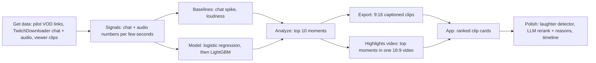

# Roadmap

| | |
|---|---|
| **Status** | Replanned 2026-10-31. We're behind the original design-doc schedule, so this plan builds the app and the data pipeline at the same time and gets to an end-to-end demo as early as possible. |
| **Last updated** | 2026-10-31 |

**Key dates:** Demo of Demos **Fri Dec 4, 2026** · final presentations and demo night **Fri Dec 11, 2026** · feature freeze **Mon Nov 30**.

Tasks are GitHub issues. Each issue lists what it depends on; anything whose dependencies are merged can be picked up.

## The plan in one picture

The app is built against fake data from day one, so it never waits for the model.

## Week by week

| Week of | Goal | Main issues |
|---|---|---|
| **Nov 2** | **Data and building blocks.** Download chat + audio for the five pilot channels (about 5 VODs each). Merge audio download and vertical export. Viewer clips, time windows, chat and audio features. Backend with a fake job; app screens on fake data. | #17, #19, #20, #22, #23, #24, #28, #29, #30, #31, #34, #35 |
| **Nov 9** | **First numbers and a working app on fake data.** Baselines, evaluation, candidate moments, labels and splits. Captions and export endpoint. App talks to the backend end to end. | #21, #25, #26, #27, #32, #33, #36, #38 |
| **Nov 16** | **Real VOD in, real clips out.** Training command, dataset v1, logistic regression and LightGBM. Analyze command and real jobs in the app with real media. Highlights video renderer and its button in the app. | #39, #40, #41, #42, #43, #44, #45, #46, #71, #72 |
| **Nov 23** (Thanksgiving) | **Best scorer in the app, then polish.** Ship the best model, end-to-end test. Then Should items: laughter/scream detector, LLM rerank with reasons, snap clips to speech pauses, timeline view. | #47, #48, #63, #64, #65, #66, #67 |
| **Nov 30** | **Freeze.** Results write-up, taste test, demo rehearsal, slides. | #49, #50, #69 |
| **Dec 4 / Dec 11** | Demo of Demos / final presentations | |

## Milestones

| Milestone | Done when |
|---|---|
| **M1 Data** | Pilot VODs downloaded on team machines; chat, audio and viewer clips parsed for each |
| **M2 Baselines** | Baseline hit rate@10 on a held-out streamer, reproducible from one command |
| **M3 Model + export** | A trained model compared with the baselines; any interval exports as a captioned 9:16 MP4, and a list of moments as a 16:9 highlights video |
| **M4 App end to end** | A real VOD goes in, 10 ranked clips and a highlights video come out in the app |
| **M5 Demo** | A classmate uses the app without help; results written up honestly |

## Stretch, after the MVP works

- **Channel tracking (#37):** pick channels in the app; when a new VOD appears (the Twitch API client can already list a channel's VODs), download and analyze it automatically.
- **Desktop download + website (#70):** a static project page with a demo video, the repo link and a packaged download of the local app. The app keeps running on the user's machine, so nothing needs paid hosting.
- Facecam-over-gameplay layout (#68), video signals, thumbs up/down feedback, Docker.

## Out of scope this semester

Live clipping, predicting TikTok/Reels views, auto-posting, non-Twitch input, hosted analysis, accounts and payments, mobile app.
