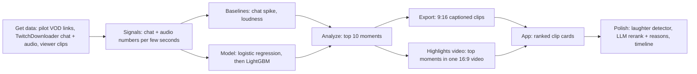

# Roadmap

| | |
|---|---|
| **Status** | Replanned 2026-10-31, dates updated 2026-11-28. The app works end to end on a real VOD. What's left before the freeze is the real dataset, the models trained on it and demo prep. |
| **Last updated** | 2026-11-28 |

**Key dates (2026):**

| Date | What |
|---|---|
| **Wed Dec 2** | Feature freeze |
| **Thu Dec 3, 6:30 pm** | Homework and demo prep due |
| **Fri Dec 4** | Demo of Demos |
| **Fri Dec 11** | Dress rehearsal |
| **Mon Dec 14** | Demo Night |

Tasks are GitHub issues. Each issue lists what it depends on; anything whose dependencies are merged can be picked up.

## Where we are (2026-11-28)

**Done:** the whole demo path works on a real Twitch VOD. A live QA run on `main` with VOD 2941757172 (about 2 hours) went from the start page through analysis to rendered clips. The pieces:

- **Data:** pilot collection of 25 VODs (#35) and its exploration (#36).
- **Pipeline:** windows, chat and audio features, baselines, candidates, evaluation and the training command (synthetic data). The `analyze` command and real jobs in the app.
- **Output:** vertical export with captions and the stacked facecam layout (#68, #191), and the highlights video.
- **App:** timeline (#67, #189, #213), library and channel browser, one-command setup (#193), the landing page (#194) and the UI redesign (#190 parts 1–2).
- **Polish:** explanations and titles (#65), pause snapping (#66), audio-event detection (#63) and opt-in speech features (#64, module built, issue open), top-10 ranking rules (#192, answer-spam rule still off), sharing (#196) and browser end-to-end tests (#211).

**Left:**

- **Data and models (critical path):** dataset v1 from the pilot VODs (#40), baselines on it (#41), logistic regression (#42), LightGBM (#43) and the best scorer in the app (#47). Until then the app ranks with the `chat_loudness` baseline plus the #192 rules.
- **Demo:** results write-up against the baselines (#49), blind taste test (#69), demo prep and rehearsal (#50).
- **Small app items:** UI primitives and loading/error states in the results screen, clip editor and highlights dialog (#117, partly done in #224), the webcam in the stacked gameplay pane (#229) and reusing an identical highlights render (#230).

## The plan in one picture

The app was built against fake data from day one, so it never waited for the model.

## Week by week

| Week of | Goal | Main issues | State |
|---|---|---|---|
| **Nov 2** | **Data and building blocks.** Download chat + audio for the five pilot channels (about 5 VODs each). Merge audio download and vertical export. Viewer clips, time windows, chat and audio features. Backend with a fake job; app screens on fake data. | #17, #19, #20, #22, #23, #24, #28, #29, #30, #31, #34, #35 | ✅ Done |
| **Nov 9** | **First numbers and a working app on fake data.** Baselines, evaluation, candidate moments, labels and splits. Captions and export endpoint. App talks to the backend end to end. | #21, #25, #26, #27, #32, #33, #36, #38 | ✅ Done (baseline numbers on real data wait for #40) |
| **Nov 16** | **Real VOD in, real clips out.** Training command, dataset v1, logistic regression and LightGBM. Analyze command and real jobs in the app with real media. Highlights video renderer and its button in the app. | #39, #40, #41, #42, #43, #44, #45, #46, #71, #72 | 🟡 App side done; #40–#43 open |
| **Nov 23** (Thanksgiving) | **Best scorer in the app, then polish.** Ship the best model, end-to-end test. Then Should items: laughter/scream detector, LLM rerank with reasons, snap clips to speech pauses, timeline view. | #47, #48, #63, #64, #65, #66, #67 | 🟡 Polish done; #47 waits on #42/#43 |
| **Nov 30** | **Freeze Wed Dec 2.** Dataset and models if they land, results write-up, taste test, demo prep (due Thu Dec 3, 6:30 pm). | #40–#43, #47, #49, #50, #69 | Next |
| **Dec 4 – Dec 14** | Demo of Demos (Fri Dec 4), dress rehearsal (Fri Dec 11), Demo Night (Mon Dec 14) | #50 | |

## Milestones

| Milestone | Done when | State |
|---|---|---|
| **M1 Data** | Pilot VODs collected and reusable through the team's chosen storage; chat, audio and viewer clips parsed for each | ✅ 25 VODs (#35) |
| **M2 Baselines** | Baseline hit rate@10 on a held-out streamer, reproducible from one command | 🟡 Command built; real numbers wait for #40, #41 |
| **M3 Model + export** | A trained model compared with the baselines; any interval exports as a captioned 9:16 MP4, and a list of moments as a 16:9 highlights video | 🟡 Export and highlights done; real-data models #42, #43 |
| **M4 App end to end** | A real VOD goes in, 10 ranked clips and a highlights video come out in the app | ✅ Demo VOD 2941757172 |
| **M5 Demo** | A classmate uses the app without help; results written up honestly | Not started (#49, #50, #69) |

## Stretch, after the MVP works

- **Channel tracking (#37):** pick channels in the app; when a new VOD appears, download and analyze it automatically. The channel browser and bulk queue are built; automatic tracking is not.
- **Desktop download + website (#70):** the static project page is built (#194, `site/`); a packaged app download is not.
- **Hosted deployment:** an optional delivery improvement when useful and affordable. The local setup remains a working development and demo target.
- Video signals, thumbs up/down feedback, Docker. (The facecam-over-gameplay layout, #68, is done.)

## Out of scope this semester

Live clipping, predicting TikTok/Reels views, auto-posting, non-Twitch input, accounts and payments, mobile app.
