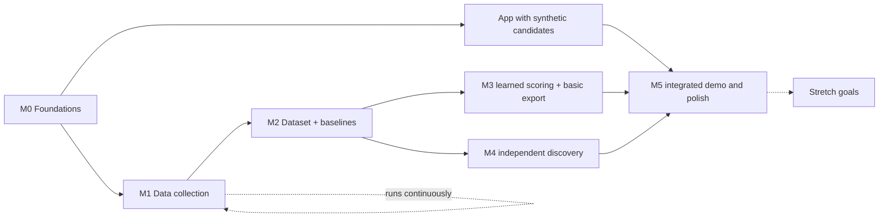

# Roadmap

| | |
|---|---|
| **Status** | Agreed milestones. Week-by-week dates are replanned at the weekly sync. |
| **Last updated** | 2026-10-16 |

**Key dates (course syllabus):** Demo of Demos on **Fri Dec 4, 2026**; final presentations and demo night on **Fri Dec 11, 2026**. The MVP must run end to end before Dec 4.

The milestones build the pipeline and the web app **in parallel**: the app starts with synthetic candidates in M0/M1 and is wired to real results later. The finished semester product is the MVP in the [PRD scope](prd.md#scope-at-a-glance): whole-VOD discovery (including VODs with no viewer clips), a ranked shortlist, preview, trim and 9:16 captioned export. One trained model can serve both discovery and ranking; two separate models are not required.

> **Start a small authorized data pilot promptly**, then collect at an agreed scale while app/export work proceeds. VODs expire, but urgency does not establish permission. Synthetic development can proceed while collection decisions are resolved.

---

## M0: Foundations

**Goal:** a repo where anyone, human or agent, can pick up a task and ship it consistently.

- [ ] Documentation, conventions, ADRs, issue/PR templates merged
- [x] Labels and `main` protection ruleset configured
- [x] Core ADRs accepted: tooling, layout, scope, pipeline storage, web stack (license still open)
- [ ] Teammates added as collaborators; first issue backlog created
- [ ] Python project scaffold: `pyproject.toml`, `uv`, Ruff, Pyright, pytest, pre-commit
- [ ] CI on GitHub Actions: lint + type check + tests on every PR. Make these required checks.
- [ ] Config module and `.env` loading
- [ ] Twitch developer application registered (team-owned credentials, shared privately)
- [ ] Next.js app skeleton showing synthetic candidates (shortlist → preview → trim → export flow)

**Exit criteria:** `uv sync && uv run pytest` passes on a fresh clone on Windows and macOS/Linux, and CI is green on `main`.

## M1: Data collection

**Goal:** a growing, versioned local corpus of VOD metadata, clips, chat and audio for a fixed set of channels.

- [ ] Choose target channels and categories ([collection plan](../data/collection-plan.md))
- [ ] Record source authorization, retention and privacy choice (OQ-9/OQ-17) before real collection
- [ ] Twitch API client: app token, Get Users, Get Videos, Get Clips with pagination and rate-limit handling
- [ ] Chat replay downloader wrapper (TwitchDownloader CLI) with username pseudonymization
- [ ] Audio-only VOD downloader (yt-dlp) with resumable downloads
- [ ] Scheduled collector: new VODs per channel, plus a clip refresh N days later so clips can accumulate
- [ ] Investigate live-chat backup only if replay access/reliability requires it
- [ ] Manifest/catalog of what's been collected, with dataset versioning

**Exit criteria:** an agreed pilot ingested with a reproducible catalog, immutable observations, coverage records and explicit missing-data status. Scale targets follow measured cost and channel coverage; arbitrary corpus counts do not block baselines.

## M2: Dataset and baselines

**Goal:** a clean, versioned training dataset and reproducible baseline comparisons.

- [ ] Moment merging (dedupe overlapping clips) per [labeling](../data/labeling.md)
- [ ] Windowing and window labels, with chat-lag handling
- [ ] Chat features and audio features per [features](../ml/features.md)
- [ ] Train/validation/test split by broadcaster and time, saved to disk
- [ ] Evaluation harness implementing [evaluation](../ml/evaluation.md) metrics, with bootstrap CIs
- [ ] Applicable baselines B0–B4 evaluated on the same population and candidate budget
- [ ] Agree the first learning target and evaluation protocol (OQ-1/OQ-15, ADR-0009)

**Exit criteria:** `autoclipper eval --baseline all` reproduces the baseline table from a clean checkout plus the dataset.

## M3: v1 clip ranker and basic export

**Goal:** useful learned scoring and basic export; an existing-clip prototype is one possible first integration.

- [ ] Train a simple model justified by the agreed target; compare with heuristics before adding complexity
- [ ] Ablations: chat only, audio only, both
- [ ] Export: cut, center/fixed-layout 9:16 crop, burned-in captions (faster-whisper)
- [ ] CLI: `autoclipper analyze <vod>` → ranked candidates JSON. `autoclipper export <candidate>` → MP4.
- [ ] Results write-up in `experiments/`

**Exit criteria:** a reproducible learned-model comparison and a supported VOD → exported MP4 flow work on a laptop. Baseline improvement is the research goal, reported separately from delivery readiness. Negative results prompt analysis, not suspension of app work.

## M4: v2 moment detector

**Goal:** independent discovery in VOD time nobody clipped. This may reuse the M3 scorer or combine heuristics and learned reranking.

- [ ] Whole-VOD signal analysis with an agreed discovery strategy; a separate classifier/sequence model is optional
- [ ] Candidate generation: peak picking, non-max suppression, boundary refinement
- [ ] Evaluation: recall of held-out human moments, precision@k, comparison against heuristics
- [ ] "Zero-clip VOD" mode: run on a VOD while hiding its clips, and measure how many held-out clips we recover
- [ ] *(Optional polish, US-9)* Explanations: top contributing signals per candidate

**Exit criteria:** signal-derived candidates work without clip metadata; baseline comparisons and limitations are recorded. Hidden clips test independence from clip availability, not generalization to small audiences by itself.

## M5: Demo-ready app

**Goal:** integrate and polish the semester app. UI development starts in M0/M1, rather than after ML research finishes.

- [ ] Wire the Next.js app to real FastAPI jobs and results (ADR-0007)
- [ ] VOD input → progress/errors → understandable highlights → preview → basic trim → export
- [ ] Smart 9:16 crop (face/facecam detection) if time allows
- [ ] Small permitted demo/evaluation media set retained before expiry; processed features alone cannot support preview/export
- [ ] Final results write-up and slides

**Exit criteria:** a non-team member can run the demo flow unassisted.

## Stretch goals (only after the MVP runs end to end; each needs its own ADR)

- **Video features:** scene cuts, motion, game-specific CV. Measured as an ablation ("does video add anything beyond chat + audio?").
- **Online posting experiment:** model picks vs. random picks on a clip account, with streamer permission.
- **Clip refinement:** learned start/end boundaries instead of fixed padding.
- The other Should/Could items in the [PRD scope table](prd.md#scope-at-a-glance).

## Out of scope this semester

Live-stream clipping, predicting TikTok/Reels views, auto-publishing to social platforms, non-Twitch sources, accounts and payments, mobile app. See the Won't row in the [PRD scope table](prd.md#scope-at-a-glance).
