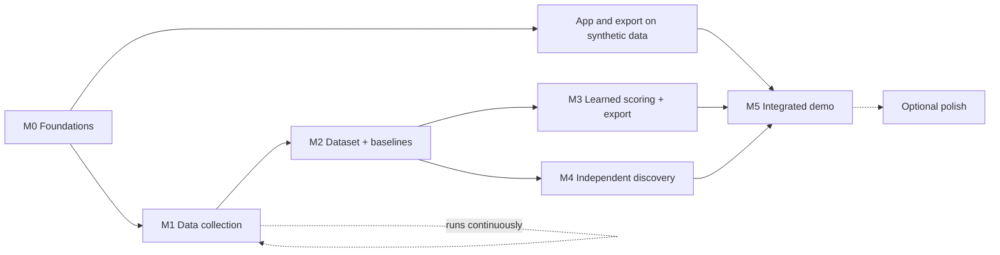

# Roadmap

| | |
|---|---|
| **Status** | Agreed milestones. Week-by-week dates are replanned at the weekly sync. |
| **Last updated** | 2026-10-16 |

**Key dates (course syllabus):** Demo of Demos on **Fri Dec 4, 2026**; final presentations and demo night on **Fri Dec 11, 2026**. The MVP must run end to end before Dec 4.

This page is the **high-level milestone view**. The individual tasks, their dependencies and acceptance criteria live in one place: the [implementation backlog](../project/backlog.md), grouped into waves.

The milestones build the pipeline and the web app **in parallel**: the app starts with synthetic candidates and is wired to real results later, and it never waits on model results. The finished semester product is the MVP in the [PRD scope](prd.md#scope-at-a-glance): whole-VOD discovery (including VODs with no viewer clips), a ranked shortlist, preview, trim and 9:16 captioned export. One trained model can serve both discovery and ranking; two separate models are not required.

> **Start a small authorized data pilot promptly**, then collect at an agreed scale while app/export work proceeds. VODs expire, but urgency does not establish permission. Synthetic development proceeds while collection decisions are resolved.

---

## M0: Foundations

**Goal:** a repo where anyone, human or agent, can pick up a task and ship it consistently.

**Backlog:** Wave 0 (team access, Twitch app), Wave 1 (Python and Next.js scaffolds with CI, plus the decision tasks) and the config module.

**Exit criteria:** teammates have access and the backlog is published as issues; `uv sync && uv run pytest` passes on a fresh clone on Windows and macOS/Linux; CI is green on `main`; the decisions that unblock Wave 2 (dataset rules, feature set, API contract) are recorded.

## M1: Data collection

**Goal:** a growing, versioned local corpus of VOD metadata, clips, chat and audio for an agreed set of channels, collected only as the permissions decision allows.

**Backlog:** the mocked ingestion adapters in Wave 2; the ingest command, pilot, pilot analysis and collector in Wave 3.

**Exit criteria:** an agreed pilot ingested with a reproducible catalog, immutable observations, coverage records and explicit missing-data status. Scale targets follow measured cost and channel coverage; arbitrary corpus counts do not block baselines.

## M2: Dataset and baselines

**Goal:** a clean, versioned dataset and reproducible baseline comparisons.

**Backlog:** windows/moments, features, the evaluation harness and baselines in Wave 2; labels/splits and dataset v1 in Wave 3; the baseline run in Wave 4.

**Exit criteria:** the baseline table reproduces from a clean checkout plus dataset v1.

## M3: Learned scoring and export

**Goal:** trained models compared honestly with the baselines, and a working vertical, captioned export.

**Backlog:** the export tasks in Wave 2; the training command in Wave 3; the logistic regression and LightGBM experiments in Wave 4.

**Exit criteria:** a reproducible learned-model comparison and a VOD interval → exported MP4 flow work on a laptop. Baseline improvement is the research goal, reported separately from delivery readiness. Negative results prompt analysis, not suspension of app work.

## M4: Independent discovery

**Goal:** find moments across the whole VOD, including time nobody clipped and VODs with no viewer clips.

**Backlog:** candidate generation (with zero-clip mode) in Wave 2; the analyze command in Wave 5.

**Exit criteria:** signal-derived candidates work without clip metadata; baseline comparisons and limitations are recorded. Hidden clips test independence from clip availability, not generalization to small audiences by itself.

## M5: Integrated demo

**Goal:** the semester app working end to end on real, permitted VODs, ready for demo night. UI work starts in M0, not after ML research finishes.

**Backlog:** the app tasks in Wave 2; integration in Wave 5; results write-up and demo preparation in Wave 6.

**Exit criteria:** a non-team member can run the demo flow unassisted, and results are written up honestly with links to `experiments/`.

## Optional polish and future work

Only after the MVP runs end to end. Optional polish (speech signals, ablations, taste test, smart crop, explanations, caching, detailed progress, evaluation in CI) has drafts at the end of the [backlog](../project/backlog.md#optional-polish-should). Future work is listed there without drafts; each item needs a team decision (and an ADR if it changes contracts) before it starts.

## Out of scope this semester

Live-stream clipping, predicting TikTok/Reels views, auto-publishing to social platforms, non-Twitch sources, accounts and payments, mobile app. See the Won't row in the [PRD scope table](prd.md#scope-at-a-glance).
